# 如何使用这份手册

本手册主题是 Design Methodology and Automation（设计方法学与自动化），不是直接存储器访问。这一版可以直接从正文开始学，不要求打开其他讲义或试卷。准备纸笔，先沿每章“图解跟做”看图、算数、补步骤，再做章末独立题。图中标出的每一个值都在正文解释；题目所需条件完整给出。网站与离线 HTML 的答案默认折叠；PDF 的检查题与练习答案集中在附录 A，先作答再核对。原资料只用于核验来源和选学。

证据顺序：2025-10-31 讲义与习题为课程主线；近年卷只证明历史考查；外部规范、论文、作者代码用于交叉核验。2026-11-08 为本版资料核验日，图解跟学版更新于2026-11-09。学校本次补考安排与允许携带资料尚未提供。

## 时间与取舍

每天约5小时净学习，第10天4小时；每学50分钟休息10分钟，休息不计入下列预算。先打开当天模块的“图解跟做”，按“现在做”动笔；停一下题先写再核对；再做指定章末题。做不出时回到第一个不会的步骤，不从头重读。外部来源、原讲义和历年卷仅供核验，不是这份路线的必做阅读。第8、9天分别完成本站完整训练卷A、B。网站保留作答、错题与复习记录；只看PDF时在纸上记录题号和得分。

- **每天只有3小时**：保留20分钟复习、70分钟主课、70分钟独立题、20分钟复盘；删去扩展阅读和工具实现，继续保留两次60分钟整卷。功能分解、QM、FSM、事件仿真和ATPG不可整章跳过。
- **布尔基础诊断低于一半评分点**：D1/D2合并投入更多基础和QM；D3的深层代数kernel、D7的MISR推导改为选学。不要用背答案替代cofactor与真值表。
- **已会某章**：先做未见过的独立题并解释反例；通过后把节省时间交给两次诊断中失分最大的模块。
- **距离考试不足10天**：按依赖合并相邻日，每天保留复习和独立作答；优先完成核心题型，再做一份未见答案的整卷，最后一天停止大量新内容。

## 关键问题—先修知识—模块—练习/实验—来源

### 1. 课程地图与数字设计的三种视角

关键问题：同一个电路为什么要有行为、结构、物理三种描述，综合、仿真和测试分别证明什么？

先修：无需额外先修。核心目标：画出 Y-chart 并给每个域举例；把需求逐步转成 RTL、门级结构和物理实现；区分功能正确、时序正确与制造测试；用统一口径比较面积、延迟和资源取舍。

活动：补全 → 独立 → 迁移；章节手算与画图。来源：L25 2025-10-31；Introduction，印刷 pp.3–7 / PDF pp.7–11；F072 2023 Introduction slides，PDF pp.23–28；历史版本，仅用于设计流程。

### 2. 布尔空间、cube 与 Shannon 展开

关键问题：一个横杠到底代表多少点，固定一个变量以后为什么能重建整个函数？

先修：m01。核心目标：在 minterm、cube、集合、SOP/POS 之间互换；计算维数、覆盖点数、cube 距离与包含关系；求 cofactor、Shannon 展开、Boolean difference；用严格包含关系判断 unate 与变量依赖。

活动：补全 → 独立 → 迁移；章节手算与画图。来源：L25 2025-10-31；I.1–I.2，印刷 pp.9–20 / PDF pp.13–24；T25 Tutorial 1，印刷 pp.3–12 / PDF pp.5–14。

### 3. 精确两级综合：从全部 PI 到最小覆盖

关键问题：怎样证明一个 SOP 正确而且在指定成本下最优，而不是只看起来更短？

先修：m02。核心目标：完整列出所有素蕴含项并解释为什么不能继续扩张；从覆盖表识别必要项，正确处理行列支配；建立选择变量方程，区分贪心结果与精确最优；对 don’t-care 与多输出共享分别计费并验证等价。

活动：补全 → 独立 → 迁移；把真值表压成最小 SOP。来源：L25 2025-10-31；I.3，印刷 pp.21–33 / PDF pp.25–37；T25 Tutorial 2，印刷 pp.13–24 / PDF pp.15–26；Tutorial 3 P1、P4，PDF pp.27、29–33、38；F086 文件名19_retake；卷内日期2020-06-29；Problem 1c，PDF p.3；F088 2021 exam；Problem 1b，PDF p.3。

### 4. 启发式优化与恒真检验

关键问题：为什么“单独能删”不代表“可以一起删”，为什么先变复杂有时能通向更好的解？

先修：m02、m03。核心目标：推导 expand、reduce、remove 的合法性条件；把 cube 包含转成 cofactor 恒真问题；解释配置图的可行解、邻域、局部与全局最小；对每步修改给出证明或反例而非只写是/否。

活动：补全 → 独立 → 迁移；接受坏解的温度。来源：L25 2025-10-31；I.4，印刷 pp.34–36 / PDF pp.38–40；多输出操作 PDF p.35；T25 Tutorial 3 P2、P3，PDF pp.28–29、34–37；F087 2020 exam，Problem 1g，PDF p.7；F088 2021 exam，Problem 2a，PDF p.5；SIS92 Berkeley UCB/ERL M92/41元数据页；仅作L25提及工具的背景，不据此声称复现。

### 5. 多级逻辑与函数分解

关键问题：为什么两个 LUT 中间的线数由不同余函数的数量决定，而不是由原来的 minterm 数决定？

先修：m02、m03。核心目标：画 Boolean network 并识别 fanin/fanout/reconvergence；用等价类构造 h 与 g，使 f(x,y)=g(h(x),y)；计算最少编码位和有利分解条件；区分逻辑共享的 literal 节省与实际时序成本。

活动：补全 → 独立 → 迁移；章节手算与画图。来源：L25 2025-10-31；I.5，印刷 pp.37–43 / PDF pp.41–47；T25 Tutorial 4 P4，印刷 p.40 / PDF p.42；解答 PDF p.52；F089 内页 DMA 2022（文件名21_retake_exam）；Problem 1d/1f，PDF pp.3–4；MULTILEVEL90 1990-02；§IV.D，印刷p.272 / PDF p.9，kernel/co-kernel定义与Table 1；深入选学。

### 6. ROBDD：共享余函数的决策图

关键问题：为什么同一变量序下的最简决策图可以判等价，而换变量序后节点数会改变？

先修：m02。核心目标：按指定变量序从 cofactors 构造 OBDD；使用删除无效测试与合并同构子图两条规则；由到1/到0的路径写 SOP/POS并求 cofactor；用明确计数口径比较变量序与功能分解。

活动：补全 → 独立 → 迁移；改变顺序，观察 BDD 大小。来源：L25 2025-10-31；I.6，印刷 pp.44–47 / PDF pp.48–51；T25 Tutorial 4 P1–P3，PDF pp.39–41、44–51；F086 文件名19_retake；卷内日期2020-06-29；Problem 1f，PDF p.4；F087 2020 exam；Problem 1d，PDF p.4；BRYANT86 1986原刊；作者注释电子版§1–2，PDF pp.1–7；固定序ROBDD规范性与变量序限制。

### 7. FSM：状态建模、最小化与编码

关键问题：怎样证明两个状态可以合并，并把合并后的图变成可实现的触发器输入方程？

先修：m02。核心目标：将文字规格转为确定且完整的 Mealy/Moore 状态表；删除不可达状态并逐轮细分等价类；构造能区分两个状态的输入序列；完成编码、下一状态与输出方程并验证复位/非法码。

活动：补全 → 独立 → 迁移；章节手算与画图。来源：L25 2025-10-31；I.7，印刷 pp.48–56 / PDF pp.52–60；T25 Tutorial 4 P5，PDF p.42；解答 PDF pp.53–54；F087 2020 exam，Problem 1f/1h，PDF pp.6、8；F088 2021 exam，Problem 2c/2d，PDF pp.7–8。

### 8. 逻辑仿真：把变化放回时间轴

关键问题：布尔函数没有错，为什么仿真波形仍会出现毛刺、X 或时间不前进？

先修：m02、m07。核心目标：区分稳态布尔等价、定时行为与模拟电气行为；按事件队列逐步画出门级波形，记录生成时刻与执行时刻；预测 transport 与 inertial 对窄脉冲的不同处理；解释三值逻辑、组合毛刺和零时间反馈不收敛。

活动：补全 → 独立 → 迁移；短脉冲与事件队列。来源：L25 II.1–3，印刷 pp.57–63；PDF pp.61–67；L25 II.4，印刷 pp.67–68；PDF pp.71–72；T25 Tutorial 5，印刷 pp.58–64；PDF pp.60–66；T25 Tutorial 6，印刷 pp.65–71；PDF pp.67–73；GHDL-SIM Simulation options：--stop-delta、--disp-time；2026-11-08所见7.0.0-dev文档。

### 9. VHDL：读懂并发与赋值的真实含义

关键问题：为什么同一段process里两行看似顺序的赋值，得到的硬件与软件直觉不同？

先修：m08。核心目标：根据进程唤醒与signal更新规则手算运行结果；分别写出组合逻辑、锁存器和边沿触发寄存器；发现敏感列表缺项、未赋值分支和多驱动等错误；用可重复的输入与断言验证模型，而非只看波形。

活动：补全 → 独立 → 迁移；章节手算与画图。来源：L25 II.4，印刷 pp.64–68；PDF pp.68–72；T25 Tutorial 6，印刷 pp.65–71；PDF pp.67–73；IEEE1076 IEEE 1076-2019官方元数据；仅核对规范身份、范围和发布日期；GHDL-STD Implementation of VHDL：VHDL standards；标准模式与部分实现限制；GHDL-SIM Simulation options：断言、时间与delta选项。

### 10. 故障模型与最小测试集

关键问题：测试通过能证明什么？怎样用少量输入检测一个明确定义的故障集合？

先修：m02、m03。核心目标：区分设计验证、制造测试、故障检测和故障定位；建立单stuck-at故障字典与test-fault关系；用集合包含判断等价、支配及删除方向；计算带明确定义分母的覆盖率并求小规模最小测试集。

活动：补全 → 独立 → 迁移；激活、传播与最小测试集。来源：L25 III.1，印刷 pp.69–78；PDF pp.73–82；T25 Tutorial 7，印刷 pp.72–75；PDF pp.74–77；F071 Testing slides：fault models与制造测试引言，PDF pp.1–15。

### 11. ATPG：激活故障，再把差异送到输出

关键问题：看到一个内部stuck-at故障，怎样系统地构造会在输出暴露它的输入？

先修：m02、m10。核心目标：从cofactor推导布尔差分与stuck-at检测条件；完整完成一个D算法的激活、传播、证明与回溯过程；识别重汇合的自掩蔽，避免错误套用单路径链式法则；解释PODEM的主输入决策与controllability近似的边界。

活动：补全 → 独立 → 迁移；章节手算与画图。来源：L25 III.2，印刷 pp.79–89；PDF pp.83–93；L25 III.4，印刷 pp.93–99；PDF pp.97–103；T25 Tutorial 8，印刷 pp.76–81；PDF pp.78–83；T25 Tutorial 10，印刷 pp.87–94；PDF pp.89–96；F088 21_exam.pdf，Problem 4(c)，PDF p.12：global implication学习准则与可控性；ROTH66 D算法原始论文；出版信息与可索引摘要，全文抓取受限；GOEL80 PODEM原始会议版本FTCS-10，1980，pp.145–151；仅索引摘要，全文403。

### 12. 故障仿真：给定测试到底检出了谁

关键问题：ATPG给出一个向量后，怎样知道它是否顺便覆盖其它故障，又怎样避免重汇合误判？

先修：m08、m10、m11。核心目标：给定输入向量，先计算无故障值再找全部被检出故障；区分扇出干线与分支的传播和掩蔽；用局部可观察性构造无扇出区域的故障树；解释serial、parallel、deductive、concurrent的成本与模型限制。

活动：补全 → 独立 → 迁移；章节手算与画图。来源：L25 III.2，印刷 pp.85–89；PDF pp.89–93；L25 III.3，印刷 pp.90–92；PDF pp.94–96；T25 Tutorial 9，印刷 pp.82–86；PDF pp.84–88；AGRAWAL-FAULTSIM 作者课程Lecture 7：Fault Simulation；四类方法为选学扩展。

### 13. 时序测试、Scan与BIST

关键问题：内部状态既不能直接设置也不能直接读出时，怎样使测试仍然可管理？

先修：m07、m09、m11、m12。核心目标：通过时间展开解释为什么时序故障需要输入序列；画出scan移位、capture、卸载的状态与资源时间线；计算明确装载重叠假设下的scan测试周期数；按明确定义递推手算LFSR与GF(2)签名，并解释aliasing限制。

活动：补全 → 独立 → 迁移；LFSR 的状态与周期。来源：L25 III.5，印刷 pp.100–107；PDF pp.104–111；T25 Tutorial 11，印刷 pp.95–97；PDF pp.97–99；OPENTITAN-LFSR prim_lfsr文档：参数、锁死态保护和验证范围；master于2026-11-08所见；XAPP052 Peter Alfke, XAPP052 v1.1, 1996-07-07；最大周期抽头与编号约定。


# 10 天路线与能力证据

## Day 1 · 先诊断，再修复布尔基础

净学习约300分钟；模块 m01、m02。

- 15分钟准备：在纸上写“输入abc的位权为4、2、1”，再列000到111。先不看第2章答案，把a=b=1、c=0代入y=ab+c。
- 45分钟打开m01图解跟做：看真值表和门图，逐门计算110与001，在每个“停一下”写下自己的值。
- 80分钟打开m02图解跟做：先抄完整真值表，再沿K-map中的圈读出每个未变化的变量；亲手代入a=0和a=1求cofactor。
- 100分钟完成m01-q1、m01-q3、m02-q1、m02-q2、m02-q3、m02-q4。每题先留作答，再展开评分点；错误就重算全部8行找第一处分歧。
- 60分钟做m02-q5、m02-q6；最后合上示范，用2分钟说清on-set、off-set、don’t-care，并把一个真实错误记入本章笔记。

**当天必须留下的能力证据**

- 不看答案，从3变量真值表写CSOP并化简；再逐行验证8种输入。
- 能在2分钟解释on-set、off-set、don’t-care三者关系，区分cube维数与空间维数。

**间隔复习**：当晚回忆当天3个错误，重做一题，不抄整页笔记。

## Day 2 · 精确最小化：把步骤做稳

净学习约300分钟；模块 m03。

- 20分钟不看资料重画3变量真值表，口述Shannon展开的两个选择分支。
- 90分钟跟m03图解例题走完：按1的数量分组→合法合并→标记PI→填覆盖表→选择最小覆盖。每一轮先遮住下一轮。
- 90分钟完成m03-q1到m03-q4；不要只交最终式，保留每轮cube和覆盖表。
- 60分钟进入本章“精确两级最小化”实验：n=3，ON=0,1,2,5,6,7，DC留空。先在纸上预测PI与EPI，再运行核对；再去掉ON中的7，重新预测。
- 40分钟做m03-q5、m03-q6并自评。用全部输入枚举检查没有漏ON或包含OFF；写清你的代价是项数还是literal数。

**当天必须留下的能力证据**

- 提交全部PI、覆盖表、MinSOP、代价口径和至少一次等价验证。
- 能解释CompSOP不等于MinSOP，并给出启发式可能非最优的理由。

**间隔复习**：D1错题；D2知识次日、3天后、7天后复习。

## Day 3 · 启发式、共享逻辑与函数分解

净学习约300分钟；模块 m04、m05。

- 25分钟重做昨天最早出错的QM一步，不先翻答案。
- 75分钟跟m04图解：每次删除项或literal后先给当前cover，再检查具体输入；算一次接受概率exp(-Δ/T)，记录随机数比较结果。
- 80分钟跟m05图解：亲自画ab+ac与a(b+c)两张门图；按绑定变量逐行求cofactor，再给相同函数编码。
- 80分钟完成m04-q2、m04-q3、m04-q4、m05-q1、m05-q3、m05-q4。凡说“不合法”，必须给一个实际输入反例。
- 40分钟完成m04-q5、m05-q5、m05-q6；比较两种等价电路时同时写门输入数和最长逻辑层数。

**当天必须留下的能力证据**

- 能够用恒真检验说明一个literal能否删除，失败时给具体输入反例。
- 画出h(X)→Z→g(Z,Y)并说明未用编码何时可以成为don’t-care。

**间隔复习**：D1间隔复习；D2最易错一步。

## Day 4 · ROBDD 与 FSM：图不是装饰

净学习约300分钟；模块 m06、m07。

- 20分钟从昨日笔记中抽一个cofactor重新代入，确认自己没有把固定变量留在结果里。
- 85分钟跟m06图解：手指沿0/1边走具体输入；将两个孩子相同的节点删掉，将相同三元组节点合并，最后才数非终端节点。
- 85分钟跟m07图解：从复位状态逐位读10101，记录旧状态、输入、输出、新状态；再按输出与后继组做划分细化。
- 70分钟完成m06-q1、m06-q3、m06-q4、m07-q1、m07-q3、m07-q4。画图后必须选一条输入序列验图。
- 40分钟进入BDD实验：ON=0,5,10,15；比较顺序a,b,c,d和a,c,b,d，预测9与6节点并逐路径验证相同函数；再做m06-q5或m07-q5。

**当天必须留下的能力证据**

- 独立构造一个ROBDD并从路径恢复SOP，用真值表对照。
- 完成FSM稳定划分，给出区分两个不等价状态的输入序列。

**间隔复习**：D2复习覆盖；D3复习合法删除条件。

## Day 5 · 事件仿真与 VHDL：掌握时间语义

净学习约300分钟；模块 m08、m09。

- 20分钟闭卷画昨天的状态图，标清复位箭头和“输入/输出”边标签。
- 85分钟跟m08图解：把物理时间、delta、当前值、未来事务分栏；一条事务出队后再计算它引发的新事务。
- 70分钟进入事件实验：脉宽2 ns、延迟3 ns，比较transport与inertial；再改脉宽为3 ns和4 ns，运行前写出预测波形。
- 75分钟跟m09图解，逐条执行signal与variable赋值；完成m09-q1、m09-q3、m09-q4，分别解释下一delta、敏感列表和缺失赋值。
- 50分钟完成m08-q1、m08-q3、m08-q4，画出波形并和自己的事件表逐项核对；最后把一处错误队列修好。

**当天必须留下的能力证据**

- 同一电路独立产生与实验一致的事件序列和最终稳定值。
- 说明为什么signal赋值后不能立即读到新值，指出不完整赋值/敏感列表的不同问题。

**间隔复习**：D2的3天后复习；D4图形题一题。

## Day 6 · 故障覆盖与布尔差分

净学习约300分钟；模块 m10、m11。

- 20分钟重做昨日的窄脉冲：先写输入变化，再加门延迟，不凭图形位置猜输出。
- 70分钟跟m10图解，把y=ab+c的好电路与n stuck-at-0电路并排算；依次尝试110和111，观察c为什么会遮蔽故障。
- 90分钟跟m11图解：先激活，再选非控制值传播，再证明输入可实现；每条D或D-bar旁写出好/坏二元值。
- 80分钟完成m10-q1、m10-q3、m10-q4、m11-q1、m11-q3、m11-q4；每个最终测试向量都代入好/坏电路验证。
- 40分钟打开故障实验只选110，再分别加入010、100、001；写出覆盖率分母和为什么检测不等于诊断。

**当天必须留下的能力证据**

- 对至少两个输入逐门计算好/坏输出，解释哪个输入能检测、哪个输入被屏蔽。
- 给出全部激活/传播约束，并说明它们如何落实到真正可控制的主输入。

**间隔复习**：D3的3天后复习；D5时序易错点。

## Day 7 · D 算法、故障树和扫描设计

净学习约300分钟；模块 m11、m12、m13。

- 20分钟写出AND、OR的控制值与非控制值，并用一个输入验证。
- 65分钟重做m11图解中的传播/冲突分支，完成m11-q5、m11-q6、m11-q7；失败时写清是这条路径失败还是所有可能都试完。
- 85分钟跟m12图解逐格填故障矩阵：先选一行算好输出，再逐个注入单故障；完成m12-q1、m12-q3、m12-q4。
- 80分钟跟m13图解，用纸画扫描链，逐拍移入与捕获；LFSR从0001开始逐步异或并右移，自己算前5步。
- 50分钟完成m13-q1、m13-q3、m13-q4。进入LFSR实验，seed=1/mask=3，再改seed=0、mask=1验证边界。

**当天必须留下的能力证据**

- 提交一次D传播推理与失败分支说明；手算一个向量的检测集合，与矩阵核对。
- 画出scan三阶段并列出LFSR前5步，解释零种子与非本原反馈的反例。

**间隔复习**：D4的3天后复习；D6布尔差分一题。

## Day 8 · 第一轮整卷：按证据分配修复时间

净学习约300分钟；模块 m02、m03、m04、m05、m06、m07、m08、m09、m10、m11、m12。

- 15分钟只打开“本站训练卷A”，准备纸笔；不要展开答案。前7天不要提前浏览这份卷，若已看过答案就标为复练。
- 60分钟完成卷A。题目、状态表、门延迟与故障条件全部在页面中；先写确定的入口，卡住时保留过程后跳题。
- 75分钟展开本站参考答案，按每项量表逐题自评。每个失分只标记首次错误步骤，分清符号、算法、检查遗漏和超时。
- 100分钟修复失分最多的两类：回对应章图解，遮住错误那一步重算；再各做一题此前未作答的章末题。
- 50分钟到“练习与间隔复习”重做已到期题，记录修复证据；不要用看过答案后的重做分数当第一次独立分数。

**当天必须留下的能力证据**

- 保留计时作答纸和自评分；给每个错题标首个错误步骤及修复证据。
- 同类新题在限定时间达到至少80%评分点。该阈值是学习门槛，不是学校及格线。

**间隔复习**：D1的7天后复习；D5的3天后复习。

## Day 9 · 第二轮模拟：迁移与速度

净学习约300分钟；模块 m02、m03、m04、m05、m06、m07、m08、m10、m11、m12、m13。

- 20分钟回忆卷A最早出现的两个错误，口述正确操作。
- 60分钟只打开“本站训练卷B”，完成迁移训练；留最后5分钟核对变量顺序、反相、延迟和好坏输出。
- 70分钟按卷B内置量表评分，比较自己两天的错误类型和耗时；两份训练卷并非难度校准试卷，不能凭分差预测学校成绩。
- 100分钟做变式：将错题的一项初值、故障极性或变量顺序改变，先预测影响，再用对应实验或全输入枚举核验。优先完成仍未做过的m03-q6、m06-q6、m07-q6、m08-q6、m11-q7。
- 50分钟写两页自己的速查纸：一页综合/图，一页事件/故障。每个算法只写入口、重复步骤、停止条件、验证方法和一个反例。

**当天必须留下的能力证据**

- 写出每个高风险题型的5行解题程序，能在不看讲义时复述。
- 对一条错误规则构造反例，并解释为何之前看似可行。

**间隔复习**：D2的7天后复习；D6的3天后复习。

## Day 10 · 收口：可用的知识与稳定状态

净学习约240分钟；模块 m03、m06、m07、m08、m11。

- 40分钟闭卷画五张空模板并填一个小例子：QM覆盖表、BDD、FSM转移、事件队列、故障激活/传播。需要时只回本书对应图解检查。
- 60分钟从“待修复错题”中选择最近没看答案的题；没有记录时各做m03、m06、m07、m08、m11的一道独立题。
- 60分钟只修复仍反复发生的错误；阅读打勾不能代替独立题评分，尚未掌握的地方明确记录。
- 40分钟检查学校考试通知中的时间地点、允许资料和计算器，准备纸笔；这些个人考试安排不由本站推断。
- 40分钟轻量口述自己的速查纸，并导出网站学习记录；收工休息，不再开新主题。

**当天必须留下的能力证据**

- 所有必学模块至少有一份独立作答证据；未通过项明确写“尚未掌握”，不由阅读进度代替。
- 能够解释机制、画图、计算、定位错误、比较方案和给验证方法。

**间隔复习**：D3的7天后复习；D7的3天后复习；考试前只看高频个人错因。


# 01 课程地图与数字设计的三种视角

先理解问题、表示与评价标准，再学习算法

**关键问题**：同一个电路为什么要有行为、结构、物理三种描述，综合、仿真和测试分别证明什么？

**学习目标**

- 画出 Y-chart 并给每个域举例
- 把需求逐步转成 RTL、门级结构和物理实现
- 区分功能正确、时序正确与制造测试
- 用统一口径比较面积、延迟和资源取舍

**先修**：无；**横向联系**：m03、m07、m08、m10。

## 图解跟做：第一张草稿纸：把一句需求变成可检查的电路

约35分钟。不预设你会逻辑设计：亲手写完八行真值表，画出两级门电路，并说明自己究竟验证了什么。

准备纸笔，按下列步骤做。“停一下”题的答案见附录 A 对应编号；不需要另开资料。

### 第1步 · 先把自然语言拆成没有歧义的条件

**现在做**：在纸上写三个输入 a、b、c 和一个输出 y，然后抄下下面两条规则。先不要画门。

我们做一个指示灯控制器：$a=1$ 表示条件 A 满足，$b=1$ 表示条件 B 满足，$c=1$ 表示手动点亮。要求①只要 $c=1$，灯就亮；②当 $c=0$ 时，只有 A、B 同时满足灯才亮。

先圈出“同时”和“只要……或……”。“A、B 同时”为 $a\land b$；“手动点亮，或两条件同时”为

$$y=(a\land b)\lor c=ab+c.$$

本课程常把 AND 写成相乘、OR 写成加号，但这是布尔代数：$1+1=1$，不会得到数值 2。撇号表示取反，例如 $a'=1$ 当且仅当 $a=0$。你现在不必记住所有定律，只需能判断一行输入对应的输出。

**先约定边界**：输入只取 0/1，没有未知 X；输出只依赖当前输入，没有记忆。没有记忆的电路称为组合逻辑。这些条件少写一项，后面可能把状态机问题误当真值表问题。

**停一下 · m01-step-1**

a=0、b=0、c=1 时灯亮吗？不要代公式，先用需求回答。

先写在纸上，再到附录A核对。

### 第2步 · 给输入编号，把八种情况一行不漏地列出

**现在做**：画六列表：编号、a、b、c、n=ab、y=n+c。先写 a、b、c，再逐行填 n，最后填 y。

三个二值输入一共有 $2^3=8$ 种组合。约定变量顺序 $abc$，$a$ 是最高位，编号 $i=4a+2b+c$。所以编号 6 是二进制 110，不是 011。按二进制从 000 数到 111，能避免漏掉情况。

| 编号 | a | b | c | 内部量 n=ab | 输出 y=n+c |
|---|---|---|---|---|---|
| 0 | 0 | 0 | 0 | 0 | 0 |
| 1 | 0 | 0 | 1 | 0 | 1 |
| 2 | 0 | 1 | 0 | 0 | 0 |
| 3 | 0 | 1 | 1 | 0 | 1 |
| 4 | 1 | 0 | 0 | 0 | 0 |
| 5 | 1 | 0 | 1 | 0 | 1 |
| 6 | 1 | 1 | 0 | 1 | 1 |
| 7 | 1 | 1 | 1 | 1 | 1 |

示范第 6 行：先看 $a=b=1$，所以 $n=1$；再做 $1\lor0=1$。示范第 3 行：$a=0$ 令 $n=0$，但 $c=1$，所以 $0\lor1=1$。输出为 1 的编号集合叫 ON 集，本题是 $\{1,3,5,6,7\}$；其余 $\{0,2,4\}$ 是 OFF 集。本题没有“不关心”输入，不能擅自把任何 0 改成 don't-care。

**停一下 · m01-step-2**

遮住表格，只给你编号 5，写出输入、n、y。

先写在纸上，再到附录A核对。

### 第3步 · 让每个运算对应一个具体的门

**现在做**：画 AND 门接 a、b，给输出线起名 n；再画 OR 门接 n、c，把输出线写成 y。

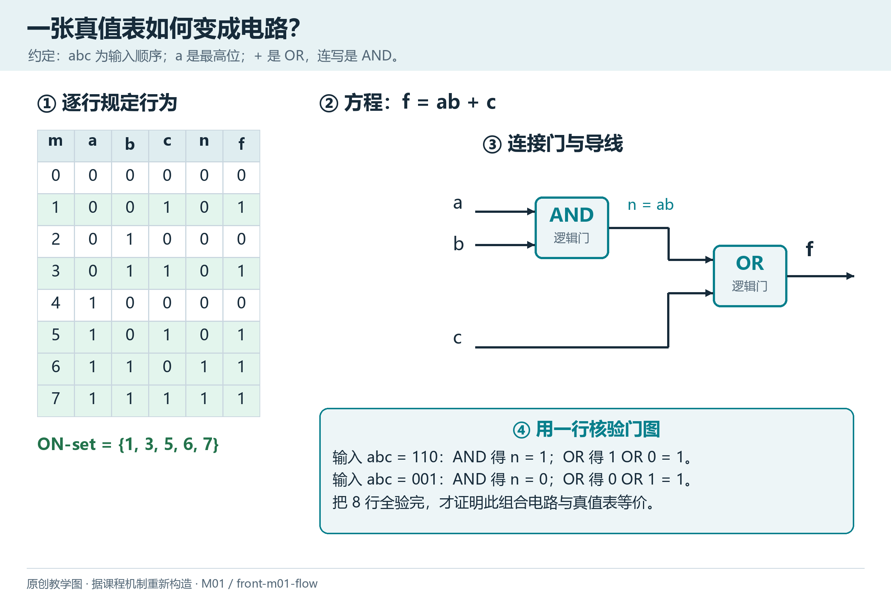{width=100%}

画图时不要直接把三个输入接在一个写着“公式”的框里。现在的目标是把中间结果和连线显露出来：

1. 两输入 AND 的输入是 $a,b$，输出 $n=ab$。
2. 两输入 OR 的输入是 $n,c$，输出 $y=n+c$。
3. 每根线都只有一个驱动源；把同名的 $n$ 当成同一根信号。

用第 6 行检验连线：AND 输出 1，OR 接收 1 和 0，输出 1。再用第 1 行检验：AND 输出 0，OR 因 $c=1$ 输出 1。如果你误把第二个门画成 AND，第 6 行变成 $1\land0=0$，立刻违反需求。

这张门图是**结构描述**；前面的需求、公式和真值表描述输入输出行为。门在芯片上的位置、线长、尺寸、寄生电容还没确定，那是物理描述。三种视角描述同一个设计的不同问题，不是三种互相替代的真值表。

**停一下 · m01-step-3**

有人画成先对 b、c 做 OR，再与 a 做 AND。它是否等价？给一个最短反例。

先写在纸上，再到附录A核对。

### 第4步 · 沿路径算代价，明确单位和比较口径

**现在做**：给每个门写上“1 个面积单位、1 个时间单位”，分别描出 a→y 和 c→y 的路径。

为了第一次手算，我们采用刻意简化的模型：所有两输入 AND/OR 面积相同、延迟相同，都记作 1；忽略导线、负载、输入到达差异。于是总面积代价为 $1+1=2$ 门单位。

$a$ 或 $b$ 的变化先经过 AND，再经过 OR，路径长度为 2；$c$ 的变化只经过 OR，路径长度为 1。如果三个输入在时刻 0 都稳定，最坏输出稳定时间在这个模型中是 2 个门延迟单位。不能写成“2 ns”，因为题目根本没给每门多少秒。

这里要区分**门数**与**路径长度**：一个有十个并排门的电路，最长路径可能只有一级；两个串联门则是两级。门数近似资源用量，最长路径近似速度约束，不能互相代替。真实延迟还取决于具体单元、负载、线长和到达时间，不能把本例的两级当成芯片性能预测。

**停一下 · m01-step-4**

若 AND 延迟 2 ns，OR 延迟 3 ns，导线仍忽略，a、c 分别到 y 的路径延迟是多少？

先写在纸上，再到附录A核对。

### 第5步 · 把“做对了”拆成三个可以检查的主张

**现在做**：在门图旁写三行：功能、时间、制造。每行写一句目前已有的证据和还缺的证据。

**功能**：我们遍历全部 8 种输入，门图输出与需求完全相同。在二值、组合、稳定输入模型下，这已经穷尽功能情况。对于有 $n$ 个输入的真值表，行数是 $2^n$；$n$ 大时才需要更紧凑的表示与验证算法。

**时间**：两级只是基于假定门延迟的估算；真实电路是否按时稳定，要用实际时序模型核查。稳定真值表也没有描述输入切换过程中可能出现的短暂脉冲，这会在事件仿真章再学习。

**制造**：即使设计图正确，实际芯片的某根线仍可能损坏。假设内部线 $n$ 永远卡在 0，本应输出 1 的输入 110 会得到 0，因此 110 可以检测这个特定故障；输入 111 因 $c=1$ 强制 OR 输出 1，会掩盖它。由此可见，设计验证与制造测试使用的模型和问题不同。

本章所有数值均是原创教学例。课程术语与流程依据本章末尾的 L25 Introduction 页码；这套小电路不是讲义宣称的硬件测量结果。

**停一下 · m01-step-5**

为什么用 111 测过一次输出 1，既不能证明八行功能都对，也不能保证 n 没有卡 0？

先写在纸上，再到附录A核对。

### 合上示范，检查是否学会

**m01-exit**

合上示范，用 5 分钟重新完成：①写出 y=ab+c 的 ON 集；②画含内部线名的门图；③分别写 a、c 的逻辑级数；④给 y=a(b+c) 一个反例。四项都能独立完成再前进。

**接下来**：保留这张八行表，下一章直接把它折叠成 Karnaugh 图；不需要重新记一组陌生输入。若编号会错，先练 2、5、6 对应的二进制再继续。

## 你要掌握的主线：表示、变换、验证

这门 DMA 是 **Design Methodology and Automation，设计方法学与自动化**，不是计算机体系结构中传数据的 Direct Memory Access。整门课围绕一个问题：怎样把数字功能要求转成可制造、可验证、可测试的电路。第一部分“综合”寻找正确且成本好的结构；第二部分“仿真”研究状态怎样随事件变化；第三部分“测试”研究制造出的实例是否出现指定故障。

十天复习不宜逐页平均用力。先建立统一语言：布尔函数把输入映成输出；cube 把一组输入压缩表示；cofactor 固定部分输入；SOP 是一种表示；BDD 是另一种表示。QM、启发式优化、BDD 化简并非彼此无关的口诀，它们都在改变**表示**并保持允许输入上的**行为**。FSM 把当前状态加入输入；仿真把状态加入时间；测试把正常与故障行为作比较。

本学习站采用的能力顺序是：能解释 → 能手算 → 能画中间过程 → 能找反例 → 能比较 → 能设计验证。每章“已阅读”只记录接触过内容，真正通过需要提交独立题的过程。已有数电基础可以从诊断题开始；没有把握时先用真值表这一共同语言补足。这里不假定你已经学过 CPU、GPU 或某种编程语言。

## Y-chart：域与抽象层级是两根不同坐标

{width=100%}

Y-chart 的三个方向表示观察同一对象的三种方式。**行为域**回答“输入什么会得到什么”，如算法、寄存器传输、布尔方程；**结构域**回答“由什么连接而成”，如 CPU/存储器、ALU/寄存器/MUX、门/触发器、晶体管；**物理域**回答“放在哪里、几何形状怎样”，如芯片/板、布局块、标准单元、掩模多边形。离中心远近表达抽象层级，不能把“结构域”当作“低层级”的同义词。

请在纸上画三条轴，每轴按 system → algorithm → RT → logic → circuit 排列对应对象。例如同在逻辑层：行为是 $y=ab+\bar ac$，结构是 AND/OR/NOT 门网表，物理是单元与连线布局。综合通常从行为走向结构，同时逐步细化；分析从结构推导行为或性能；物理提取从布局获得电容、电阻等更具体信息。实际流程有反馈回路，不是一次向前永不回头。

可把它类比为“菜谱、厨具与工位布置”：菜谱说明目的与步骤，厨具连接说明实现，摆放决定移动成本。类比边界是数字电路有精确定义的并发与时序，菜谱通常没有形式化等价标准。理解类比后应立即回到“同一行为、不同结构、不同物理代价”的严格表述。来源：L25 PDF pp.9–10。

## 设计流程：每次转换都要带上约束

一个可复述的简化流程是：需求/行为规范 → 架构选择 → RTL → 逻辑优化 → 技术映射 → 布局布线 → 制造 → 测试。RTL 描述每个时钟边界上的寄存器更新与组合运算；逻辑优化寻找等价表达；技术映射把抽象逻辑匹配到真实单元库；物理设计处理放置和连线。L25 PDF p.8 展示的流程同时包括库信息、模块生成和测试生成，这些不是事后可有可无的附加物。

同一份布尔功能可映到标准单元，也可映到 FPGA 的 LUT 与寄存器。选用何种实现结构影响合法操作和成本。例如两级 SOP 的一个大 AND 不能假定对应一个任意扇入、零延迟的物理门；一个 6 输入 LUT 也不能无条件装下 7 输入函数。抽象算法必须保留“目标库/资源/时间预算”这组上下文。

每一步至少问三个问题：①转换前后在什么输入假设下等价？②评价的是 literal、门数、面积、最长路径还是功耗？③模型没覆盖什么？忽略第①会优化错函数，忽略第②会把不同方案的不同指标混比，忽略第③会把教学估算说成硬件预测。十天内优先练课程算法，不必为流片工具安装消耗主线时间。

## 贯穿案例：一位全加器的等价实现

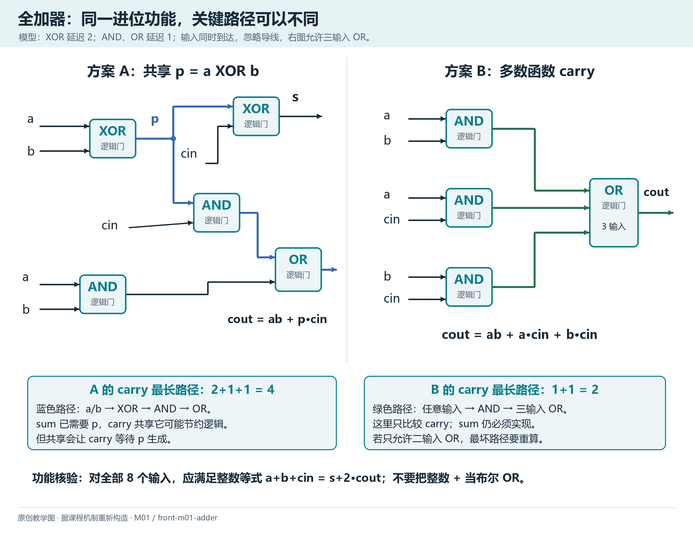{width=100%}

问题：输入为 $a,b,c_{in}$，输出和位 $s$ 与进位 $c_{out}$，必须满足 $a+b+c_{in}=s+2c_{out}$（本式是整数算术）。基线直接由真值表列出两个输出的 SOP。机制改写为 $p=a\oplus b$，$s=p\oplus c_{in}$，$c_{out}=ab+pc_{in}$。另一种进位写法是 $ab+ac_{in}+bc_{in}$。两式功能相同，最短表达不一定在所有库里最快。

证据先用八种输入穷举。例如 101 的整数和为 2，所以 $s=0,c_{out}=1$；公式得到 $p=1,s=0,c_{out}=1$。对 111，$p=0,s=1,c_{out}=1$，对应整数 3。成本比较必须声明模型：假设 XOR 延迟 2 个时间单位、AND/OR 各 1，且输入同到、无限扇出、忽略连线，使用 p 的 carry 最长路径为 XOR→AND→OR，共 4 单位；多数函数写法 AND→OR，共 2 单位（假设 3 输入 OR 可用）。这是教学估算，换单元库就可能变化。

适用条件：共享 p 可能节约逻辑，且 sum 本来需要 p；反例：carry 是关键路径时，共享 p 可能拖慢它。验证办法：功能做八行表，时序做按路径累计或库级分析，面积按同一库统计。如果库只允许二输入 OR，多数函数的 OR 树还需额外一级，比较要重算。不要把本段任意时间单位当作纳秒。

## 仿真、形式验证、制造测试：证据不能互相替代

仿真在模型和选定激励下计算行为，一次仿真“没有报错”只支持已测试的轨迹。组合电路若穷举所有有限输入且模型无遗漏，可以建立该模型上的完整功能证据；大电路通常不能穷举。形式等价检查则尝试证明所有允许输入上两个表示相同，例如构造 $f\oplus g$ 并证明恒为 0。两者都依赖约束正确：把关键场景错误排除，结论也会失真。

制造测试是在实物上施加测试并观察输出，通常相对于 stuck-at 等故障模型报告覆盖率。逻辑功能正确的设计仍可能制造损坏；没有检测到 stuck-at 故障也不能证明不存在所有模拟、电源或时序问题。课程后半部分会教“激活故障、传播差异、在输出观察”，这与综合中的“覆盖全部 minterm”在数学上都有集合覆盖影子，但覆盖对象和物理含义不同。

十天验收建议：每天先闭卷回忆昨天的两个机制，再做一道未见过或改参数的题；晚上只记录错误原因与改正证据。对“概念没记住、算法步骤漏、符号看错、时间分配失误”分别处理。正式考试允许资料、时长与范围请以学校最新通知为准，本站旧试卷仅作练习依据；没有收到的通知不会被猜成事实。

## 练习：先作答，再查附录

### m01-q1 · 补全 · 2 分

“布尔方程、门级网表、单元布局”分别属于哪一个域？三者是否必然处于不同抽象层？

### m01-q2 · 独立 · 4 分

不用看正文，画从规范到制造测试的流程，标出至少两个需要反馈重做的地方。

### m01-q3 · 独立 · 2 分

全加器输入 110 时，carry 和 sum 是什么？为什么不能用布尔 OR 代替整数求和来解释？

### m01-q4 · 补全 · 2 分

在正文的理想门延迟模型下，XOR→AND→OR 的路径延迟是多少个时间单位？

### m01-q5 · 迁移 · 4 分

有人说“我运行了 1000 组随机向量，所以 20 输入组合电路已完全验证”。你会怎样补全他的证据？

### m01-q6 · 迁移 · 3 分

用“问题—基线—机制—成本—反例—验证”简述全加器共享 p 的取舍。

## 本章来源

- L25：2025-10-31；Introduction，印刷 pp.3–7 / PDF pp.7–11
- F072：2023 Introduction slides，PDF pp.23–28；历史版本，仅用于设计流程


# 02 布尔空间、cube 与 Shannon 展开

把公式读成集合，把消元读成固定输入

**关键问题**：一个横杠到底代表多少点，固定一个变量以后为什么能重建整个函数？

**学习目标**

- 在 minterm、cube、集合、SOP/POS 之间互换
- 计算维数、覆盖点数、cube 距离与包含关系
- 求 cofactor、Shannon 展开、Boolean difference
- 用严格包含关系判断 unate 与变量依赖

**先修**：m01；**横向联系**：m03、m04、m06、m11。

## 图解跟做：同一张真值表的三种压缩：cube、K-map、cofactor

约45分钟。把 ON 集 {1,3,5,6,7} 实际转换成两个 cube，并独立算出固定 a 后的两个余函数。

准备纸笔，按下列步骤做。“停一下”题的答案见附录 A 对应编号；不需要另开资料。

### 第1步 · 从一行输入开始，把“点”写成乘积项

**现在做**：写下 101，并在每个 0 对应变量上加撇号；再写出 ON 集中五个点的乘积项。

继续使用变量序 $abc$、$f=ab+c$。一个 minterm 只在一行输入为 1。例如编号 5 对应 101，要把这一行锁定，就写 $ab'c$：$a$ 必须是 1，$b$ 必须是 0，$c$ 必须是 1。变量取 0 时写反变量，而不是在乘积中写数字 0；写 $a0c$ 会令整个项恒为 0。

| 编号 | 输入 abc | 只覆盖这一行的 minterm |
|---|---|---|
| 1 | 001 | $a'b'c$ |
| 3 | 011 | $a'bc$ |
| 5 | 101 | $ab'c$ |
| 6 | 110 | $abc'$ |
| 7 | 111 | $abc$ |

把这些项 OR 在一起，就得到规范的 sum of minterms。它保证没漏 ON 点，却写了 15 次文字 literal。literal 指变量或它的反，不是二进制位数：$ab'c$ 有 3 个 literal。接下来要利用相邻行之间的重复条件把表示压缩。

**停一下 · m02-step-1**

编号 2 的 minterm 是什么？本题能把它加入 cover 吗？

先写在纸上，再到附录A核对。

### 第2步 · 用短横线消去一个无关条件

**现在做**：把 001 与 011 上下对齐，圈出唯一不同的 b；把合并结果写为 0-1。

两个点只差 $b$：$a'b'c+a'bc=a'c(b'+b)=a'c$。用 cube 记号就是 $001+011\rightarrow0{-}1$。短横线表示这一位可以为 0，也可以为 1，不是减号，也不是输入信号未知 X。

再把 101 与 111 合成 $1{-}1$；两个 cube $0{-}1$ 和 $1{-}1$ 只差 $a$，于是合成 $--1$，即 $c$。它覆盖 001、011、101、111 四个点。最后剩下的 110 可以与已覆盖的 111 合成 $11-$，即 $ab$。

一个 cube 有 $k$ 个横线时覆盖 $2^k$ 个点。因此 $--1$ 覆盖 4 点，$11-$ 覆盖 2 点；二者在 111 重叠，合起来覆盖 $4+2-1=5$ 个不同点。**重叠允许，漏掉 ON 或盖住 OFF 才是错误。** 这里最终有 2 个乘积项、3 个 literal，而不是 5 个 minterm、15 个 literal。

**停一下 · m02-step-2**

可以把 001 和 110 直接合成 --- 吗？写出一个被错误引入的 OFF 点。

先写在纸上，再到附录A核对。

### 第3步 · 按 Gray 顺序把点放进 Karnaugh 图

**现在做**：画 2 行 4 列。行写 a=0、a=1；列一定写 bc=00、01、11、10，再按编号填 0/1。

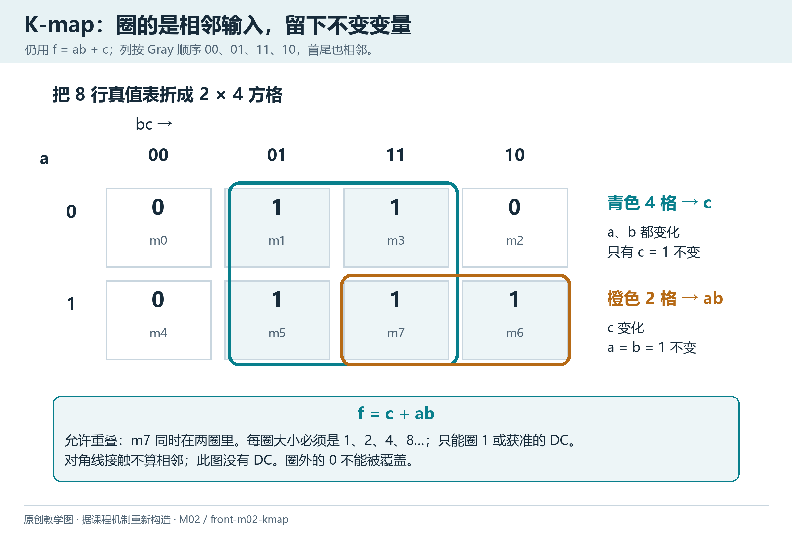{width=100%}

K-map 不是普通表格。相邻列必须只变一位，因此列顺序是 Gray 顺序 00、01、11、10，而不是数值顺序 00、01、10、11。先在格角标 minterm 编号，再填函数值，会比直接填值更不容易错。

| a / bc | 00 | 01 | 11 | 10 |
|---|---|---|---|---|
| 0 | m0: 0 | m1: 1 | m3: 1 | m2: 0 |
| 1 | m4: 0 | m5: 1 | m7: 1 | m6: 1 |

把中间两列的四个 1 圈起来。圈内 $a$ 既有 0 又有 1，$b$ 也既有 0 又有 1，只有 $c$ 始终是 1，所以写出项 $c$。再圈底行的 11、10 两列：$a,b$ 都固定为 1，$c$ 在变，所以写出 $ab$。最终 $f=c+ab$。

每个圈的格数应为 1、2、4、8……并形成允许跨边界的相邻矩形；不能圈一个 L 形的三格，然后声称消去某变量。本图不能把整底行圈起来，因为 m4 是 0。

**停一下 · m02-step-3**

如果你错误地要求“每个 1 只能被圈一次”，这个例子会发生什么？

先写在纸上，再到附录A核对。

### 第4步 · 固定一个输入，真正算出 cofactor

**现在做**：在原式中先代 a=0，再代 a=1；各写一张只剩 b、c 的四行表。

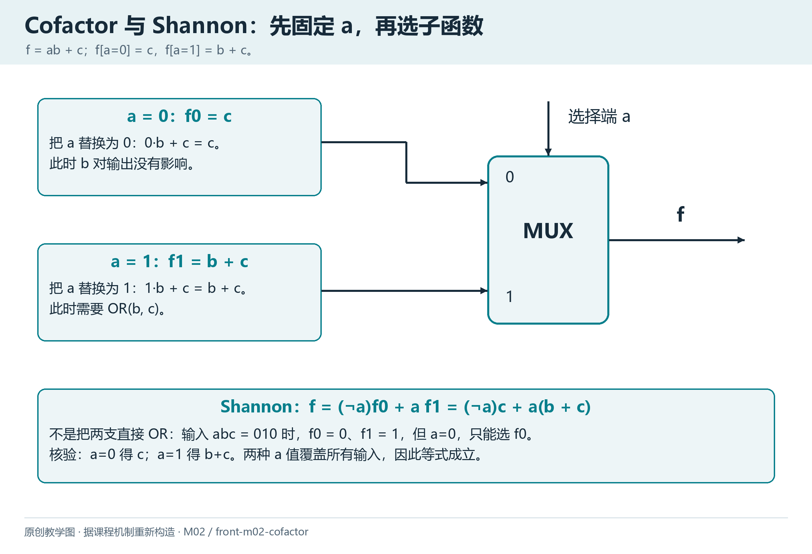{width=100%}

余函数 cofactor 是“先固定一个变量，再看剩余变量的函数”。用 $f_{a=0}$、$f_{a=1}$ 避免把下标与取反混淆。直接代入得

$$f_{a=0}=0b+c=c,\qquad f_{a=1}=1b+c=b+c.$$

| b | c | $f_{a=0}$ | $f_{a=1}$ |
|---|---|---|---|
| 0 | 0 | 0 | 0 |
| 0 | 1 | 1 | 1 |
| 1 | 0 | 0 | 1 |
| 1 | 1 | 1 | 1 |

原真值表的上半张与下半张正是这两个余函数。它们通常已经不再依赖 $a$；例如 $f_{a=0}=c$ 在 $c=1$ 时等于 1。不要把 cofactor 写成 $af$，后者仍包含变量 $a$，在 $a=0$ 时恒为 0，含义完全不同。

Shannon 展开用 $a$ 选择这两个余函数：$f=a'f_{a=0}+af_{a=1}=a'c+a(b+c)$。当 $a=0$ 时只保留左支，$a=1$ 时只保留右支，因此它逐行等于原函数。这就是后面决策图的建图操作。

**停一下 · m02-step-4**

本题对 c 做 cofactor，$f_{c=0}$ 与 $f_{c=1}$ 是什么？

先写在纸上，再到附录A核对。

### 第5步 · 用反例与余函数检查“这个输入真的有用吗”

**现在做**：对比上一步两列余函数，找出第一行输出不一样的位置，并还原成两行原输入。

一个函数不依赖变量 $a$，当且仅当 $f_{a=0}=f_{a=1}$ 对所有剩余输入都相同。本例在 $bc=10$ 时两者分别为 0、1，所以 $a$ 确实有用：输入 010 输出 0，输入 110 输出 1，仅改变 $a$ 就改变了输出。

这也给出布尔差分 $\partial f/\partial a=f_{a=0}\oplus f_{a=1}$。从四行表逐行 XOR 得到 0、0、1、0，对应 $bc'$。它说的是“在哪些输入条件下改变 a 会改变输出”，不是微积分中的斜率。你不必先背公式，可以先比较两张表，再给结果命名。

最后做一次独立核验：按两个 cube 列出并集 $\{1,3,5,7\}\cup\{6,7\}=\{1,3,5,6,7\}$，与题给 ON 集完全相同；检查 $\{0,2,4\}$ 都没有被覆盖。既查“该有的都有”，也查“不该有的没加进来”。

**停一下 · m02-step-5**

有人只检查五个 ON 点都为 1，就宣布 $f=b+c$ 等价。指出漏掉的检查和一个反例。

先写在纸上，再到附录A核对。

### 合上示范，检查是否学会

**m02-exit**

独立变式：变量序仍为 abc，但 ON 改为 {1,3,5,7}，没有 DC。画 K-map，写最简式，并求 a=0、a=1 的余函数。它是否依赖 a？

**接下来**：能够从圈写出项后，再做本章补全题。下一章把“相邻合并”改成可以逐轮执行的表格算法，不再凭眼睛找圈。

## 先统一符号：同一个“加号”有两种语义

本课程用 $+$ 表示 OR，用并写或 $\cdot$ 表示 AND，用 $\bar x$ 或 ASCII `x'` 表示 NOT；$\oplus$ 是 XOR。布尔代数有 $x+x=x$，所以不要套整数规则 $x+x=2x$。常用法则要能正反使用：吸收 $x+xy=x$；分配 $x(y+z)=xy+xz$；另一条分配 $x+yz=(x+y)(x+z)$；De Morgan $\overline{xy}=\bar x+\bar y$。后一条意味着翻转整个门时也要翻转输入和门类型。

例：$f=ab+\bar ab$，提取 b 得 $b(a+\bar a)=b$。每一步是集合并/交的等式，不是“把 a 消掉”的口诀。再看 $ab+\bar ac+bc$：$bc$ 是前两项的 consensus，可被吸收；但是 $ab+\bar ac$ 一般不等于 $b+c$，输入 $a=1,b=0,c=1$ 就是反例。学会找一个反例比盲目展开更快。

变量顺序必须显式写出，例如 $abc$ 的 101 是 $a=1,b=0,c=1$，对应十进制 minterm 5。输入空间有 $2^n$ 个点；所有完全指定单输出布尔函数有 $2^{2^n}$ 个，不是 $2^n$。这是“输入有几种”和“可给每个输入安排多少种输出表”两个不同计数问题。来源：L25 PDF pp.13–19。

## cube：少一个 literal，就多一个自由维度

cube 是一组固定了部分比特的输入点。$n$ 变量空间中，一个含 k 个不同且一致 literal 的乘积项维数为 $d=n-k$，覆盖 $2^d$ 个 minterm。三变量 `1-0` 是 $a\bar c$，覆盖 100 与 110，维数 1；`---` 是常量 1，覆盖全部 8 点，维数 3；`101` 是 minterm，维数 0。空集 0 不是通常的非空 cube，不能把相互矛盾的 $a\bar a$ 算作“2 literal、维数 n−2”。

每位可写 0、1、横杠，故非空 cube 总数为 $3^n$。恰好 d 维的 cube 数为 $\binom nd2^{n-d}$：先选自由位置，再给其余位赋值。比如三变量的 1-cube 有 $\binom31 2^2=12$，也等于立方体的 12 条边。四维的 1-cube 有 32 条边。这是 Quine 第一轮最多可能产生多少不同 1-cube 的来源。

两个 cube 的距离按本课口径是**发生相反固定值的位置数**，也等于从两集合各取一点的最小 Hamming 距离。例如 `1-0` 与 `0-1` 在 a、c 上冲突，距离为 2；`1-0` 与 `-10` 距离为 0，交集为 110。距离 0 不等于两个 cube 相同；也不等于一个包含另一个。包含检验是“更大集合的每个固定条件都被更小集合满足”：`110` 包含于 `1-0`，而不是反过来。

## On/off/DC 与 SOP/POS 的转换

完全指定函数的 on-set F 是必须为 1 的点，off-set R 是必须为 0 的点。若有 don’t-care D，则 F、D、R 两两不交且并集为 $B^n$；一个合法实现 g 满足 $F\subseteq on(g)\subseteq F\cup D$。cube 中的横杠表示该输入变量自由，而真值表输出栏的星号表示规范未约束输出，二者虽然常用同一符号，语义不同。

原创示范：变量 abc，$F=\{1,3,5,7\}$，即 c=1 的四点。CSOP 写成 $\bar a\bar bc+\bar abc+a\bar bc+abc$，全部合并得到 $f=c$。off-set 为 0、2、4、6；CPOS 是对应四个 maxterm 的积。对输入 010，令该和项恰为 0 的式子是 $(a+\bar b+c)$，因此 maxterm 中 0 对应正 literal、1 对应负 literal，正好与 minterm 相反。

一般求 POS 的稳妥方法：先求补函数 $\bar f$ 的 SOP，再整体取反并应用 De Morgan。例如 $\bar f=ab+\bar ac$，则 $f=(\bar a+\bar b)(a+\bar c)$。不要把 SOP 中每个乘号换加号却忘记整体补关系。要检查时，挑一个 on-set 和一个 off-set 点代入；小函数可穷举全部点。canonical 表示全部 minterm/maxterm，complete SOP 表示全部 PI，这两个单词不是同义词。

## 完整示范：固定输入、重建函数、得到 MUX

取 $f(a,b,c)=ab+\bar ac$。固定 a=1 时，$f_{a=1}=b$；固定 a=0 时，$f_{a=0}=c$。cofactor 是把变量替换为常数后得到剩余变量的函数，不是普通代数求导。Shannon 展开为：

$$f=a f_{a=1}+\bar a f_{a=0}=ab+\bar ac.$$

证明只需分 a=1 和 a=0 两种情形；此时一个分支被屏蔽，另一个分支被选中。因此它正是 2:1 MUX：a 为选择，b 为 a=1 的数据，c 为 a=0 的数据。若画图，必须在边上标 0、1，不能只靠左右方位猜。连续固定不同变量可交换次序，例如 $f_{a=0,b=1}=c=f_{b=1,a=0}$。

沿 b 展开也成立：$f_{b=1}=a+\bar ac=a+c$，$f_{b=0}=\bar ac$，所以 $f=b(a+c)+\bar b\bar ac$。表达式变长并不表示推导错了；不同分解变量会导致不同的 BDD 大小和电路结构。把 cofactor 类比为程序中“把某个参数设为常量后部分求值”很有用，但布尔函数没有程序的副作用和执行顺序，不能把公式里的左右顺序当时间先后。来源：L25 PDF pp.19、24。

## 依赖、单调、量词与布尔差分

变量 a 的布尔差分为 $\partial f/\partial a=f_{a=0}\oplus f_{a=1}$。对 MUX 例，它等于 $b\oplus c$：当 b=c，改变选择 a 不影响输出；当 b≠c，改变 a 会翻转输出。**独立于 a** 等价于这个差分恒为 0；**依赖于 a** 只要求存在某个输入使差分为 1，即差分不恒为 0，不要求处处为 1。这一点在 PDF 文本抽取丢失否定符号时尤其容易看错。

positive unate 意味着 $f_{a=0}\subseteq f_{a=1}$：固定其他输入后，a 从 0 到 1 不能把输出从 1 变 0。negative unate 方向相反。若两个方向都不成立，就是 binate。MUX 对 a 为 binate：取 b=1,c=0，a 升高输出升高；取 b=0,c=1，a 升高输出降低。它对 b 和 c 则是 positive unate。独立变量同时满足正、负 unate，不能因此认定定义矛盾。

Consensus/全称消元为 $\forall a\,f=f_{a=0}f_{a=1}$；smoothing/存在消元为 $\exists a\,f=f_{a=0}+f_{a=1}$。对 MUX 例分别得到 bc 与 b+c。前者问“不论 a 如何都为 1 吗”，后者问“能否选一个 a 使它为 1”。恒真证明需要两个 cofactor 都恒为 1；一个分支为 1 只证明部分输入成立。布尔差分会在故障传播中再次出现，cofactor 会在 BDD、启发式合法性和分解中反复使用。

## 你该怎样在纸上验证自己

每次转换先写变量序与假设，再写集合或真值表作独立检查。若题目要求某个 cube 属于函数，使用 $c\subseteq f\Leftrightarrow f|_c\equiv1$，这里 $f|_c$ 表示固定 c 中所有 literal，使其为真。例如 $c=ab$，就取 a=1,b=1。注意 $f|_c=1$ 要对剩余所有输入都成立，而不是随便再取一组值验证。

发现答案不同时，先检查输出补号、变量顺序和 CSOP/CompSOP 混淆，再检查代数。这三种抄写错误比算法本身更常见。站内必做题已给出完整函数、变量顺序和符号，不依赖原 PDF 才能作答。若额外选做历史原卷，发现文本提取的上划线不清，再对照原页确认补号。能力验收是能在 10 分钟内把一个三变量函数写成真值表、求两个 cofactor、给出一条合法扩张和一条反例；做到后即可进入 QM。

## 练习：先作答，再查附录

### m02-q1 · 补全 · 2 分

在 B^7 中，cube 1-0--11 的维数是多少？

### m02-q2 · 独立 · 2 分

在 B^4 中，恰好 1 维的非空 cube 有多少个？

### m02-q3 · 独立 · 4 分

对 f=ab+a'c，求 f|a=0、f|a=1、关于 a 的差分，并给出 a 不影响输出的一类输入。

### m02-q4 · 独立 · 3 分

求 1-0 与 -10 的距离和交集，并解释距离 0 为什么不表示相同。

### m02-q5 · 迁移 · 3 分

有人从“f|a=1 恒为 1”推出 f 恒真。构造最小反例，并给正确判据。

### m02-q6 · 迁移 · 4 分

对 f=ab+a'c 判断 a 是否 positive unate、negative unate 或 binate，必须给证据。

## 本章来源

- L25：2025-10-31；I.1–I.2，印刷 pp.9–20 / PDF pp.13–24
- T25：Tutorial 1，印刷 pp.3–12 / PDF pp.5–14


# 03 精确两级综合：从全部 PI 到最小覆盖

Quine–McCluskey、必要项、覆盖表、Petrick 与成本口径

**关键问题**：怎样证明一个 SOP 正确而且在指定成本下最优，而不是只看起来更短？

**学习目标**

- 完整列出所有素蕴含项并解释为什么不能继续扩张
- 从覆盖表识别必要项，正确处理行列支配
- 建立选择变量方程，区分贪心结果与精确最优
- 对 don’t-care 与多输出共享分别计费并验证等价

**先修**：m02；**横向联系**：m04、m05、m10。

## 图解跟做：从零做完一道最小覆盖题：没有 EPI 时怎么办

约60分钟。独立写出全部合并、PI chart 和两组最优覆盖；能证明最优，而不只说“看起来最小”。

准备纸笔，按下列步骤做。“停一下”题的答案见附录 A 对应编号；不需要另开资料。

### 第1步 · 抄清 ON/DC/OFF，并按 1 的个数分组

**现在做**：给纸分出“合并区”和“覆盖区”。在合并区顶端写 ON={0,1,2,5,6,7}、DC=空集。

这是一道新题，不沿用上一章的 ON 集。变量顺序是 $abc$，$a$ 为最高位；$F=\{0,1,2,5,6,7\}$，$D=\varnothing$，所以 OFF 是 $\{3,4\}$。优化目标按先最少乘积项、再最少 literal 处理。本题各最终 PI 都是 2 literal，因此两种目标会一致。

第一轮把每个 minterm 写成三位二进制，按其中 1 的数量分组：

| 组 | 1 的个数 | 编号与二进制 |
|---|---|---|
| G0 | 0 | 0: 000 |
| G1 | 1 | 1: 001；2: 010 |
| G2 | 2 | 5: 101；6: 110 |
| G3 | 3 | 7: 111 |

只有相邻组才可能恰差一位，但**相邻组并不保证能合并**。必须逐位比较。例如 001 与 110 虽分别在 G1、G2，却差三位，不能合并。本题没有 DC；如果题目有 DC，它们可参与合并，但后面的覆盖表只要求覆盖 ON 列。

**停一下 · m03-step-1**

为什么本题不能把 011 添进合并表来帮助 001 扩大？

先写在纸上，再到附录A核对。

### 第2步 · 写全第一轮的六次合法合并

**现在做**：按 G0↔G1、G1↔G2、G2↔G3 的顺序逐对检查。每成功一次，在两个原项旁打勾，并记下来源集合。

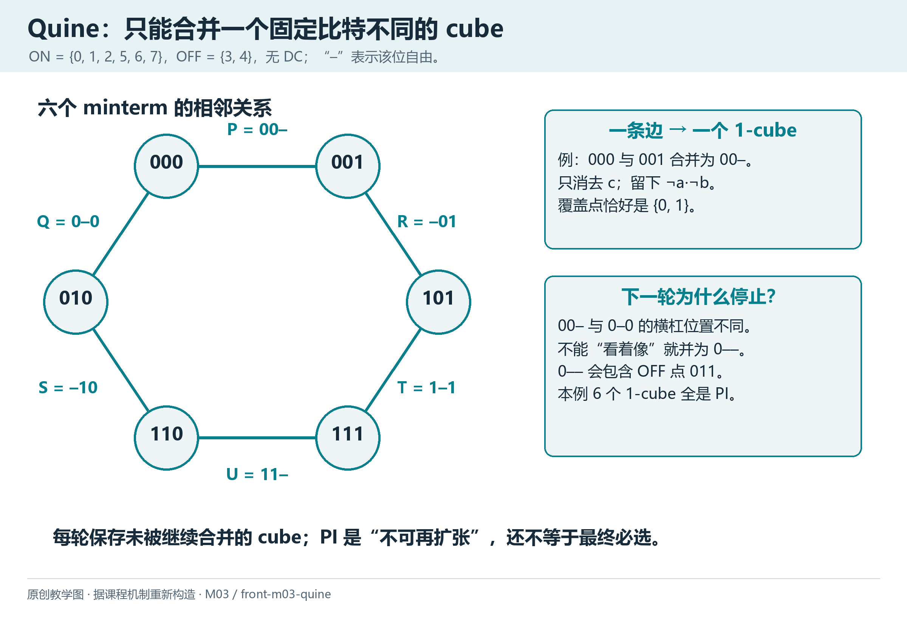{width=100%}

完整合并记录如下。最右列不是装饰：它可以直接用来填写覆盖表，也能防止 cube 记错后覆盖范围失真。

| 标签 | 两个来源 | 唯一变化位 | 合并 cube | 覆盖编号 | 乘积项 |
|---|---|---|---|---|---|
| P | 000、001 | c | 00- | 0,1 | $a'b'$ |
| Q | 000、010 | b | 0-0 | 0,2 | $a'c'$ |
| R | 001、101 | a | -01 | 1,5 | $b'c$ |
| S | 010、110 | a | -10 | 2,6 | $bc'$ |
| T | 101、111 | b | 1-1 | 5,7 | $ac$ |
| U | 110、111 | c | 11- | 6,7 | $ab$ |

第一轮结束后六个原 minterm 都被合并过，所以它们都不是最终 PI；但还不能马上说这六个二点 cube 全是 PI，需要检查能否继续扩大。

检查二次合并时，横线位置必须相同，而且剩余固定位恰差一位。横线同在最后一位的 P=00- 与 U=11- 差了 a、b 两位；横线在中间的 Q=0-0 与 T=1-1 差了 a、c；横线在开头的 R=-01 与 S=-10 差了 b、c。全部不能合并。因此六个 cube 都未被再次合并，全部是 prime implicants。

**停一下 · m03-step-2**

P=00- 与 Q=0-0 能直接合成 0-- 吗？找出它会错误包含的输入。

先写在纸上，再到附录A核对。

### 第3步 · 从 cube 建 PI chart，先查有没有必选行

**现在做**：覆盖区横向列 0、1、2、5、6、7，纵向列 P 到 U。按来源集合填勾，再逐列数勾的个数。

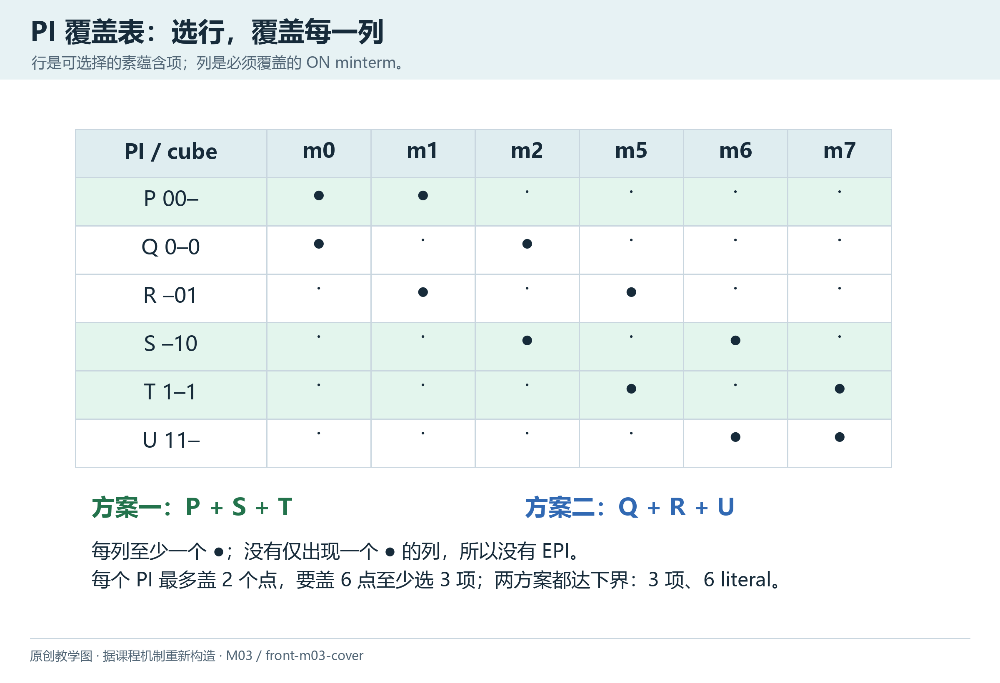{width=100%}

覆盖表必须把 ON 放列、PI 放行，并明确自己的约定。下表的“1”表示这一行覆盖这一列：

| PI | 0 | 1 | 2 | 5 | 6 | 7 |
|---|---|---|---|---|---|---|
| P=00- | 1 | 1 | | | | |
| Q=0-0 | 1 | | 1 | | | |
| R=-01 | | 1 | | 1 | | |
| S=-10 | | | 1 | | 1 | |
| T=1-1 | | | | 1 | | 1 |
| U=11- | | | | | 1 | 1 |

某个 ON 列如果只有一个勾，那唯一的行就是 EPI（essential prime implicant），必须选。**本题每列恰有两个勾，因此没有 EPI。** “没有 EPI”不等于无解，也不等于六行都得选；它只表示没有单个输出点能立即强迫某一行。

此表中每行都是两格，任意两行的覆盖集合既不相等也没有严格包含；因此不能凭行支配消去某行。实际考试若有行支配，还必须把代价方向一起写清：一行覆盖更多且成本不高，才可以代替另一行。

**停一下 · m03-step-3**

只选 P 和 T，哪些 ON 列还没盖住？这能作为完整答案吗？

先写在纸上，再到附录A核对。

### 第4步 · 把“每列至少选一行”翻译成 Petrick 条件

**现在做**：从左到右读每一列，把能覆盖该列的行标签写成括号；再把六个括号相乘。

覆盖列 0 必须选 P 或 Q，写成 $(P+Q)$；列 1 是 $(P+R)$；依此得到

$$\Phi=(P+Q)(P+R)(Q+S)(R+T)(S+U)(T+U).$$

这里 P、Q 等是“是否选择这一行”的布尔变量，不是原电路的输入。乘积表示所有列的要求必须同时满足，加号表示备选。

不必盲目展开成几十项。先演示两括号：$(P+Q)(P+R)=P+QR$，因为 $PP=P$，而 $P+PQ=P$、$P+PR=P$。它的意思是：同时盖住 0、1 两列，可以选 P，也可以同时选 Q、R。

沿第一条分支选 P：余下列为 2、5、6、7；选 S 同时盖 2、6，再选 T 同时盖 5、7，得到 PST。沿第二条分支选 Q、R：它们共盖 0、1、2、5，剩 6、7，由 U 一行同时覆盖，得到 QRU。其他选择可能产生四行甚至更多行的可行覆盖，不能把“可行”当成“最优”。完整 Petrick 化简还可能保留更大的包含极小解；这里我们只抽取最低次数的候选。

**停一下 · m03-step-4**

候选 P、R、S、U 是不是可行？是不是最优？

先写在纸上，再到附录A核对。

### 第5步 · 证明三项已经最优，并还原成电路函数

**现在做**：在答案前写一句下界证明，再把 PST 与 QRU 分别替换成实际的乘积项。

全部 PI 每个最多覆盖 2 个 ON 点，题目有 6 个 ON 点，所以至少需要 $\lceil6/2\rceil=3$ 项。PST 与 QRU 都用 3 项，达到这个下界，因而确实最优。由于每个 PI 都有 2 个 literal，两组也都为 6 literal。

$$f_1=a'b'+bc'+ac,\qquad f_2=a'c'+b'c+ab.$$

“最小式”未必唯一。本题两式结构不同但功能相同：第一组分别覆盖 {0,1}、{2,6}、{5,7}；第二组分别覆盖 {0,2}、{1,5}、{6,7}。两者并集都等于给定 ON。

最后主动试两个 OFF：输入 011 时 $f_1=0+0+0=0$；输入 100 时同样为 0。只证明下界却没检查候选可行不够，只列候选却不说明下界也还没证明最优。最完整的答案链是：合法 PI → 可行 cover → 下界 → 达到下界。

**停一下 · m03-step-5**

为什么不能仅凭“我没找到两项解”来证明三项最优？

先写在纸上，再到附录A核对。

### 第6步 · 改动一个条件，观察算法哪一部分必须重做

**现在做**：把 3 从 OFF 改成 DC，保持 ON={0,1,2,5,6,7}。先判断哪些大 cube 现在合法，再思考覆盖表列要不要增加。

这个变式让你分清“可覆盖”与“必须覆盖”。原来 011 是 OFF，阻止了 $0--$ 的扩张；现在若题目明确给 $D=\{3\}$，$0--$ 覆盖 {0,1,2,3} 就合法了，代表 $a'$。同样 $--1$ 覆盖 {1,3,5,7} 合法，代表 $c$；$-1-$ 覆盖 {2,3,6,7} 也合法，代表 $b$。

但编号 4=100 仍是 OFF，所以 $---$ 仍不合法。一个正确覆盖是 $a'+b+c$，它覆盖除了 4 以外的全部输入；DC 点 3 被置为 1 是允许的。覆盖表仍只以原来的六个 ON 作为必须覆盖列，不必要求 DC=3 被盖住。

这个变式不是要求你背一个新答案，而是提醒：ON、OFF、DC 的身份变了，PI 集就可能变，不能沿用上一题的六行再硬做覆盖。实际作业中每次开题先写清这三个集合。

**停一下 · m03-step-6**

若仍用原来的三项解，它在 DC 变式中合法吗？新答案能否用两项？

先写在纸上，再到附录A核对。

### 合上示范，检查是否学会

**m03-exit**

遮住六个步骤重做原题。交出四项：全部 PI、PI chart、“无 EPI”的理由、一个三项最优解及最优性证明。评分每项 1 分，4 分才记作本章独立通过。

**接下来**：把这个六环 cover 在实验中复现，再改变一个 ON/DC 点重新做。随后进入启发式：当完整生成 PI 与覆盖搜索太贵时，如何逐步改善一个合法 cover。

## 先分清四种“最简”

一个乘积项 $c$ 是蕴含项（implicant），意思是 $c$ 覆盖的每个输入点都允许输出 1。完全指定函数要求 $c\subseteq F$；不完全指定函数允许 $c\subseteq F\cup D$，但最终必须覆盖全部 $F$。素蕴含项（PI）是不能再删除任何一个 literal 而保持合法的蕴含项。因此“素”是局部不可扩张，不是“必须选”。必要素蕴含项（EPI）至少独占一个 on-set 点：不选它就没人能覆盖那个点。

**CompSOP** 是所有 PI 的和；**irredundant cover** 是无法直接删去任何一项的覆盖；**MinSOP** 才是按目标成本最小的 SOP。L25 印刷 p.21 将 MinSOP 定义为最少 literal。某些教材采用“先项数，再 literal”的字典序目标，做卷子必须先读题，不能悄悄换口径。本课程默认报告“项数 / literal 数”两个数，并按题设选择目标。

为什么可把最优搜索限制到 PI？若某解含非 PI 项，至少能删去一个 literal 扩张它，覆盖仍合法，成本不会增加。重复后得到 PI。因此至少存在一个由 PI 组成的最优解；这没有说全部 PI 都要保留。literal 计数是逻辑代理成本，不等于标准单元面积、门延迟或晶体管数量。来源：L25 PDF pp.25–27。

## 示范一：把所有合并做完，别漏 PI

以下是原创教学实例，变量顺序固定为 $abc$，$a$ 为最高位：$F=\{0,1,2,5,6,7\}$，$D=\varnothing$。先列 0-cube 并按 1 的个数分组：0 个为 `000`；1 个为 `001,010`；2 个为 `101,110`；3 个为 `111`。第一轮只合并恰好一个固定比特不同的项：

```text
000 + 001 → 00-  = P = a'b'   覆盖 {0,1}
000 + 010 → 0-0  = Q = a'c'   覆盖 {0,2}
001 + 101 → -01  = R = b'c    覆盖 {1,5}
010 + 110 → -10  = S = bc'    覆盖 {2,6}
101 + 111 → 1-1  = T = ac     覆盖 {5,7}
110 + 111 → 11-  = U = ab     覆盖 {6,7}
```

第二轮要求横杠位置相同、另一个固定比特恰好不同。`00-` 与 `11-` 相差两位，不能合并；`0-0` 与 `1-1` 也相差两位；`-01` 与 `-10` 亦然。因此六项全是 PI，没有 2-cube。每个已参与合并的父项都打勾，同一个新 cube 经不同路径生成时只保留一份；最终收集**所有轮次**中未被继续合并的项，不能只取最后一轮。

最常见错法是看到 `00-` 和 `0-0` 只有“一个位置看起来不同”，便写 `0--`。它实际上多覆盖了 `011`，而 $m_3$ 是 off-set，立即非法。验证手段就是把 cube 展开为点集，检查新增点，而非凭图形印象判断。算法依据：L25 PDF p.26；T25 Tutorial 2。

## 示范二：覆盖表与选择变量，不把项变量当输入

在六个 PI 的表中，$m_0$ 可由 P 或 Q 覆盖，$m_1$ 由 P 或 R，$m_2$ 由 Q 或 S，$m_5$ 由 R 或 T，$m_6$ 由 S 或 U，$m_7$ 由 T 或 U。没有只出现一次的列，所以没有 EPI。这不代表无解，只代表必须作选择。

为每个 PI 引入一个选择变量（P 表示“选 P”而不是输入值），覆盖条件为：

$$C=(P+Q)(P+R)(Q+S)(R+T)(S+U)(T+U)=1.$$

这就是常称的 Petrick 形式：**每列求 OR，所有列求 AND**。展开并用 $X^2=X$、$X+XY=X$ 吸收，得到若干选择集合；逐个按 literal 成本比较即可。此例每个 PI 都覆盖两个点，所以至少要 $\lceil6/2\rceil=3$ 项。选择 $PST$ 覆盖六点，选择 $QRU$ 也覆盖六点，两者都恰好 3 项、6 literal，达到了下界，因而都最优。

得到两种 MinSOP：$\bar a\bar b+b\bar c+ac$ 与 $\bar a\bar c+\bar bc+ab$。不要因标准答案选了第一种而否定第二种。也不要机械展开很大的选择式：每乘入一列就吸收包含别人的冗余乘积，或保留成本下界做分支剪枝。小题可以枚举，规模大时这一组合步骤本身会很贵。最后用 8 行真值表验证两式均在 0、1、2、5、6、7 为 1，在 3、4 为 0；正确性验证与最优性下界是两份不同证据。

## EPI 与支配：删行删列方向要有理由

另取 $F=\{0,2,3,7\}$，PI 为 $A=0-0$、$B=01-$、$C=-11$。点 0 只有 A 能盖，点 7 只有 C 能盖，故先选 A、C，覆盖全部 F，B 不必选。这个小例用于复核课程中的必要项概念。

**列规则（约束）**：设覆盖列 $m_i$ 的可选行集合为 $R_i$。若 $R_i\subseteq R_j$，覆盖更难的 $m_i$ 时必然覆盖 $m_j$，因此可删去较容易的列 $m_j$，保留 $m_i$。背“谁支配谁”的名字容易混乱，最好在纸上写集合包含关系。

**行规则（候选）**：若行 A 的覆盖集合包含行 B，且 $cost(A)\le cost(B)$，则在寻找至少一个最优解时可删 B。必须检查成本！一个含很多 literal 的大候选不一定优于一个便宜的小候选。若同成本同行覆盖，任选保留一个只会保留部分等价最优解；要列出所有最优解时应记录替代关系。

删除列后重新找 EPI，选择后再删除已覆盖列，循环至不能约简。若余表仍非空，贪心“选覆盖剩余点最多的行”是启发式，不是精确证明。抽象反例：宇宙为 1…6，A 盖 {1,2,3,4}，B 盖 {1,2,5}，C 盖 {3,4,6}，成本均为 1。贪心先选 A 后还需 B、C，共 3；而 B+C 只需 2。它说明覆盖策略的局限，并非声称这三行已是某特定布尔函数的完整 PI 表。

## Don’t-care 与多输出：扩大候选，不扩大必须完成的任务

在 Quine 合并阶段使用 $F\cup D$ 生成候选，在覆盖表中只为 $F$ 建必须覆盖的列；纯覆盖 D 的 PI 不值得单独选择。例：$F=\{1,3\},D=\{5,7\}$，三变量函数可选 $f=c$，只需 1 literal；但实现不用覆盖 D 也合法，$f=\bar ac$ 同样满足规范，只是不够便宜。若某个 don’t-care 是“正常运行不出现”，必须有可达性或输入约束依据，不能因为题目没列就随意把它当 D。

多输出共享优化要区分“函数表达式里的出现次数”和“实际创建的共享乘积项”。若 $f_1=ab+ac$、$f_2=ab+ad$，分别计算输入 literal 是 4+4=8；实现时将 $t=ab$ 共享，AND 平面只有 $ab,ac,ad$，输入 literal 共 6，另有四个输出连接。这个成本统计只适合声明了 AND/OR 平面的模型，不应拿 6 去对比另一方案的总门输入数。

一个同时供给两个输出的乘积项必须蕴含 $f_1f_2$（若有 D 则逐输出检查允许集合）。单输出 PI 的独立最小化可能错过共享机会；有时缩小某个 cube，反而使它能同时服务多个输出，整体更省。来源：L25 PDF pp.35–37。先做题目明确的单输出成本，再处理共享，避免把最少 literal、最少乘积项和最少连接数混为一谈。

## 考场步骤、反证与迁移

把答案分成五段：①写变量序、F/D 和成本；②给分组、每轮合并、未合并项；③列 PI 覆盖表并说明必要项；④给覆盖选择及成本；⑤用 off-set/真值表复核。即使最后选择错了，这种结构也让中间方法可检查。近年卷确实包含 Quine、覆盖表、cube 计数等题型，但旧题分布只能说明训练价值，不能证明本次补考权重。

迁移到真实综合时，课上两级最优只是一个局部目标：标准单元有扇入限制，扇出会带来负载，增加共享可能拉长路径；综合工具还要在多级网络上考虑时序和库映射。可以把 QM 想成“列出所有合法积木，再精确选覆盖”；这有助于理解 set cover，但硬件优化还有连线与延迟，并非纯集合游戏。

验收线：离开答案，在 25 分钟内做一题 3–4 变量 QM，能解释“漏 PI、错支配、把 D 当必盖、把 irredundant 当 minimum”四类错因。若失败，先回 m02 练 cube 展开和 cofactors；若已能独立写出完整表，可跳过示范，直接做本章独立题并隔一天换变量重做。不要以“我看懂了解析”代替这项能力证据。

## 练习：先作答，再查附录

### m03-q1 · 补全 · 3 分

在三变量空间中，00- 覆盖哪些 minterm？能否与 0-0 合并成 0--？

### m03-q2 · 补全 · 2 分

主示范中六个 PI 每个覆盖 2 个必需点；最少至少要几项？

### m03-q3 · 独立 · 4 分

独立求 F={0,2,3,7}, D=空 的全部 PI、EPI 与 MinSOP，变量 abc。

### m03-q4 · 独立 · 4 分

F={1,3}, D={5,7}，变量 abc。为什么 f=c 合法？把 5、7 放进必须覆盖的列会造成什么概念错误？

### m03-q5 · 迁移 · 4 分

有两行：A 覆盖 {1,2,3}、成本 5；B 覆盖 {1,2}、成本 2。能仅凭 A 覆盖更多就删 B 吗？

### m03-q6 · 迁移 · 4 分

比较 f1=ab+ac、f2=ab+ad 的分别实现与共享 ab 实现。报告你采用的成本口径，并提出一个共享可能变慢的原因。

## 本章来源

- L25：2025-10-31；I.3，印刷 pp.21–33 / PDF pp.25–37
- T25：Tutorial 2，印刷 pp.13–24 / PDF pp.15–26；Tutorial 3 P1、P4，PDF pp.27、29–33、38
- F086：文件名19_retake；卷内日期2020-06-29；Problem 1c，PDF p.3
- F088：2021 exam；Problem 1b，PDF p.3


# 04 启发式优化与恒真检验

每一次删项、扩张、缩小，都要证明仍然合法

**关键问题**：为什么“单独能删”不代表“可以一起删”，为什么先变复杂有时能通向更好的解？

**学习目标**

- 推导 expand、reduce、remove 的合法性条件
- 把 cube 包含转成 cofactor 恒真问题
- 解释配置图的可行解、邻域、局部与全局最小
- 对每步修改给出证明或反例而非只写是/否

**先修**：m02、m03；**横向联系**：m06、m05。

## 图解跟做：把启发式从口号变成可执行动作：四次 cover 检查

约45分钟。在不改变函数的前提下，从 9 literal 降到 4；每一步都能指出删了什么条件、增加或删除了哪些覆盖点。

准备纸笔，按下列步骤做。“停一下”题的答案见附录 A 对应编号；不需要另开资料。

### 第1步 · 先锁定函数和代价，防止“变简单”时悄悄改题

**现在做**：写出初始 cover：abc + abc′ + a′bc。旁边列 ON、OFF，并给每项计 literal。

本次从 $f=abc+abc'+a'bc$ 开始，变量序 $abc$，没有 DC。三项分别表示编号 7、6、3，所以 ON 为 $\{3,6,7\}$，OFF 为 $\{0,1,2,4,5\}$。

我们用两个代价：乘积项数 $N_p$ 和 literal 总出现次数 $N_l$。起点有三个三文字项，故 $(N_p,N_l)=(3,9)$。这只是两级 SOP 的表示代价；它既不等于门数，也不直接等于纳秒。

每次尝试都做两个检查：①当前 cover 是否仍覆盖全部 ON；②有没有覆盖任何 OFF。expand 把 cube 扩大，因此特别容易犯第二种错；reduce 或删项把覆盖缩小，因此特别容易犯第一种错。把这两句写在草稿纸顶端，比背一串算法名更能避免失分。

下面是借用 expand、irredundant、reduce 思想的**局部教学轨迹**，没有实现完整 Espresso 的距离度量、候选选择和控制流程，不能称为 Espresso 的真实软件运行日志。

**停一下 · m04-step-1**

在 9 literal 起点中，为什么不能直接删掉 abc？

先写在纸上，再到附录A核对。

### 第2步 · Expand：删去一个条件，但先枚举新增的点

**现在做**：只改第一项，把 abc 的 c 划掉得到 ab；把新 cube 覆盖的输入列出来，再与 OFF 对照。

原 cube $abc=111$ 只盖点 7；删掉 $c$ 后成为 $ab=11-$，覆盖 {6,7}。新增点是 6，它属于 ON，所以这次扩大合法。现在 cover 为

$$C_1=ab+abc'+a'bc.$$

三个项的 literal 数分别是 2、3、3，总数变为 8，项数仍为 3。原项 $abc'$ 现在与扩大后的 $ab$ 重叠，这并不违法，下一步再处理冗余。

再试把 $ab$ 扩成 $a$：$a=1--$ 会盖 {4,5,6,7}，新增的 4、5 都是 OFF，所以失败。若改为 $b=-1-$，会盖 {2,3,6,7}，其中 2 是 OFF，也失败。**expand 不是随便删字母，而是在不进入 OFF 的约束下删条件。** 本步已经把这个 cube 扩到无法再删 literal，但不代表整个 cover 已经最优。

**停一下 · m04-step-2**

有人说“ab 比 abc 短，所以必然合法”。请补上他缺少的检查，并指出本题一个不合法的缩短。

先写在纸上，再到附录A核对。

### 第3步 · Irredundant：删除已被其他项完整照顾的项

**现在做**：用 ab 的覆盖集合 {6,7} 对照 abc′ 的集合 {6}，判断第二项是否还有独有贡献。

在 $C_1$ 中，$abc'$ 只盖点 6，而 $ab$ 已经盖住点 6。因此删掉 $abc'$ 后，所有 ON 仍被覆盖。得到

$$C_2=ab+a'bc.$$

代价从 $(3,8)$ 变为 $(2,5)$。注意删项前后“项数”和“literal 数”都应重算，不能把删掉一个项误说成只少一个 literal。

再检查剩余两项：$ab$ 有点 6、7 的贡献；$a'bc$ 有点 3 的贡献。此时任何一项都不能直接删除，所以这个 cover 已 irredundant（无冗余项）。但“无冗余”只表示单独删项不行，**不意味着没有改进空间**：第二项还可以扩大。

一个可靠的删项做法是：临时拿掉候选项，再验证所有 ON。不要同时删除多项却只对每项在原 cover 中检查一次，因为它们可能互相依赖。

**停一下 · m04-step-3**

如果现在删掉 a′bc，会漏哪一点？如果删掉 ab，又会漏哪些点？

先写在纸上，再到附录A核对。

### 第4步 · 再扩大一次，并画出实际代价轨迹

**现在做**：把 a′bc 的 a′ 划掉得到 bc。写出四个 cover 对应的 literal 数 9→8→5→4。

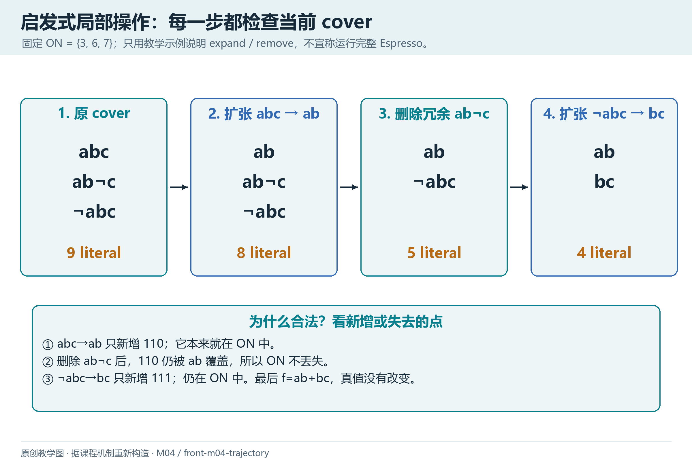{width=100%}

原 $a'bc=011$ 只盖 3；扩大为 $bc=-11$ 盖 {3,7}，新增 7 是 ON，所以合法。最终

$$C_3=ab+bc=b(a+c).$$

两级 SOP 代价是 2 项、4 literal。右边因式分解写成三文字，是多级表示的另一种代价口径，留到下一章比较；不要在同一条两级 SOP 代价曲线里突然把它记作 3。

| 状态 | cover | 项数 | literal 数 | 为什么合法 |
|---|---|---|---|---|
| 起点 | $abc+abc'+a'bc$ | 3 | 9 | 给定函数 |
| 扩大第一项 | $ab+abc'+a'bc$ | 3 | 8 | 仅新增 ON 点 6 |
| 删冗余项 | $ab+a'bc$ | 2 | 5 | 点 6 仍被 ab 覆盖 |
| 扩大第二项 | $ab+bc$ | 2 | 4 | 仅新增 ON 点 7 |

本例最后结果碰巧可以证明为最小：合法 PI 只有 $ab$ 和 $bc$，点 6 只能由前者覆盖，点 3 只能由后者覆盖。一般启发式停止时未必能给出这样的全局最优证明，不能把这个小例子的结论推广到所有输入。

**停一下 · m04-step-4**

用最终式算 abc=011、110、010 的输出，并说明第三行为什么特别值得查。

先写在纸上，再到附录A核对。

### 第5步 · Reduce：为什么有时先把代价变差

**现在做**：从 ab+bc 出发，把 ab 缩成 abc′；先确认被删掉的点 7 是否仍由另一项覆盖。

把 $ab$ 从 {6,7} 缩到 $abc'$ 的 {6}，少掉的点 7 仍由 $bc$ 覆盖，因此 $abc'+bc$ 与原函数等价。代价从 4 literal 暂时回升到 5。

这一步说明 reduce 的目标不是立即缩短公式，而是改变 cube 的形状，为后续不同扩张创造机会。本小例子再 expand 很可能回到 $ab+bc$，并没有实际收益；我们保留这个“没赚到”的结果，避免制造“每次 reduce 都会找到更好解”的错觉。

启发式完整实现需要选择下一步、保存当前最优解、判断是否继续。即使当前工作解暂时变差，也应保留已发现的 4-literal 解。模拟退火的接受较差解是另一套带温度和概率的搜索机制；不能把任何暂时增大的 reduce 操作都叫模拟退火。

**停一下 · m04-step-5**

把 ab 缩成 abc，保留 bc，其余不变，是否合法？

先写在纸上，再到附录A核对。

### 第6步 · 用一个互相依赖的反例学会逐项复查

**现在做**：写 c1=ab、c2=ac、h=ab′c+abc′。分别删 c1、删 c2，再尝试两者一起删，并检查 111。

考虑 cover $C=c_1+c_2+h$，其中 $c_1=ab$、$c_2=ac$、$h=ab'c+abc'$。$h$ 覆盖点 5、6，两个大项分别还覆盖点 7。

单独删 $c_1$ 合法：点 6 由 $h$ 覆盖，点 7 由 $c_2$ 覆盖。单独删 $c_2$ 也合法：点 5 由 $h$ 覆盖，点 7 由 $c_1$ 覆盖。然而把二者一起删，只剩 $h$，在 111 输出 0，漏掉点 7。

因此“每项单独在原 cover 中冗余”不能推出“它们可以同时删除”。正确流程是删一项就更新 cover，再对下一项重新检查。考试里写出这个反例，比只说“算法要迭代”更能证明你理解了机制。

**停一下 · m04-step-6**

如果先删 c1，再在更新后的 cover 中检查 c2，c2 还冗余吗？

先写在纸上，再到附录A核对。

### 合上示范，检查是否学会

**m04-exit**

独立重做 9→8→5→4 轨迹。每个箭头必须写：修改的 cube、增删的输入点、ON/OFF 检查、前后 literal 数。再解释“无冗余”为什么不等于“最优”。

**接下来**：在实验中先预测某个 literal 能否删除，再点操作。若只会看数字下降，回到 OFF 检查；若能解释所有箭头，进入多级综合，明确“项数、literal、门数、延迟”各自的口径。

## 为什么不用穷举解决所有问题

QM 先产生候选 PI，再解决覆盖选择。变量变多时，真值表、PI 数与选择组合都可能迅速增长。启发式方法不承诺枚举所有可能，而是在合法覆盖之间移动：把一份 cover 看成一个状态，literal 数等看成成本，把一次允许的修改看成边。这就是 configuration graph。顶点必须是合法实现；非法低成本表达没有资格参加比赛。

在只保留改进方向的图中，没有可继续改善的相邻解就是局部最优；全局最优要求所有可行解都没有更小成本。两者取决于邻域定义。只允许“直接删一整项”时的局部最优，可能通过先 reduce 再 expand 到达更好解。允许成本持平边时还要处理平台与循环，不能把“出度为 0”脱离课程画图规则随意推广。

可以类比整理行李：直接丢东西不可能减少必需品，但重新打包能让空间更省。类比边界是电路中每一次改动都有逐输入的功能约束，不能凭直觉宣布“差不多”。工业工具的搜索顺序、停止条件和成本模型更复杂；此章演示的是 L25 的局部操作与合法性论证，不声称完整实现 ESPRESSO。

## 三种修改的严格条件

设当前完全指定函数 $f=c+h$，h 是除当前 cube c 外其余项的和。**Remove** 把 c 整项删掉，得到 h；合法当且仅当 $c\subseteq h$，即 $h|_c\equiv1$。一定要先从 h 里拿掉 c，否则拿 $f|_c$ 检查永远为真，会错误地证明所有项都可删。

**Expand** 删除 c 中一个 literal。若原项为 $c=lq$，新项为 q，则增加的区域是 $\bar lq$。完全指定函数上合法当且仅当 $\bar lq\subseteq h$，也等价于 $q\subseteq f$。后一个条件可用 $f|_q\equiv1$ 检查。若有 D，要求新区域不碰 off-set，已有实现值在 D 上改变仍合法；这时不要强求新旧完整真值表在 D 上相同。

**Reduce** 给 c 加一个 literal l，变成 cl，移走的区域是 $c\bar l$。完全指定情况下必须有 $c\bar l\subseteq h$；有 D 时只要被移走的必需 on-set 点仍被其他项覆盖。缩小会增加此项 literal 成本，却可能调整其他项的可扩张边界、制造新的共享或冗余。

三步的共性是“只检查新增/移走区域”，不是每次从头猜一个函数。做题时写清 c、h、新项与待证 cofactor，是最稳的得分结构。来源：L25 PDF pp.39–40。

## 完整示范：从三个点到两个大 cube

取三变量函数 $f=abc+ab\bar c+\bar abc$，on-set 为 {3,6,7}，没有 D。初始 cover 有 3 项、9 literal。

第一步扩张 $abc\to ab$。新增区域是 $ab\bar c$，它已由其他项覆盖；也可算 $f|_{a=1,b=1}=c+\bar c+0=1$，所以合法。覆盖变成 $ab+ab\bar c+\bar abc$，literal 暂时从 9 降到 8。

第二步删除 $ab\bar c$。此时其余项 h 包含 ab，固定 a=1,b=1,c=0 时 $h=1$，合法。成本变成 2 项、5 literal。

第三步扩张 $\bar abc\to bc$。$f|_{b=1,c=1}=a+0+\bar a=1$，所以合法。得到 $f=ab+bc$，2 项、4 literal。若尝试再把 ab 扩张成 a，取 100 时新式为 1、原式为 0，失败；若扩张成 b，取 010 即失败。给反例比写“不是恒真”更有说服力。

再演示一次合法 reduce：把 ab 缩成 $ab\bar c$。被移走的 abc 仍被 bc 覆盖，所以合法，得到 $ab\bar c+bc$，5 literal。它本身没有改善成本，只展示允许的反向移动；不能把“reduce 有时帮助搜索”误写成“每次 reduce 必然改善”。最后穷举八个点验证所有合法中间步骤保持 {3,6,7}。

## 关键反例：分别可删，不能一起删

令 $c_1=ab$、$c_2=ac$，其余项 $h=a\bar bc+ab\bar c$，所以 $f=c_1+c_2+h=a(b+c)$。单独删除 $c_1$ 时，其独有区域 $ab\bar c$ 已在 h 中，公共区域 abc 仍由 $c_2$ 保留；因此合法。单独删除 $c_2$ 时同理，它独有的 $a\bar bc$ 由 h 保留，公共区域 abc 仍由 $c_1$ 保留。

但若同时删去两者，只剩 h，输入 111 时 h=0 而原 f=1。因此结论是：**各自针对原 cover 的删除证明不能直接叠加**。如果顺序删除，做第二次判断时必须使用第一次修改后的 cover，重新构造“其余项”。同样的问题也会出现在分别删除两个 literal 的扩张操作中：各自增加的集合合法，不代表一次删除两者引入的更大交叉区域也合法。

这正是训练题喜欢要求“分别、同时”的原因；它考的是逻辑量词与当前状态。调试算法时保存每步 cover、成本与失败反例，能够定位究竟是修改逻辑错了，还是拿了过期的证明。把合法性写成纯函数并在小 n 上做穷举，是比观察最终式子更可靠的程序验证方式。

## 怎样高效做恒真检验

要证明 $c\subseteq f$，固定 c 中全部 literal 使其为真，剩下的函数必须恒为 1。若它不是显然的 $x+\bar x$，再任选剩余变量 x 分成两个 cofactor，两个都为 1 才通过。任一分支变成 0 或出现使输出 0 的输入，就给出了反例。递归求值树与 BDD 是同一个 Shannon 思想的两种组织方式。

若 f 对 x positive unate，则 $f_{x=0}\subseteq f_{x=1}$，要证明恒真只需证明更小的 $f_{x=0}$ 恒真；negative unate 时检查 $f_{x=1}$。这是有前提的剪枝，不能凭表达式看起来“正项多”就套用。例：$f=x+y+\bar y$，两个分支都恒真；但 $g=x+y$ positive unate，检查 x=0 后得到 y，不恒真，反例 x=0,y=0。

SOP 中出现包含某变量的正负项，不自动证明 binate，因为表达式可能冗余。函数属性要靠 cofactor 比较。对于条件受限输入，还需明确恒真是在整个 $B^n$ 还是允许域上；若假设输入约束 A，则要检验 $A\Rightarrow(f=g)$，而不是无限制地删掉边界情况。

## 方案比较与验收

问题同为求成本小的合法 cover：基线是 QM 完整候选加精确覆盖；替代是启发式局部搜索。前者可在完成搜索时提供指定成本最优证据，但组合爆炸；后者可较早得到好解，且可在预算用尽时返回当前可行结果，但需要承认没有全局最优保证。公平比较应使用同一 F/D、同一成本、相同计算预算，并把“最优性缺口未知”写出来。

课程配置图只是某个邻域下的示意，不代表某工具的实测运行轨迹。要验证程序，先检查每个顶点覆盖 F、不碰 R，再检查每条边确实对应允许修改，最后检查成本变化。局部最优性还需检查全部允许邻居，而不只是运行中恰好访问过的邻居。独立题应能同时交出“判定结果、cofactor 过程、反例或恒真证明”。若仅会背三个操作名，尚未达到补考做题水平。

## 练习：先作答，再查附录

### m04-q1 · 补全 · 2 分

测试是否可以从 f=c+h 中删去 c，应检查 f|c 还是 h|c？为什么？

### m04-q2 · 独立 · 3 分

对 f=abc+ab c'+a'bc，证明 abc 可以扩张成 ab，并报告最终 ab+bc 的 literal 数。

### m04-q3 · 独立 · 3 分

把 ab+bc 中 ab 缩小为 ab c' 是否合法？给出被移走区域和覆盖者。

### m04-q4 · 独立 · 4 分

在 f=ab+ac+ab'c+abc' 中，分别删除 ab、ac 是否可行？同时删除呢？

### m04-q5 · 迁移 · 4 分

一个启发式程序只测试了 3 个邻居就宣布局部最优，你要求它补充什么？

### m04-q6 · 迁移 · 4 分

设计一个针对 cube 删除程序的小规模验证器，不需写具体语言。

## 本章来源

- L25：2025-10-31；I.4，印刷 pp.34–36 / PDF pp.38–40；多输出操作 PDF p.35
- T25：Tutorial 3 P2、P3，PDF pp.28–29、34–37
- F087：2020 exam，Problem 1g，PDF p.7
- F088：2021 exam，Problem 2a，PDF p.5
- SIS92：Berkeley UCB/ERL M92/41元数据页；仅作L25提及工具的背景，不据此声称复现


# 05 多级逻辑与函数分解

从提取公共表达式到压缩 bound variables 的信息

**关键问题**：为什么两个 LUT 中间的线数由不同余函数的数量决定，而不是由原来的 minterm 数决定？

**学习目标**

- 画 Boolean network 并识别 fanin/fanout/reconvergence
- 用等价类构造 h 与 g，使 f(x,y)=g(h(x),y)
- 计算最少编码位和有利分解条件
- 区分逻辑共享的 literal 节省与实际时序成本

**先修**：m02、m03；**横向联系**：m04、m06、m07。

## 图解跟做：真的搭出共享结构：从 ab+ac 到一个中间信号

约50分钟。亲手比较两种门图，并用四列余函数推导功能分解的中间位数，而不是只背“提公因式”。

准备纸笔，按下列步骤做。“停一下”题的答案见附录 A 对应编号；不需要另开资料。

### 第1步 · 按原式逐个造门，建立有具体成本的基线

**现在做**：写 f=ab+ac；画两个 AND 分别输出 u=ab、v=ac，再画 OR 输出 f=u+v。

先规定比较资源：只允许普通两输入 AND/OR，每门面积 1 单位、延迟 1 单位，线延迟忽略；输入 a、b、c 同时可用。这个口径使手算可复查，但不代替工艺库测量。

基线需要两个 AND 和一个 OR，共 3 门。任一输入到输出都经过“AND→OR”两级。式子中 a 出现两次，b、c 各一次，共 4 literal。信号 a 分到两个门的输入，即扇出为 2。

先算几个输入确保自己读懂电路：000→0；001 时 a=0，两个 AND 都为 0，故输出 0；101 时 $ab=0,ac=1$，输出 1；110 时 $ab=1,ac=0$，输出 1；111 时两项均为 1，OR 结果仍是 1。完整 ON 集是 {5,6,7}。

如果题目允许任意三输入 LUT，整个三变量函数本来就能装进 1 个 LUT；那是另一个资源模型，不能拿来与本段的两输入门数直接比较。

**停一下 · m05-step-1**

基线为什么是 3 个门、2 级，而不是 3 级？

先写在纸上，再到附录A核对。

### 第2步 · 把重复条件提出来，并给共享量命名

**现在做**：在 ab、ac 中圈出共同的 a，写 f=a(b+c)。令 z=b+c，再画 z 与 a 相与。

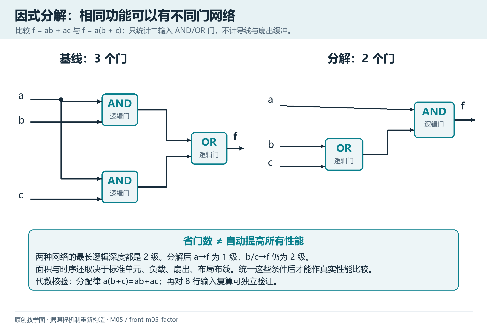{width=100%}

利用布尔代数的分配律 $ab+ac=a(b+c)$，定义中间节点 $z=b+c$，则 $f=az$。新结构是一个 OR 接 b、c，输出 z，再由 AND 接 a、z。

资源现在为 2 门，literal 出现 3 次。a 到输出只经过末级 AND，为 1 级；b、c 仍经过 OR→AND，为 2 级。最长路径没有从 2 降到 1。因此正确结论是：在相同理想门模型下减少 1 门，最长逻辑深度不变，a 的路径缩短。不能笼统写“面积和速度都提高”。

对于真实单元库，AND 与 OR 延迟可能不同，负载也改变；共享节点还可能增加扇出或线路开销。因此这里只证明代数等价和模型内代价，不宣称真实芯片一定更快。共享的好处需要带着负载、布局和可用单元一起验证。

**停一下 · m05-step-2**

若 a 比 b、c 晚到 5 ns，而每个门延迟 1 ns，两种结构输出最迟何时稳定？输入 b、c 在 0 ns 到达，忽略线延迟。

先写在纸上，再到附录A核对。

### 第3步 · 把提因式写成可检查的代数除法

**现在做**：用 divisor a 去除 ab+ac，写出 quotient、remainder，并把乘回去验证。

代数除法的形式是 $f=dq+r$。本例选 divisor $d=a$，quotient $q=b+c$，remainder $r=0$。检查不是看着像，而是把 $a(b+c)+0$ 重新分配成 $ab+ac$，与原 cover 的项一一相符。

因为 $b+c$ 已经没有同时出现在所有项中的非平凡 cube 因子，它是 cube-free。于是按 kernel 的课程定义，$b+c$ 是本例的一个 kernel，而把它乘回原式的 cube $a$ 是对应 co-kernel。术语背后就是两件具体事：找一个能提出的 cube；提出后剩下的商不再能整体提同样的公共 cube。

做一个带余项的变式：$f=ab+ac+d$，仍以 $a$ 除，商为 $b+c$，余项为 $d$；实现为 $z=b+c$、$f=az+d$。余项不能丢，否则在 a=b=c=0、d=1 时就从 1 变成 0。代数除法处理项的结构，有些布尔等价化简依赖互补/吸收等规律，不能一概当成普通代数多项式除法。

**停一下 · m05-step-3**

对 ab+ac+d 用 a 除，如果有人写 quotient=b+c+d、remainder=0，用哪个输入能立刻证伪？

先写在纸上，再到附录A核对。

### 第4步 · 不看因式分解，单靠余函数也能发现中间量

**现在做**：把 b、c 作为 bound set，a 作为 free variable。依次固定 bc=00、01、10、11，写出剩余关于 a 的函数。

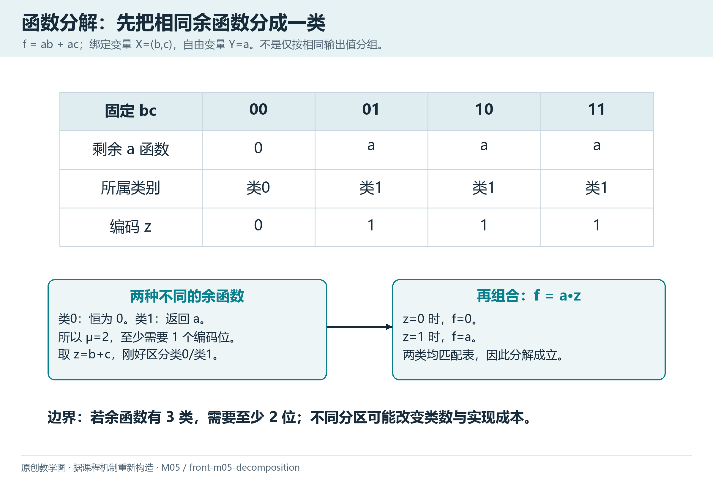{width=100%}

功能分解询问：能否用一个较小的中间编码 $z=h(b,c)$，再由 $g(a,z)$ 算出原函数？先按 bound set 的每个取值计算 cofactor：

| 固定 bc | 代入 ab+ac | 剩余的 a 函数 | 等价类别 | z |
|---|---|---|---|---|
| 00 | $a0+a0$ | 0 | 类 0 | 0 |
| 01 | $a0+a1$ | a | 类 1 | 1 |
| 10 | $a1+a0$ | a | 类 1 | 1 |
| 11 | $a1+a1$ | a | 类 1 | 1 |

四列输入并不需要四种不同信息；只有 2 个不同余函数：恒 0 与 a。因此 $\mu=2$，最少中间位数为 $\lceil\log_2\mu\rceil=1$。这一步数的是**不同函数的个数**，不是输入组合数 4，也不是输出为 1 的列数 3。

把“余函数为 0”编码为 z=0，把“余函数为 a”编码为 z=1，直接读出 $h(00)=0$，其余为 1，所以 $h=b+c$。这正好重新发现了前面的共享量。

**停一下 · m05-step-4**

为什么不能把 bc=00 和 bc=01 编进同一类？请给一个 a 的值说明它们必须可区分。

先写在纸上，再到附录A核对。

### 第5步 · 填满两张小表，验证分解没有丢信息

**现在做**：写 h 的四项表，再写 g 的四项表。用输入 101 与 100 依次通过 h→g。

前级 $h(b,c)=b+c$ 的表已由上一步得到。后级需要满足 z=0 时输出恒 0、z=1 时输出 a，所以 $g(a,z)=az$：

| b | c | h(b,c)=z |
|---|---|---|
| 0 | 0 | 0 |
| 0 | 1 | 1 |
| 1 | 0 | 1 |
| 1 | 1 | 1 |

| a | z | g(a,z) |
|---|---|---|
| 0 | 0 | 0 |
| 0 | 1 | 0 |
| 1 | 0 | 0 |
| 1 | 1 | 1 |

走输入 101：bc=01，前级得 z=1；后级看到 a=1、z=1，输出 1。走 100：bc=00，前级 z=0；后级输出 0。其余六行同样检查，可证明 $f(a,b,c)=g(a,h(b,c))$。

若用普通两输入单输出 LUT 表示，每张表占一个 LUT，所以分解结构用 2 个 LUT。若原样按两个 AND 与一个 OR 映射则用 3 个这样的 LUT。若允许一个三输入 LUT，原函数可直接用 1 个；比较时必须固定 LUT 输入数与输出能力。

**停一下 · m05-step-5**

如果把两类的 z 标签对调：bc=00 编 1，其余编 0，函数分解还成立吗？后级怎样改？

先写在纸上，再到附录A核对。

### 第6步 · 用失败案例说明分解的适用边界

**现在做**：把原函数换成 f=a⊕b⊕c，仍固定 bc，试着写四个余函数，不要沿用 z=b+c。

异或变式在 bc=00、01、10、11 下的余函数依次为 $a,a',a',a$，仍只有两类，所以仍只需 1 位中间量。但分类与本例不同：00 和 11 应同类，01 和 10 应同类。因此可选 $z=b\oplus c$，后级 $g=a\oplus z$。

如果照抄 $z=b+c$，bc=01 与 bc=11 都会给 z=1，却对应不同余函数，后级就丢了必要信息。例如 a=0 时，001 的输出应为 1，而 011 的输出应为 0；错误编码不能区别它们。

所以功能分解的实际步骤是：选 bound/free 划分 → 求余函数 → 按完全相等分类 → 编码 → 构造后级 → 全部输入检查。提因式是容易看见共享的一条途径，余函数分类则能发现更一般的逻辑共享。

**停一下 · m05-step-6**

本例与异或变式都有 μ=2，是否意味着它们的中间函数相同？

先写在纸上，再到附录A核对。

### 合上示范，检查是否学会

**m05-exit**

不看示范，交出 f=ab+ac 的两张门图、固定 bc 的余函数表、h/g 表，并用一句话说明为何“3 门变 2 门”不能直接写成“时延减少三分之一”。

**接下来**：把“同一个余函数只保存一次”的想法带到 BDD。下一章会把相同子函数直接合并成共享节点，并观察变量顺序如何改变需要同时记住的信息。

## 两级最优并不是所有电路结构里的最优

SOP 的两级结构是“若干 AND 后接 OR”，它的好处是表示和覆盖关系清楚。多级逻辑允许中间子函数被后级重复使用。一个组合 Boolean network 是有向无环图：输入节点、内部函数节点、输出节点，边表示信号依赖。fanin 是直接前驱，transitive fanin 包含所有祖先；fanout 是输出被多少后继使用；reconvergence 是分叉的信号又在后面汇合。

例：$y=ab+ac+db+dc=(a+d)(b+c)$。展开 SOP 有 8 次输入 literal 出现，因式表达有 4 次。若库允许 OR、AND，每项的实现门和层数都要根据目标结构重数，而不是简单以“字符串变短”判断速度。共享中间信号 $t=b+c$ 能减少重复逻辑，但驱动多个目的地会增加负载。拓扑图的边是功能依赖，不自带固定延迟。

来源 L25 PDF pp.41–42 将多级综合目标表述为更少门/literal、较好的 fanin/fanout。它没有保证每一次提因子都降低关键路径。将软件的公共子表达式消除类比到这里很直观，边界是软件常按指令顺序复用计算，而组合电路各级同时响应变化，共享的传播延迟与物理扇出必须另外评估。

## 函数分解：只向后级传递真正需要区分的信息

把输入分成 bound variables $x$ 与 free variables $y$，希望写成 $f(x,y)=g(h(x),y)$。h 只能看 x，输出 z；g 看 z 与原来的 y。对每个固定 x，f 变成关于 y 的余函数 $f_x(y)$。若两个 x 值产生完全相同的余函数，它们对后级来说不可区分，可以用同一个 z 编码；若余函数不同，就绝不能共用编码，否则 g 无法还原差别。

设不同余函数数量为 $\mu$，至少需要 $r=\lceil\log_2\mu\rceil$ 个中间比特，因 r 比特最多编码 $2^r$ 种情形。这是对该固定分区、完全指定函数的最少信息宽度。要实现课程所说的“有利分解”，还要求 $r<|x|$，即 $\mu\le2^{|x|-1}$。能够写一个 h 不表示必然减少逻辑：h=x 总是可以，却没有压缩。

这很像对后续处理足够的“摘要”：两份输入只要对所有后续 y 都产生同样反应，就能共用摘要。但摘要必须对**所有** y 保真，而不是对当前采样的 y 看起来相同。构造分解表时把每列视为一整个向量，不能只比较某一行。来源：L25 PDF pp.43–47。

## 完整示范：3 位 bound 输入压成 2 位

原创例子：$x=(a,b,c)$、自由变量为 d，定义 $f=ab+ac+bc+d(a+b+c)$。固定 abc 后，只剩 d 的函数：000 对应常量 0；001、010、100 对应 d；011、101、110、111 对应常量 1。按 d=0、1 写向量分别是 (0,0)、(0,1)、(1,1)，因此 $\mu=3$，最少 $r=2$ 位，满足 $2<3$。

选择编码如下：余函数 0 用 z1z0=00，余函数 d 用 01，余函数 1 用 11。于是可以构造：

$$z_1=h_1(a,b,c)=ab+ac+bc,\qquad z_0=h_0(a,b,c)=a+b+c.$$

后级 $g(z_1,z_0,d)=z_1+z_0d$。检查三类：00 时恒 0；01 时等于 d；11 时恒 1。编码 10 不会由 h 产生，所以 g 在这一内部码上可按 don’t-care 处理；本例 g(10,d)=1，是一种合法选择。若测试或系统接口允许外部强制 z=10，它是否仍可不关心必须重新看规范，不能把内部不可达默认变成所有模式下不可达。

画图时先画 a,b,c 进入 h1/h0，输出两根线 z1,z0，再让 z 与 d 一起进入 g。验证不要只画箭头：枚举 abc 的 8 值，并对 d=0/1 共 16 个输入检查 $g(h(x),d)=f(x,d)$。一共 3 种余函数是证据，2 位是信息论下界，所给 h/g 是达到下界的构造。这三个结论一起才算完整答案。

## 编码选择、LUT 容量与 BDD 切割的联系

给等价类分配不同编码，不改变 $\mu$，但会改变 h 的表达式和 g 的表达式。正文编码让 z0 等于 OR、z1 等于 majority；若把常量 1 类改为 10，h/g 可能更复杂或更简单，要实际化简才知道。不同余函数必须有不同码；相同余函数允许分配多个码，只是通常不会减少最少位数，有时可让 h 更便宜。L25 PDF p.46 展示了这种编码取舍。

若目标是单输出 k-LUT，一块 LUT 能实现不超过 k 个输入的任意函数，但多输出 h 的每一位通常需要独立 LUT（除非器件明确支持特殊双输出结构）。本例 h1、h0 各需一个 3 输入函数，g 也是 3 输入函数，因此按普通单输出 3-LUT 模型需三块 LUT，不能把“h 画成一个盒子”误算成一块 LUT。原函数有四个变量，不能直接放进一个普通 3-LUT。

若 BDD 的变量顺序先 x 后 y，在 x 层后切开，每种可达的剩余子函数对应一个等价类。统计时要包括越过某些变量的边和直接到达的常量终端；只数某一横排画了几个圆圈可能漏掉余函数。BDD 提供分区探索方法，但选择能同时优化线宽、LUT 数与延迟的分区仍需成本评估。

## 深入选学：代数除法、kernel 与 co-kernel

本节帮助连接真实多级综合；十天主线先掌握前面功能分解，不要求把 kernel 枚举当作当前讲义新增必考内容。代数除法试图将一个 SOP 表示写成 $f=pq+r$，在项集合和 literal 的形式结构上寻找可提取因子；它比允许全部布尔恒等变换的布尔分解限制更强。

原创例：$f=ab+ac+db+dc+e$。以 cube a 作除数，能被 a 整除的项给商 $b+c$，余项是 $db+dc+e$。商 $b+c$ 没有共同的非平凡 cube 因子，称为 cube-free，因此是一个 kernel；a 是得到它的 co-kernel。同一个 kernel 也能由 co-kernel d 得到。将这两个共同商合并，可写 $f=(a+d)(b+c)+e$。

kernel 是“用单个 cube 作代数除法得到的 cube-free 商”，co-kernel 是对应的 cube 除数；不要与 cofactor 混淆。cofactor 固定变量值，会把含相反 literal 的项消为 0，并不等于取某些项的除法商。比如 $f=ab+\bar ac$，对 a=1 的 cofactor 为 b；但这只是一个巧合式相似，不是两种运算在所有表达式上相同。

原始扩展阅读：[Brayton 等，Multilevel Logic Synthesis](https://people.eecs.berkeley.edu/~alanmi/publications/other/multi_level.pdf)，Proceedings of the IEEE，1990，§IV.D（印刷 p.272 / PDF p.9）的 kernel 定义与代数方法；2026-11-08 核对该部分。该引用用于方法定义，不把论文历史实验数字当成本网站的性能实测。本文例题是自拟，计数与推导可独立核验。

## 公平比较与失败反例

案例问题是压缩前级传给后级的信息。基线直接传全部 x；机制按相同余函数分组；证据是完整分解表；成本包括 h 的逻辑、z 线数、g 的 fanin 和额外级数；适用条件是 $\mu$ 足够小且新结构满足目标库约束。反例：若每个 x 产生不同余函数，$\mu=2^{|x|}$，最少 r=|x|，没有输入宽度收益。即使 r 小，复杂 h 也可能让最长路径变差。

比较面积与延迟必须固定同一库、同一输入到达时间、同一输出负载和同一时序约束。站内用 literal 或理想 LUT 数的估算只回答该抽象模型的问题。能力验收是拿到一个分解表，能找等价列、算 r、编码、画 h/g、填 LUT 表并用原输入复算。若只会说“用 BDD 可以分解”，还无法完成课程的构造题。

## 练习：先作答，再查附录

### m05-q1 · 补全 · 3 分

4 个 bound 变量产生 5 种不同余函数，最少需几位中间编码？

### m05-q2 · 独立 · 3 分

正文例子 abc=010、d=1 时，求 z1,z0 与输出，并用原式复核。

### m05-q3 · 独立 · 3 分

为什么不能把余函数 d 和常量 1 编成相同的 z？

### m05-q4 · 迁移 · 3 分

某人将正文 h=(h1,h0) 画成一个盒子，宣称总共只需两块单输出 3-LUT。找出资源计算问题。

### m05-q5 · 独立 · 4 分

对 f=ab+ac+db+dc+e，写一组 kernel/co-kernel 和因式分解，并说明它不是 cofactor。

### m05-q6 · 迁移 · 4 分

设计一个检验候选分解 h/g 是否正确的办法，并说明仅检查全部 z 编码为什么可能不够。

## 本章来源

- L25：2025-10-31；I.5，印刷 pp.37–43 / PDF pp.41–47
- T25：Tutorial 4 P4，印刷 p.40 / PDF p.42；解答 PDF p.52
- F089：内页 DMA 2022（文件名21_retake_exam）；Problem 1d/1f，PDF pp.3–4
- MULTILEVEL90：1990-02；§IV.D，印刷p.272 / PDF p.9，kernel/co-kernel定义与Table 1；深入选学


# 06 ROBDD：共享余函数的决策图

会建图、会约简、会从图读 SOP/POS，也会承认变量序的代价

**关键问题**：为什么同一变量序下的最简决策图可以判等价，而换变量序后节点数会改变？

**学习目标**

- 按指定变量序从 cofactors 构造 OBDD
- 使用删除无效测试与合并同构子图两条规则
- 由到1/到0的路径写 SOP/POS并求 cofactor
- 用明确计数口径比较变量序与功能分解

**先修**：m02；**横向联系**：m04、m05、m11。

## 图解跟做：把四位相等判断画成两张不同大小的 ROBDD

约60分钟。从余函数实际造出 9 节点与 6 节点两张图，能逐边追踪输入，并解释为什么只是换顺序就能共享更多结构。

准备纸笔，按下列步骤做。“停一下”题的答案见附录 A 对应编号；不需要另开资料。

### 第1步 · 先写出要判断什么，再定好图的读法

**现在做**：写 f=(a XNOR c) AND (b XNOR d)，圈出要相等的两对变量；把满足条件的四个输入列出来。

我们判断两个二位字 $(a,b)$ 与 $(c,d)$ 是否相等：第一对要 $a=c$，第二对要 $b=d$，两对都满足才输出 1。XNOR 即“相等为 1”，写成

$$f=(a\leftrightarrow c)(b\leftrightarrow d).$$

仍以固定输入记号 $abcd$ 编号，ON 为 0000、0101、1010、1111，即 $\{0,5,10,15\}$。其余十二行都是 0。例如 0101 中 a=c=0、b=d=1，所以为 1；0111 中 a≠c，所以为 0。

BDD 的每个内部节点询问一个变量，取 0 沿 low/0 边，取 1 沿 high/1 边，最后到终端 0 或 1。每条根到终端路径必须遵循给定变量序，但允许跳过无用变量。本文使用**无补边的 ROBDD**，节点计数不含终端 0、1。这个口径必须先说清，因为带补边的表示可能得到不同节点数。

**停一下 · m06-step-1**

变量顺序改成 a,c,b,d 后，原始输入 abcd=0101 会变成另一个输入吗？读图时实际依次测试哪几个值？

先写在纸上，再到附录A核对。

### 第2步 · 从底部造出两种 d 节点，并学会两条约简规则

**现在做**：画 D+：d=0→0、d=1→1；画 D−：d=0→1、d=1→0。再画一个两边都到 0 的临时 d 节点并删掉它。

如果前面已经知道 b=1，那么剩下条件 b=d 就要求 d=1，余函数为 d，使用节点 D+。若 b=0，则要求 d=0，余函数为 $d'$，使用节点 D−。

| 节点 | 测试变量 | low：变量=0 | high：变量=1 | 表示函数 |
|---|---|---|---|---|
| D+ | d | 0 | 1 | d |
| D− | d | 1 | 0 | $d'$ |

约简规则一：若一个节点两条边指向同一个子图，它的测试没有影响，直接用那个子图替代它。例如 a≠c 已经使 f=0，再问 d 无论取什么都为 0，这个 d 节点应删除。

约简规则二：如果两个节点具有完全相同的三元组“变量、low 子节点、high 子节点”，它们代表同一个余函数，合并成一个共享节点。例如多个分支最后都要求 d=1，就全都指向同一个 D+。只看节点变量同为 d 还不够：D+ 与 D− 的两条边相反，绝不能合并。

实际画图建议自底向上做：先确定子图，再比较三元组，避免同名但不同功能的子图被误合并。

**停一下 · m06-step-2**

一个 c 节点 low=D+、high=D+，约简后是什么？另一个 c 节点 low=0、high=D+ 能一起合并吗？

先写在纸上，再到附录A核对。

### 第3步 · 按 a,b,c,d 顺序建图：先记住 a、b，再核对 c、d

**现在做**：先列四种已固定的 ab，每种写出关于 c、d 的余函数；据此造四个 c 节点。

按 a,b,c,d 询问时，在到达 c 之前已经遇到四种 ab，必须保留它们的不同要求：

| 已知 ab | 要求 cd | 剩余函数 | c 节点 low | c 节点 high |
|---|---|---|---|---|
| 00 | 00 | $c'd'$ | D− | 0 |
| 01 | 01 | $c'd$ | D+ | 0 |
| 10 | 10 | $cd'$ | 0 | D− |
| 11 | 11 | $cd$ | 0 | D+ |

四行的 low/high 组合都不同，因此需要四个不同 c 节点，记为 C00、C01、C10、C11。a=0 分支下有一个 b 节点 B0：low→C00、high→C01；a=1 分支下的 B1：low→C10、high→C11。B0 与 B1 不同，不能合并。根 a 节点 low→B0、high→B1。

逐层计数：a 层 1 个、b 层 2 个、c 层 4 个、d 层共享后 2 个，总共 $1+2+4+2=9$ 个非终端。这里不是说整个未经约简的二叉树只有 9 个节点，而是已经应用两条规则之后的 ROBDD 有 9 个。

**停一下 · m06-step-3**

为什么 C00 与 C01 都在 a=0 分支、都对 c=1 输出 0，却仍不能合并？

先写在纸上，再到附录A核对。

### 第4步 · 改成 a,c,b,d：立刻完成一对比较，再共享剩下的一对

**现在做**：令 E=(b XNOR d)。先画 E 的 b 节点，再把 a=0、a=1 对 c 的要求接到同一个 E。

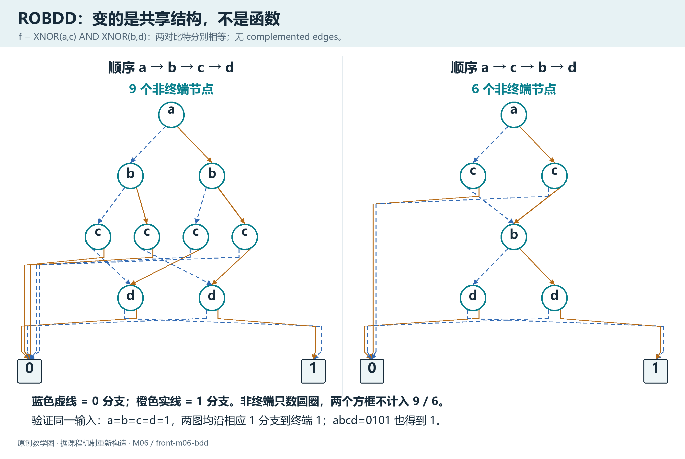{width=100%}

先把第二对比较独立画出来：E 的根测试 b；b=0 时去 D−，b=1 时去 D+。这部分只需 1 个 b 节点加 2 个 d 节点，共 3 个。

根测试 a：若 a=0，接下来 c 必须为 0，于是 c 节点 C0 的 low→E、high→0；若 a=1，c 必须为 1，于是 C1 的 low→0、high→E。两条“第一对相等”的路径都指向同一个 E；一旦第一对不等就直接到 0，不必再问 b、d。

| 节点 | 测试 | low/0 | high/1 |
|---|---|---|---|
| A | a | C0 | C1 |
| C0 | c | E | 0 |
| C1 | c | 0 | E |
| E | b | D− | D+ |
| D− | d | 1 | 0 |
| D+ | d | 0 | 1 |

所以非终端节点数为 $1+2+1+2=6$。直觉上，交错顺序先把 a 与 c 配对处理，匹配后就可以忘记它们的具体值，只保留“第一对已通过”。而分组顺序在核对 c、d 之前需要区别多个 a、b 历史，所以中间余函数更多。这个解释基于本例结构，不是所有函数都该按同一种顺序排。

**停一下 · m06-step-4**

6 节点图里 C0 与 C1 为什么不能继续合成一个 c 节点？

先写在纸上，再到附录A核对。

### 第5步 · 用具体输入逐边走，再用全表验证

**现在做**：用铅笔在两张图中追踪同一个输入 abcd=0101，旁边逐条记录节点名和边值。再换 0111。

输入 0101 的含义始终是 a=0、b=1、c=0、d=1。在 a,b,c,d 图中路径是 A→B0→C01→D+→1，依次取边 0、1、0、1；在 a,c,b,d 图中路径是 A→C0→E→D+→1，依次取边 0、0、1、1。两条路径顺序不同，最终结果相同。

再输入 0111：第一张图走 A 的 0 边、B0 的 1 边，到 C01 时 c=1，直接进 0；第二张图从 A 的 0 边到 C0，c=1，同样直接进 0。d 未被测试，因为已经确定 a≠c。

一个正例和一个反例只能作为快速检查。要核验这个四变量教学模型，可枚举全部 16 个输入，让图的结果逐行等于 $(a=c)\land(b=d)$。判定图为 tautology（恒真）时，在已约简 ROBDD 中应只剩终端 1；本函数显然不是，因为 0001 就输出 0。

**停一下 · m06-step-5**

若从图根最终走到 1，一定测试了所有变量吗？本例走到 0 又是否可能提前结束？

先写在纸上，再到附录A核对。

### 第6步 · 把建图步骤转换为考试能用的判等方法

**现在做**：在两张图下分别写变量序和计数口径，再写一句“图形相同”可以推出什么、需要什么前提。

ROBDD 的规范性有条件：固定变量顺序、采用同样的终端与边表示、完成相同的约简后，同一布尔函数有唯一的图结构（节点画在纸上的位置与名称不重要）。因此，同序的两个已约简图可用结构同构判等价。

本例两图一个 9 节点、一个 6 节点，却表示相同函数，说明“节点数不同所以不等价”是错误的，因为变量序不同。把它们统一到相同变量序后再比较，或构造异或 $f\oplus g$ 并验证恒 0，才是有效思路。

也不要把“非终端减少 3 个”直接换算为真实门数减少 3 或运行时间快一半。BDD 是函数表示，节点数主要描述这个表示中的存储规模；实际算法时间还取决于操作、缓存、变量重排与输入函数。这里给的是明确模型内的精确计数，不是硬件或软件性能实测。

**停一下 · m06-step-6**

两个同序、正确约简的 ROBDD 一个 5 节点、一个 6 节点，是否可能表示同一个函数？如果一个允许补边而另一个不允许呢？

先写在纸上，再到附录A核对。

### 合上示范，检查是否学会

**m06-exit**

独立画出 a,c,b,d 顺序的六节点图，标清 0/1 边。再回答：为什么分组顺序需要四个 c 节点，而交错顺序只需要两个？最后跟踪输入 1010。

**接下来**：在 BDD 实验中先预测两种顺序的节点数再生成，检查是否使用补边、是否计入终端。然后学习状态机：状态也在保存必要的历史信息，但合并条件需要比较未来所有输入序列。

## 图中的一个节点究竟表示什么

BDD 的非终端节点表示“检查某个变量 x，若 0 走 low，若 1 走 high”。若子图代表函数 L 与 H，当前节点代表 $\bar xL+xH$，就是 Shannon 展开。0、1 终端代表常函数。图不是门级网表的直接同义词，而是一种精确的布尔函数表示；若把每个节点实现成 MUX，可以形成一种电路，但实际库映射还可能改写结构。

OBDD 的 ordered 要求所有从根到终端的路径按同一个变量顺序前进，允许跳过不依赖的变量，不能在一条路径反向或重复测试。不是要求每层每条路径都必须有一个节点。例如顺序 a≺b≺c 时，某条路径可以从 a 直接到 c，但不能从 c 回到 b。若题目给虚实线，先写清哪个表示 0、哪个表示 1；本章文本始终标 low=0、high=1。

画图时用“每个节点标变量、每条边标值、终端标常量”三条纪律。输入原式中的同名变量在图中可以对应多个不同节点，因为它们的剩余子函数不同；只有子图结构相同才可合并。来源：L25 PDF pp.48–49。

## 两条约简规则与规范性的前提

第一条规则：若某节点 low=high，结果与该变量无关，删除此节点，所有入边指向共同子节点。这来自 $\bar xg+xg=g$。第二条规则：若两个节点测试同一变量，low 相同且 high 相同，则它们代表相同子函数，合并为一个节点。要从底向上比较“变量、low、high”三元组，不能只看两个节点标签相同就合并。

把两条规则完全应用，得到 Reduced OBDD。**对于同一布尔函数、相同固定变量序、相同终端/边约定，ROBDD 在同构意义下唯一。** 这使等价检查可以归结为图相同或共享管理器中的根节点相同；若变量序不同，形状不同不能证明函数不同。若在不同软件管理器中，节点数字编号本身也不能直接比较。

常量 0 和 1 的 ROBDD 只需对应终端；无须为每个未使用变量保留一层。教学中常见“两个子节点函数看起来差不多”不能当合并依据：必须证明它们等价，或者已经在统一序下约简成同一个子图。Bryant 1986 原始论文的作者注释版给出这一规范表示结果；电子版附有历史勘误，本站不用其中历史实验规模推断现代工具性能。

## 完整示范：MUX 的两种变量序

取 $f=ab+\bar ac$。先用顺序 a≺b≺c。根 a 的 low 为 c、high 为 b；b 与 c 的 low=0、high=1。这已完全约简：三个不同非终端节点 a、b、c，共 3 个；若把常量终端也计入则共 5 个。不要在计数题里混用两个口径。

```text
a: low → c ; high → b
b: low → 0 ; high → 1
c: low → 0 ; high → 1
```

换顺序 b≺c≺a。b=0 时剩下 $\bar ac$，b=1 时剩下 $a+c$。第一支在 c=0 为 0、c=1 为 $\bar a$；第二支在 c=0 为 a、c=1 为 1。因此有：

```text
b : low → cL ; high → cH
cL: low → 0  ; high → aN
cH: low → aP ; high → 1
aN: low → 1  ; high → 0
aP: low → 0  ; high → 1
```

两个 a 节点的 low/high 互换，不能合并。于是非终端 5 个，连终端共 7 个。此计数**不使用 complement edges**；若工具采用补边，统计可能不同，不能据此说工具或手算错。功能仍相同，穷举八种输入可证。选择变量放前面使 MUX 分解自然，是这个函数的结构证据；并非“把名称叫 selector 的变量放最前总最优”的普遍定理。

## 从图读函数、余因子与反例

到达 1 终端的每条根路径给出一个乘积项：遇到 0 边写负 literal，遇到 1 边写正 literal，跳过的变量不写。把所有此类路径相加得到合法 SOP，不保证是 MinSOP。对上面 a 优先的图，到 1 的路径分别为 a=0,c=1 与 a=1,b=1，得到 $\bar ac+ab$。

到达 0 的路径描述补函数的 SOP：$\bar f=\bar a\bar c+a\bar b$。整体取反得到 $f=(a+c)(\bar a+b)$，这是 POS。常见错误是把到 0 的路径直接“相加”当成 f，或者取反时忘记把 OR 变 AND。每条路径本质是一个部分输入约束，不要求所有变量都有 literal。

求 $f|_{a=1}$ 时，在图中固定 a 选择 high，得到 b；求 $f|_{b=0}$ 时，即使 b 不是根，也要在所有出现 b 的可达节点走 low 后重新约简，得到 $\bar ac$。找到使函数为 0 的路径就是反例生成；找到使 $f\oplus g=1$ 的路径，就是 f 与 g 不等价的具体输入。不要只写“图不同”，最好交出输入与两个输出。

## 用 BDD 证明恒真，连接包含与分解

要证明函数恒真，可以递归检查 cofactors，或把它构造成 ROBDD 后检查根是否约简到 1。原创例 $h=(a+b)(a+\bar b)+\bar a$：a=1 时 h=1；a=0 时 $h=b\bar b+1=1$。根 a 的两支都为 1，删除根，最后只剩 1。也可以先用分配律得 $(a+b)(a+\bar b)=a$，再得 h=1；两种方法互为核验。

包含关系 $c\subseteq f$ 可用 $c\bar f=0$ 检查，也可固定 c 后证明 $f|_c=1$。等价关系用 $f\oplus g=0$。这些都是将复杂问题转成常量图判定，正是 m04 合法性检查与 BDD 的横向联系。

如果变量序先 bound x 后 free y，经过全部 x 判断后能够到达的不同剩余子图代表不同余函数。其数量 $\mu$ 决定 m05 中间编码的下界。但路径可能跳过变量或直接到常量，需要统计**所有穿过切面的边所指的不同剩余函数**，而不是只数图某一行的节点。图压缩与函数信息压缩共享同一个“相同余函数可以复用”的思想。

## 成本、异常与可验证的模型边界

ROBDD 不保证对所有函数都很小。某些变量序可能导致大量不同余函数，图膨胀；即使挑选变量序，某些函数仍有很大的表示。节点数较少也不等于实际门数、面积或延迟一定较少。构图算法还需要唯一表、缓存等管理结构，这些开销不会出现在手画图里。

一个可复现实验应固定函数、变量集和补边约定，只改变变量序；记录非终端节点数与完整真值表一致性。对常量函数期望 0 个非终端，对单变量函数期望 1 个，MUX 的上述两个顺序期望 3 与 5。这些是手算与边界验证，不是硬件性能基准。若节点数异常，先查没有删 low=high、没有共享相同三元组、错把边值交换、跨顺序使用缓存四类问题。

延伸来源：[R. E. Bryant, Graph-Based Algorithms for Boolean Function Manipulation](https://www.cs.cmu.edu/~bryant/pubdir/ieeetc86.pdf)，IEEE TC C-35(8)，1986，pp.677–691；作者注释电子版 PDF 28 页，阅读 §1–2（PDF pp.1–7）及变量序讨论，2026-11-08 访问。本文只借用机制与定理，示范计数为本课程自己推导。验收时应能闭卷完成给定顺序构图、约简、读式和反例，而不是仅记住“BDD 很快”。

## 练习：先作答，再查附录

### m06-q1 · 补全 · 2 分

某节点变量 x，low 与 high 都指向同一个子函数 g。约简后是什么？

### m06-q2 · 独立 · 2 分

对 f=ab+a'c，顺序 a≺b≺c、无补边时有多少非终端节点？

### m06-q3 · 独立 · 4 分

同一函数用 b≺c≺a 时有多少非终端节点？为什么 a 与 a' 的节点不能直接合并？

### m06-q4 · 独立 · 3 分

一张图到 0 的路径为 a=0,c=0 与 a=1,b=0。写原函数 POS。

### m06-q5 · 迁移 · 3 分

两个经过约简的 BDD 形状不同，可以断言函数不等价吗？给出条件或反例。

### m06-q6 · 迁移 · 4 分

设计 BDD 实现的三个边界测试和一个非平凡一致性测试。

## 本章来源

- L25：2025-10-31；I.6，印刷 pp.44–47 / PDF pp.48–51
- T25：Tutorial 4 P1–P3，PDF pp.39–41、44–51
- F086：文件名19_retake；卷内日期2020-06-29；Problem 1f，PDF p.4
- F087：2020 exam；Problem 1d，PDF p.4
- BRYANT86：1986原刊；作者注释电子版§1–2，PDF pp.1–7；固定序ROBDD规范性与变量序限制


# 07 FSM：状态建模、最小化与编码

相同当前输出不够，必须对所有未来输入都不可区分

**关键问题**：怎样证明两个状态可以合并，并把合并后的图变成可实现的触发器输入方程？

**学习目标**

- 将文字规格转为确定且完整的 Mealy/Moore 状态表
- 删除不可达状态并逐轮细分等价类
- 构造能区分两个状态的输入序列
- 完成编码、下一状态与输出方程并验证复位/非法码

**先修**：m02；**横向联系**：m05、m08、m13。

## 图解跟做：从输入串亲手造出能检测重叠 101 的状态机

约65分钟。由“记住多少历史”推出三状态 Mealy 机，逐拍算 10101，完成最小化与二位编码，并检查未使用状态。

准备纸笔，按下列步骤做。“停一下”题的答案见附录 A 对应编号；不需要另开资料。

### 第1步 · 把时间要求说清，定义状态究竟记住什么

**现在做**：写下目标串 101。先列它的真前缀：空串、1、10；给这三种记忆分别命名 S0、S1、S2。

题目要求每拍接收一个二值输入 x；当刚读到的这一位使最后三位成为 101 时，输出 y=1，否则为 0。允许重叠：输入 10101 应命中两次，在第 3 拍和第 5 拍。复位时没有已读输入，进入 S0。

我们设计 Mealy 机：输出由“拍前状态 + 当前输入”决定，画在边上，边标签写 x/y。本走读中表格里的 y 是该次输入消费时的逻辑输出，状态随后更新；它不额外增加一个 Moore 输出状态，也不假设输出寄存器再延迟一拍。

状态不存全部历史，只存可能帮助下一次命中的最长后缀：S0 表示当前后缀没有匹配到有效前缀；S1 表示末尾已经匹配“1”；S2 表示末尾已经匹配“10”。完整“101”命中后还剩可复用的后缀“1”，因此命中后的记忆应是 S1。这一句决定了能否处理重叠。

**停一下 · m07-step-1**

已读输入为 0011 时，应该在 S0、S1 还是 S2？它需要记住前面的 00 吗？

先写在纸上，再到附录A核对。

### 第2步 · 用“加一位，再取最长有效后缀”填六个转移

**现在做**：画三行两列转移表，分别尝试在 S0、S1、S2 后追加 0 和 1。每格都写下一状态/输出。

从 S0 追加 0，没有形成任何非空前缀，仍 S0，输出 0；追加 1 得到前缀 1，去 S1，输出 0。

从 S1 追加 0 得到 10，去 S2；追加 1 得到 11，其最长有效后缀是最后一个 1，仍 S1。两种情况都未完成 101，输出 0。

从 S2 追加 0 得到 100，后缀 0、00、100 都不是目标的非空前缀，因此去 S0，输出 0；追加 1 得到 101，输出 1，并保留末尾的 1，去 S1。

| 拍前状态 | x=0：下一状态/输出 | x=1：下一状态/输出 |
|---|---|---|
| S0：无有效后缀 | S0 / 0 | S1 / 0 |
| S1：后缀 1 | S2 / 0 | S1 / 0 |
| S2：后缀 10 | S0 / 0 | S1 / 1 |

六个格全部填完才叫完整规定的二值状态机。不要只画“成功路径”S0→S1→S2→命中，失败转移同样决定实际输入串的行为。

**停一下 · m07-step-2**

为何 S1 遇到 1 不能回 S0？给一个会因此漏检的输入串。

先写在纸上，再到附录A核对。

### 第3步 · 在图上逐拍走 10101，亲眼检查重叠

**现在做**：画六条带 x/y 的箭头，再做五行表：拍号、输入、拍前状态、输出、拍后状态。不要在同一列混写前后状态。

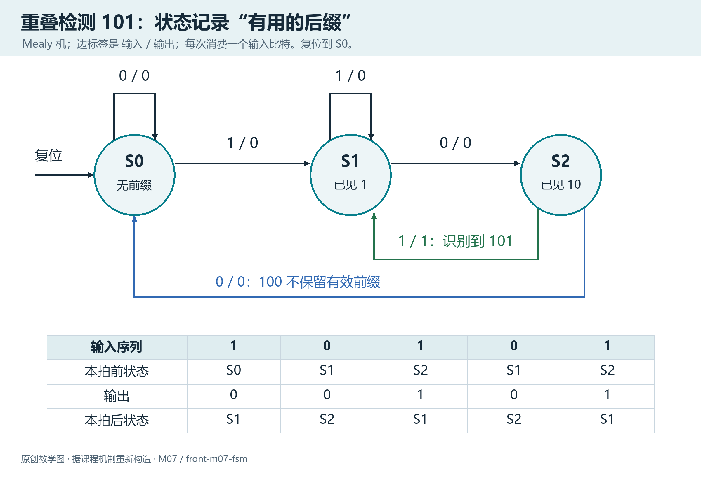{width=100%}

复位 S0 后输入 10101，逐拍套用上一张表：

| 拍号 | 输入 x | 拍前状态 | 输出 y | 拍后状态 | 此时的意义 |
|---|---|---|---|---|---|
| 1 | 1 | S0 | 0 | S1 | 开始匹配 1 |
| 2 | 0 | S1 | 0 | S2 | 已匹配 10 |
| 3 | 1 | S2 | 1 | S1 | 101 命中，保留末尾 1 |
| 4 | 0 | S1 | 0 | S2 | 用同一个末尾 1 开始第二次 |
| 5 | 1 | S2 | 1 | S1 | 第二个 101 命中 |

输出串为 00101。第一段匹配占输入位置 1–3，第二段占 3–5，共用第 3 位，所以称为重叠。

对照一个真实错误：若把 S2 在 x=1 的下一状态改成 S0，第三拍仍能输出 1，但第四拍从 S0 读 0 仍为 S0，第五拍读 1 只到 S1，输出 0，于是错误输出为 00100。只测试孤立的 101 会放过这个错误，10101 才能暴露它。

**停一下 · m07-step-3**

输入 10101 后最后状态是什么？如果随后再来 01，还会不会命中？

先写在纸上，再到附录A核对。

### 第4步 · 不靠直觉证明三个状态不能再合并

**现在做**：先按两种输入下的输出向量分组，再用下一状态落在哪一组来细分。

Mealy 等价要求：从两个状态出发，对所有未来输入串都产生相同输出串。只比较当前某个输出不够。

第一轮按 x=0、x=1 的输出向量分组：S0 为 (0,0)，S1 为 (0,0)，S2 为 (0,1)。所以分成 $A=\{S0,S1\}$ 和 $B=\{S2\}$。

再看同组内的后继分组：S0 遇 0 去 S0∈A，遇 1 去 S1∈A，签名是 (A,A)；S1 遇 0 去 S2∈B，遇 1 去 S1∈A，签名是 (B,A)。它们不同，于是 A 拆成两个单元素组。最终三个状态各自成组，不能再合并。

也可以用可区分输入串核查。S0 与 S1 用后缀 01 区分：从 S0 得输出 00，从 S1 得 01。S2 与另两个状态只需输入 1：S2 立即输出 1，其他输出 0。给出这些具体输入串，比说“看起来三种记忆不同”更严格。

三个状态都可达：从复位分别用空串、1、10 到达 S0、S1、S2，因此不存在先删一个不可达状态就能减少数量的捷径。

**停一下 · m07-step-4**

S0 和 S1 的当前输出向量都为 (0,0)，为什么还不能合并？

先写在纸上，再到附录A核对。

### 第5步 · 编码成两个状态位，先填八行再化简

**现在做**：指定 S0=00、S1=01、S2=10，状态位名 q1q0。把未用编码 11 明确设为下一拍回 00、输出 0。

三个状态至少需要 $\lceil\log_2 3\rceil=2$ 个二值状态位。编码不是状态最小化：状态数确定后，不同编码仍会改变组合逻辑。

本例额外选择“未用编码 11 在任意 x 下恢复到 00，y=0”，这是我们明确加入的恢复规则，不能一边把 11 当 DC 简化，一边又声称保证恢复。

| q1q0 | x | 下一位 D1D0 | y |
|---|---|---|---|
| 00 | 0 | 00 | 0 |
| 00 | 1 | 01 | 0 |
| 01 | 0 | 10 | 0 |
| 01 | 1 | 01 | 0 |
| 10 | 0 | 00 | 0 |
| 10 | 1 | 01 | 1 |
| 11 | 0 | 00 | 0 |
| 11 | 1 | 00 | 0 |

从表中逐列找 1：D1 只在 q1q0x=010 时为 1，因此 $D_1=q_1'q_0x'$。D0 在 x=1 且状态不是 11 时为 1，所以 $D_0=x(q_1q_0)'$。y 只在状态 10、输入 1 时为 1，所以 $y=q_1q_0'x$。

这里 D1、D0 是送给两个 D 触发器的下一状态输入；q1、q0 是当前寄存器输出，不能把两者混成同一拍的值。时钟沿到来时，寄存器执行 $q_1\leftarrow D_1$、$q_0\leftarrow D_0$。

**停一下 · m07-step-5**

把 q1q0=10、x=1 代入三条方程，得到什么？再代未用编码 11、x=1。

先写在纸上，再到附录A核对。

### 第6步 · 设计测试串，让错误主动暴露出来

**现在做**：给每种可能错误选一条测试：基本命中、重复开头、重叠命中、失败后恢复。先手算预期输出，再运行实验。

基础测试 101 应输出 001，但它不能检查所有转移。重复开头测试 1101 应输出 0001，能查 S1 在输入 1 时是否保留 S1；重叠测试 10101 应输出 00101，能查匹配后是否回 S1；失败后恢复测试 100101 应输出 000001，能查 S2 遇 0 是否正确清除过期前缀，再接受新的 101。

对于这个小机器，还可以把长度 1 到 10 的所有二进制串逐个运行，并与简单参考规则比较：第 i 拍的 y 等于“截至这一拍最后三位是否为 101”。这种参考规则直接来自需求，结构上不同于状态转移表，较容易揭示表或编码方程的共同错误。

硬件实现仍需要定义复位时刻、时钟与输入采样约束。本走读完成的是二值离散事件功能模型；若要讨论组合 Mealy 输出毛刺、建立保持时间或异步输入，需要后面的时序/仿真知识，不能从这张离散表直接得出物理波形质量。

**停一下 · m07-step-6**

机器在 101 上通过、在 1101 上失败，优先检查哪条转移？如果只在 10101 的第二次命中失败呢？

先写在纸上，再到附录A核对。

### 合上示范，检查是否学会

**m07-exit**

独立处理输入 110101：写每拍前后状态和输出。然后不看示范重建六格转移表，并用后缀 01 证明 S0、S1 不等价。最后写出编码后的 D1、D0、y。

**接下来**：先在状态机实验中预测一条含重叠的输入串，再逐拍执行并解释每次状态变化。做完本章独立题，再进入事件仿真：下一步把“每拍一次更新”细化成事件时间、队列与延迟。

## 状态是过去信息的摘要，输出时间必须说清

组合电路输出只由当前输入决定；时序电路还依赖保存的状态。同步 FSM 写成 $s_{t+1}=\delta(s_t,x_t)$。Mealy 输出为 $y_t=\lambda(s_t,x_t)$，Moore 输出为 $y_t=\lambda(s_t)$。本章约定每拍先用当前状态和本拍输入计算输出，再在时钟边界更新状态，避免把下一状态的输出提前算到本拍。

FSM 包含状态集 S、输入字母表 I、输出字母表 O、转移函数 δ、输出函数 λ 和初始状态。输入字母表不一定就是“低电平/高电平”：售货机里的一个字母可代表一种硬币事件，先编码才会成为比特。画 Mealy 图时输出写在边上 `输入/输出`；Moore 输出写在状态内。看到一个图先检查每个状态对每种允许输入是否有唯一转移。

类比记账：状态保存“迄今欠多少钱”，而不是保存全部投币历史。这解释了最小化为何可能；边界是状态还需保存一切会影响未来输出的信息，例如退币模式、超时状态。若两段历史有同样金额却处理退款方式不同，它们不能仅凭余额相同就合并。来源：L25 PDF pp.52–56。

## 示范一：从文字规格画出三状态售货机

原创规格：商品价格 3 单位，每次事件投入 1 或 2 单位；达到或超过 3 时当次出货、不找零，并回到余额 0。一次事件只允许一种硬币，暂不建模无硬币/取消/超时。状态 S0、S1、S2 代表未出货的余额 0、1、2。输出 v=1 表示本次出货。

```text
S0: 投1 → S1 / v=0 ; 投2 → S2 / v=0
S1: 投1 → S2 / v=0 ; 投2 → S0 / v=1
S2: 投1 → S0 / v=1 ; 投2 → S0 / v=1
```

这里采用 Mealy 模型，出货发生在达到阈值的转移。若用 Moore，需要一个带出货输出的状态并定义何时回到 S0；转换会影响输出对应的周期，不能只把边上的 1 挪进一个圈而忽略时序。若添加找零输出 r，S2 接受投2时总额4，需同时出货并 r=1；它和 S2 投1 的转移终点相同，但输出不同，不能因终点相同就合并标签。

验证规格要覆盖边界：余额2投1刚好达到，余额2投2超额，出货后下一枚币属于新交易。若把输入 0 编成“投1”，则 0 不是“未投币”；若真实系统允许 idle，需要扩展输入字母表或加 valid。完整描述这些边界，比凭图形看起来像售货机更重要。

## 等价的定义与分区算法

两个状态等价，当且仅当从它们出发，对**每一条有限输入序列**，产生相同输出序列。当前输出相同是必要但不充分条件。对完全指定确定性 Mealy 机，先按所有单步输入对应的输出向量分组，得到一等价分区 $\Pi_1$；然后在每组内部比较每种输入的下一状态所在的旧分区。

若同组两个状态某个输入的后继落在不同旧组，就把它们分开。重复细分，直到新旧分区一致，才得到稳定等价类。每轮比较必须使用**上一轮统一完成的分区**，不能在一行刚拆开后就让后面的行使用更新结果而前面的行不重算。它通常仍可能走向稳定结果，但你写的“第 k 轮”证据会失去定义。

最小化前先从指定初始状态做可达性遍历，删去不可达状态；若题目要求全状态机器等价而非初始行为等价，则要说明是否允许这一步。Moore 机通常首先按当前状态输出分组；不要直接套 Mealy 的双输入输出向量。对不完全指定 FSM，涉及兼容性而不只是普通等价关系，本章算法范围明确为完全指定确定性机器。来源：L25 PDF pp.57–59。

## 示范二：一轮不够，完整细分并找区分序列

原创 Mealy 机初始 A，表中每项为“下一状态/输出”：

```text
状态      输入0      输入1
A         B/0        C/1
B         A/0        C/1
C         D/0        A/0
D         D/0        B/1
E         E/1        E/1
```

从 A 可达 B、C、D；E 不可达，先移除。A、B、D 的输出向量都是 (0,1)，C 是 (0,0)，所以 $\Pi_1=\{\{A,B,D\},\{C\}\}$。记这两个旧组为 K、L，则 A、B 的后继组签名是 (K,L)，D 的签名是 (K,K)，故第二轮拆出 D：$\Pi_2=\{\{A,B\},\{C\},\{D\}\}$。

第三轮 A 与 B 在输入0时均回到 {A,B}，输入1时均到 {C}，输出相同；其他组为单状态，因此 $\Pi_3=\Pi_2$，停止。最小机的三个状态记 X={A,B}、Y={C}、Z={D}：X 在0→X/0、1→Y/1；Y 在0→Z/0、1→X/0；Z 在0→Z/0、1→X/1。

为什么 A 与 D 虽然一步输出相同却不能合并？输入序列 11 就能区分：A→C→A 输出 10，而 D→B→C 输出 11。两拍差异就是第二轮拆分的具体证据。A 与 B 可合并的证据则是稳定分区条件，不是因为试了几条序列都相同。对输入序列 1011，从 A 原机输出 1011，新机从 X 也输出1011；这是一条回归例，不能代替稳定分区证明。

## 从三状态图到二进制逻辑：别停在画圈

对最小机编码 X=00、Y=01、Z=10，使用两个触发器 q1,q0。对六个“合法状态×输入”列出下一状态与输出。X 输入0→00，输入1→01；Y 输入0→10，输入1→00；Z 输入0→10，输入1→00。输出在 X、Z 时等于 x，在 Y 时恒0。

现在明确非法码11的策略：无论输入如何，下一拍回到00，输出为0。由完整八行表可得到一组实现：

$$D_1=\bar x(q_1\oplus q_0),\qquad D_0=\bar q_1\bar q_0x,\qquad y=\bar q_0x.$$

复算 Y=01、x=0：D1=1、D0=0、y=0，确实到 Z；复算非法11：XOR为0、D0为0、y为0，满足恢复策略。复位把 q1q0 设为00。若把11当作 don't-care 来化简，可能得到更短式子，但恢复行为不再保证；要先决定系统是否允许这个取舍。

三状态的二进制编码下界为 $\lceil\log_2 3\rceil=2$ 个触发器；one-hot 通常用3个触发器，组合译码可能更简单。最少状态不必然等于映射后的最小面积或最短路径；编码、输出寄存方式和目标库都会影响结果。不得只比“触发器2对3”便下完整性能结论。

## 验证、异常与考试验收

每份 FSM 解答应交四类证据：状态含义；完整转移/输出表；最小化或区分序列；编码后的方程与复位。测试要含初态、边界阈值、连续事件、每条边覆盖和非法码策略。边覆盖只能表明这些转移被执行过，不能自动覆盖所有长序列行为；与形式等价或分区证明的范围不同。

常见异常定位：输出整体错一拍，先查用了当前还是下一状态；相同输入产生两个后继，查边条件是否重叠；永远不离开初态，查输入编码/valid；最小化分组太粗，查只比较了单步输出；方程模拟与图不符，查状态码 bit 顺序、补号和非法码假设。纸上计算与程序都应保留状态轨迹，这使错误可定位到第一拍。

比较二进制与 one-hot 时固定同一规格、目标库、时钟约束、复位策略和输入激励；报告寄存器数、组合面积与关键路径，而不是引用抽象经验当实测。十天验收线：在 30 分钟内完成一个 4–8 状态表的稳定分区，并能写一个两拍区分序列；在额外15分钟内给三状态编码和方程，至少复算两行合法码与一个非法码。

## 练习：先作答，再查附录

### m07-q1 · 补全 · 2 分

Mealy 与 Moore 的输出函数分别依赖什么？本文的 y_t 使用当前还是下一状态？

### m07-q2 · 独立 · 4 分

售货机余额2投入2，商品价格3且新增找零功能，出货、找零和下一余额分别是什么？

### m07-q3 · 独立 · 4 分

不看正文，给五状态示范删去不可达状态后的 Π1、Π2、稳定分区。

### m07-q4 · 独立 · 3 分

写出区分示范中 A 与 D 的最短输入序列，并列输出序列。

### m07-q5 · 补全 · 2 分

一个最小机有5个状态，普通二进制编码最少几个触发器？

### m07-q6 · 迁移 · 4 分

对正文 D1=x'(q1 XOR q0)、D0=q1'q0'x、y=q0'x，验证非法码11的恢复，并说明把11直接当DC可能改变什么。

## 本章来源

- L25：2025-10-31；I.7，印刷 pp.48–56 / PDF pp.52–60
- T25：Tutorial 4 P5，PDF p.42；解答 PDF pp.53–54
- F087：2020 exam，Problem 1f/1h，PDF pp.6、8
- F088：2021 exam，Problem 2c/2d，PDF pp.7–8


# 08 逻辑仿真：把变化放回时间轴

事件队列、毛刺、延迟模型与 delta cycle

**关键问题**：布尔函数没有错，为什么仿真波形仍会出现毛刺、X 或时间不前进？

**学习目标**

- 区分稳态布尔等价、定时行为与模拟电气行为
- 按事件队列逐步画出门级波形，记录生成时刻与执行时刻
- 预测 transport 与 inertial 对窄脉冲的不同处理
- 解释三值逻辑、组合毛刺和零时间反馈不收敛

**先修**：m02、m07；**横向联系**：m09、m12。

## 图解跟做：跟着画：一个短脉冲经过3 ns门延迟

约25分钟。不用先背术语：你将亲手列出0、1、3、4、6 ns的队列和输出，并解释为什么两种延迟模型结果不同。

准备纸笔，按下列步骤做。“停一下”题的答案见附录 A 对应编号；不需要另开资料。

### 第1步 · 先把题目变成三条能画的线

**现在做**：在纸上画横轴0到8 ns，纵向留出输入I、transport输出Ot、inertial输出Oi三行。

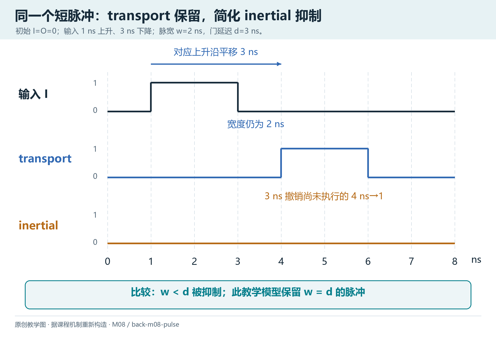{width=100%}

**完整题目：** 一个非反相门的输入和输出初值均为0。输入$I$在1 ns变1，在3 ns变回0，之后不再变化。门的固定延迟$d=3$ ns，连线延迟0。分别用transport和本实验的简化inertial模型，画出输出。

先只画输入：0–1 ns为0；1–3 ns为1；3 ns之后为0。脉宽是下降时刻减上升时刻：$w=3-1=2$ ns。这里“非反相”表示如果输入稳定足够久，输出跟输入同值；它不表示输入一变输出立刻变。

图中的虚线用于对齐同一时刻。此刻遮住两条输出，只看输入，不要照着图抄结果。图与本章实验使用同一组参数，后面可以一一对照。

**停一下 · m08-step-1**

脉冲宽度是2 ns还是3 ns？3 ns在题目中分别出现在哪里？

先写在纸上，再到附录A核对。

### 第2步 · 到1 ns，只安排未来，不改当前输出

**现在做**：写第一笔账：发生I:0→1；随后在待执行栏记“4 ns→1”。

输入上升发生在1 ns。门读取输入1，计算出将来的输出应该是1；但它有3 ns延迟，所以执行时刻为$1+3=4$ ns。可以写成事务$(O,1,t_{gen}=1,t_{exe}=4)$。

| 当前时刻 | 输入I | 当前输出 | 尚未执行的事务 |
|---|---:|---:|---|
| 0 ns | 0 | 0 | 空 |
| 1 ns处理后 | 1 | 0 | 4 ns时把输出写成1 |

关键是第三列仍为0。你可以把“4 ns→1”看成预约：预约已经建立，预约的结果还没有发生。此时transport与inertial完全一样，都在等4 ns。

**最常见错误：** 把输出上升沿画在1 ns，等于忘记延迟；画在3 ns，等于把“延迟长度”误当“绝对执行时刻”。正确时刻是生成时刻加延迟。

**停一下 · m08-step-2**

到了2 ns，如果没有别的输入变化，输出是多少？队列里有什么？

先写在纸上，再到附录A核对。

### 第3步 · 到3 ns，分叉从这里发生

**现在做**：在纸上分出transport与inertial两列，分别处理输入恢复0这件事。

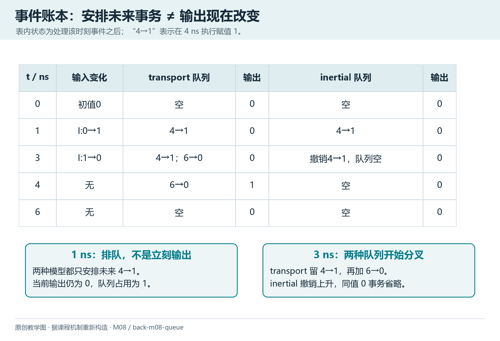{width=100%}

3 ns输入下降，门又算出“将来输出应为0”，对应时刻$3+3=6$ ns。现在要处理尚未执行的4 ns上升。

**Transport列：** 保留4 ns→1，再加入6 ns→0；队列变为两项。它让这个孤立脉冲整体向右平移3 ns。

**简化inertial列：** 输入只保持了$w=2$ ns，短于$d=3$ ns；在4 ns上升尚未执行时，把它撤销。输出本来就是0，因此最终仍为0。本教学队列省略不会改变输出的同值写0；完整VHDL driver可能仍涉及同值事务，不能把这个缩略账本当成完整语言实现。

| 3 ns处理后 | 当前输出 | 将来会造成输出变化的事项 |
|---|---:|---|
| Transport | 0 | 4 ns→1；6 ns→0 |
| 简化inertial | 0 | 空，4 ns上升已撤销 |

所以inertial不是“先让输出闪一下，再把图擦掉”；上升沿从未执行，输出一直为0。

**停一下 · m08-step-3**

3 ns时输入已经降为0，为什么transport仍允许4 ns输出升高？

先写在纸上，再到附录A核对。

### 第4步 · 把队列执行完，再读出波形

**现在做**：依次移到4 ns和6 ns，每次先执行到期事务，再改输出线。

| 时刻 | Transport动作 | Ot | Inertial动作 | Oi |
|---|---|---:|---|---:|
| 0 ns | 初值 | 0 | 初值 | 0 |
| 1 ns | 预约4 ns上升 | 0 | 预约4 ns上升 | 0 |
| 3 ns | 保留上升，预约6 ns下降 | 0 | 撤销4 ns上升 | 0 |
| 4 ns | 执行上升，队列仅剩6 ns下降 | 1 | 没有到期变化 | 0 |
| 6 ns | 执行下降，队列清空 | 0 | 没有到期变化 | 0 |

最终Ot只在区间$[4,6)$为1，脉宽$6-4=2$ ns；Oi始终为0。你刚才完成的是“预测—排队—执行—解释”，而不是凭图形猜一个输出。

现在打开同页的“短脉冲与事件队列”实验，填w=2、d=3，先选transport再选inertial。逐步按钮应与这张表一致；若你的纸面结果不同，先找第一个不同的时刻，不要直接改最后答案。

**停一下 · m08-step-4**

两种模型最终都回到0，为什么不能说它们的仿真结果相同？

先写在纸上，再到附录A核对。

### 第5步 · 只改一个参数，检查边界而不是重新猜

**现在做**：把脉宽改成3 ns：输入仍在1 ns上升，但改为4 ns下降；门延迟仍为3 ns。

本实验明确使用“$w<d$拒绝、$w=d$通过”的边界规则。现在$w=d=3$ ns，因此transport与简化inertial均在4 ns上升，在7 ns下降。4 ns既有输入下降，也有此前预约的输出上升；这是不同信号在同一物理时刻发生的事，没有矛盾。

再把d改为0，保持w=3。输出不增加物理延迟：仍在1 ns和4 ns变化；但零延迟signal赋值在后续delta轮次生效。写“1 ns/δ0输入上升→1 ns/δ1输出上升”，不要写成2 ns。

这一步专门检查两种常见误解：一是把“小于”错写成“小于等于”；二是把delta当成固定1 ns。真实VHDL的复杂波形赋值、显式reject、多驱动等规则在本实验范围之外；这道单脉冲题不需要那些扩展就能完整做完。

**停一下 · m08-step-5**

w=3 ns、d=3 ns时，输出脉冲在哪个区间？改d=0之后，物理时间和delta各如何变化？

先写在纸上，再到附录A核对。

### 合上示范，检查是否学会

**m08-exit**

遮住上面的表：输入1 ns上升、5 ns下降，d=2 ns。分别给出transport和简化inertial的高电平区间、脉宽，并说出判定过程。

**接下来**：能独立得到这两个时刻后，进入第9章，把“同一时刻内部的delta更新”看清楚；不需要先打开课程原PDF。

## 先分清你正在模拟哪一层

逻辑综合问“哪些输入产生哪些输出”；仿真还问“输出在何时变”。同一布尔函数可以由不同门网络实现，稳态真值表相同，传播延迟和毛刺却可能不同。课程采用离散事件、门级逻辑模型，时间单位可为 ns，也可为题目定义的基本时间单位。题目只写 $\tau=2$ 时，不要擅自把它解释成实际工艺的 2 ns。

两值模型只有 0/1。三值模型加入 X，表示在模型精度下无法确定。对 AND，$0\land X=0$，因为另一输入取任何值都无法改变输出；$1\land X=X$。对 OR，$1\lor X=1$、$0\lor X=X$。NAND/NOR先算AND/OR再取反。X不是一个真实的“第三个电压”，也不是能随意选成0或1的don't-care。多驱动、高阻和强弱驱动还需要更丰富的逻辑域，不能把课程三值表直接当成完整std_logic解析规则。

可用“消息队列”类比事件仿真：门收到输入变化才计算，输出变化在未来交付。边界是物理电路并没有中央队列；队列是模拟器为了重建因果关系采用的数据结构。模型也不直接预测亚稳态恢复时间、短路电流或实际脉冲幅度。

若题目给最小/最大延迟而非固定值，例如输入10 ns变化、门延迟范围[2,4] ns，则输出可能在12–14 ns内变化。保守模型可在这一窗口标X，窗口外标确定值；这不是说输出一定经历宽2 ns的模拟亚稳态，也不能从区间自动推出均匀概率分布。上升沿、下降沿及pin-to-pin延迟可能分别给出，必须按路径和边沿类型选参数。[L25 pp.60–61]

## 示范：事件怎样从一个门传到下一个门

设 $n=\neg a$，$y=n\land b$。初态 $a=0,b=1,n=1,y=1$，反相器延迟2 ns，AND延迟3 ns，连线延迟0；$a$在10 ns变1。把事件写成 $(s,v,t_{gen},t_{exe})$（依次是信号、新值、生成时间、执行时间），两时间之差就是本门延迟。

1. 10 ns执行输入变化 $a=1$，只唤醒反相器。根据新输入，产生 $(n,0,10,12)$。队列中最早时刻为12 ns。
2. 12 ns执行 $n=0$，唤醒AND，产生 $(y,0,12,15)$。此时$y$仍为1，不能提前画成0。
3. 15 ns执行 $y=0$；若没有扇出需要计算且队列为空，本次传播结束。

因此输入到输出的路径延迟为 $2+3=5$ ns。每一步都写“执行了什么、激活了谁、排入什么”，比只画最终折线更容易得步骤分。一个赋值事务不一定产生event：把当前已经为0的信号再次更新成0，是事务，但值没变化，所以不唤醒只对该信号event敏感的进程。

同一时刻可能有多个信号待更新，应先按语言规则完成该轮信号更新，再执行被唤醒的进程；不要任意采用纸面左右门的先后顺序。没有显式物理延迟的信号赋值也不是立刻修改所有读者看到的值，而进入当前时刻后续的delta轮次。当前时刻仍有待处理活动，就不能跳到下一个物理时间。

## 示范：3 ns脉冲通过5 ns延迟

设输入初值0，在10 ns变1、13 ns变0，延迟$d=5$ ns。以下是单驱动、孤立输入脉冲、相同上升/下降延迟的教学模型。

**Transport：** 10 ns排入输出1@15 ns；13 ns排入输出0@18 ns。15 ns已有上升沿仍保留，输出在15–18 ns出现宽3 ns脉冲。它将每个变化按延迟平移，适合描述理想传输延迟；不意味着所有真实连线都完全保留任意窄脉冲。

**默认inertial：** 10 ns暂排1@15 ns；13 ns发现输入已恢复，早先尚未执行的窄脉冲响应被取消；输出保持0。可把它理解成“输入必须保持足够久才让响应生效”，但这只是帮助理解的类比。VHDL的完整规则作用于信号driver的projected output waveform，还涉及显式`reject`和同一进程多次赋值；不能把任意程序简化成事后删除所有短脉冲。

默认惯性拒绝时间等于该赋值的延迟；孤立脉冲宽度小于拒绝时间时被抑制。宽度等于拒绝时间的边界应按具体语言事务规则核对，本课简化单脉冲模型保留等宽脉冲。实验应至少测宽度0、$d-1$、$d$、$d+1$和$d=0$，并明确时间离散粒度。

另一个易错点：transport不等于“旧事务永不删除”。在同一driver上后来安排的波形，会替换从其首个新事务时刻开始的旧未来波形。例如同一进程同一时刻依次安排1@10、2@20、3@30、4@15，最终是1@10和4@15；20、30时刻旧事务被覆盖。[T25 Tutorial 6, Problem 3]

## 静态冒险：从布尔函数回到门网络

考虑 $y=ab+\bar a c$，令$b=c=1$。稳态上$y=a+\bar a=1$，但两条路径延迟不同。设$a$在10 ns由1变0：直接AND输出$p=ab$延迟2 ns，在12 ns下降；反相器延迟3 ns，后接AND延迟2 ns，使$q=\bar ac$到15 ns才上升。末级OR延迟1 ns，采用transport。

于是12–15 ns间$p=q=0$，$y$在13 ns下降、16 ns恢复，产生3 ns低脉冲。这叫静态1冒险：理论上应保持1，实际门模型短暂变0。它不是布尔代数出错，而是稳态代数没有编码不同路径的到达时间。若末级采用拒绝时间大于3 ns的inertial，此教学模型会滤除脉冲，但不能因此宣布硬件永远无风险。

添加共识项$bc$可得 $y=ab+\bar ac+bc$；该项逻辑冗余，却在$b=c=1$时提供始终为1的覆盖。在满足单输入变化及相应延迟模型条件下，它消除该静态冒险。代价是额外门、负载和面积；多个输入同时变化、复杂多级网络的动态冒险并不自动消失。同步系统通常也会通过时序约束让寄存器只在稳定窗口采样，但异步复位、时钟、锁存器使能等信号尤其不能随意带毛刺。

## 反馈、锁存器与“不前进的时间”

交叉耦合NOR锁存器可写 $Q=\neg(R+Q_n)$、$Q_n=\neg(S+Q)$。$R=S=0$时保持原状态；$S=1,R=0$置位；$R=1,S=0$复位；$R=S=1$使两个输出都变0，破坏互补关系。随后同时释放至0，理想零延迟模型可能在同一物理时刻循环：$(0,0)\rightarrow(1,1)\rightarrow(0,0)\rightarrow\cdots$。每个箭头是delta推进，而不是经过了1 ns。

现实电路可能受不对称延迟、噪声与亚稳态影响最终落到某状态；离散逻辑模型的delta振荡不是对真实振荡频率的预测。解决问题也不是随便增大模拟器循环上限：先检查非法激励、初值、组合反馈和缺少真实延迟的模型。

GHDL提供`--disp-time`观察时间与delta编号，`--stop-delta=N`限制同一物理时刻的delta轮数。这是工具实现的调试选项，不是VHDL标准规定所有工具都必须同名支持的接口。[GHDL-SIM] 对课程波形题，先声明初态，再逐轮记录被唤醒进程；没有初态时不能擅自选一个看起来方便的稳定值。

## 从示范转为独立作答：固定五步

遇到一张波形图，先圈出模型：门延迟还是线延迟、transport还是inertial、二值还是三值、是否有初始状态。第二步预测“最后应是什么”，用稳态真值表做总检查。第三步按时间建立事件队列，给未来事务写出生成原因。第四步只在执行时刻改变波形，并处理反馈激活。第五步解释异常：是短脉冲抑制、路径差、X传播还是零时间不收敛。

比较全电路周期求值与事件驱动时，固定同一网表、激励、逻辑域、延迟模型和输出精度。事件驱动减少无变化区域的计算，却付出队列、调度和数据结构成本；高切换活动下未必占优。编译技术与事件调度不是绝对互斥，不能把“编译型”直接等同于“永远不支持时间”。讲义中的二分是教学抽象，真实工具可组合多种技术。

学习证据应是一张别人可复算的事件表和一段异常解释。读完只能勾选“已阅读”；能在改变一个门延迟后独立重画波形，才记录“已掌握”。先完成本页走读的事件队列表，再做本章练习和变式；全部条件与解析已提供，不需要先打开原PDF。来源中的T25仅用于核对课程出处。

## 练习：先作答，再查附录

### m08-q1 · 补全 · 2 分

链路 NOT 延迟4 ns、AND延迟6 ns，输入在7 ns变化且路径始终敏化。输出最早何时改变？只填时间。

### m08-q2 · 补全 · 4 分

初始为0的信号在10 ns变1、12 ns变0，通过默认inertial延迟3 ns。列出待执行事务如何变化，并解释输出。

### m08-q3 · 独立 · 3 分

在本章静态冒险例中，只把反相器延迟由3 ns改成5 ns，其余不变并仍为transport。输出低脉冲宽度是多少？

### m08-q4 · 独立 · 4 分

画一个三值NAND表，并用“对未知值的两种补全”解释 NAND(0,X) 与 NAND(1,X)。

### m08-q5 · 迁移 · 4 分

仿真日志停在100 ns，delta不断增加。提出两种原因、验证方法，并说明为什么不能直接据此报出真实电路振荡频率。

### m08-q6 · 迁移 · 4 分

设计一个最小实验，比较transport和inertial；要求能揭穿“所有宽度都被抑制”和“所有脉冲都通过”两种错误实现。

## 本章来源

- L25：II.1–3，印刷 pp.57–63；PDF pp.61–67
- L25：II.4，印刷 pp.67–68；PDF pp.71–72
- T25：Tutorial 5，印刷 pp.58–64；PDF pp.60–66
- T25：Tutorial 6，印刷 pp.65–71；PDF pp.67–73
- GHDL-SIM：Simulation options：--stop-delta、--disp-time；2026-11-08所见7.0.0-dev文档


# 09 VHDL：读懂并发与赋值的真实含义

从signal、variable到进程、综合和自检testbench

**关键问题**：为什么同一段process里两行看似顺序的赋值，得到的硬件与软件直觉不同？

**学习目标**

- 根据进程唤醒与signal更新规则手算运行结果
- 分别写出组合逻辑、锁存器和边沿触发寄存器
- 发现敏感列表缺项、未赋值分支和多驱动等错误
- 用可重复的输入与断言验证模型，而非只看波形

**先修**：m08；**横向联系**：m07、m13。

## 图解跟做：逐行执行：两种交换为什么结果不一样？

约30分钟。你会在纸上分开“现在读到的signal值”“立即改变的variable值”“下一delta执行的预约”，并推演两个时钟沿。

准备纸笔，按下列步骤做。“停一下”题的答案见附录 A 对应编号；不需要另开资料。

### 第1步 · 把六行代码变成一张初值表

**现在做**：先写sa=0、sb=1、va=0、vb=1、q=0、r=0，分出signal和variable两栏。

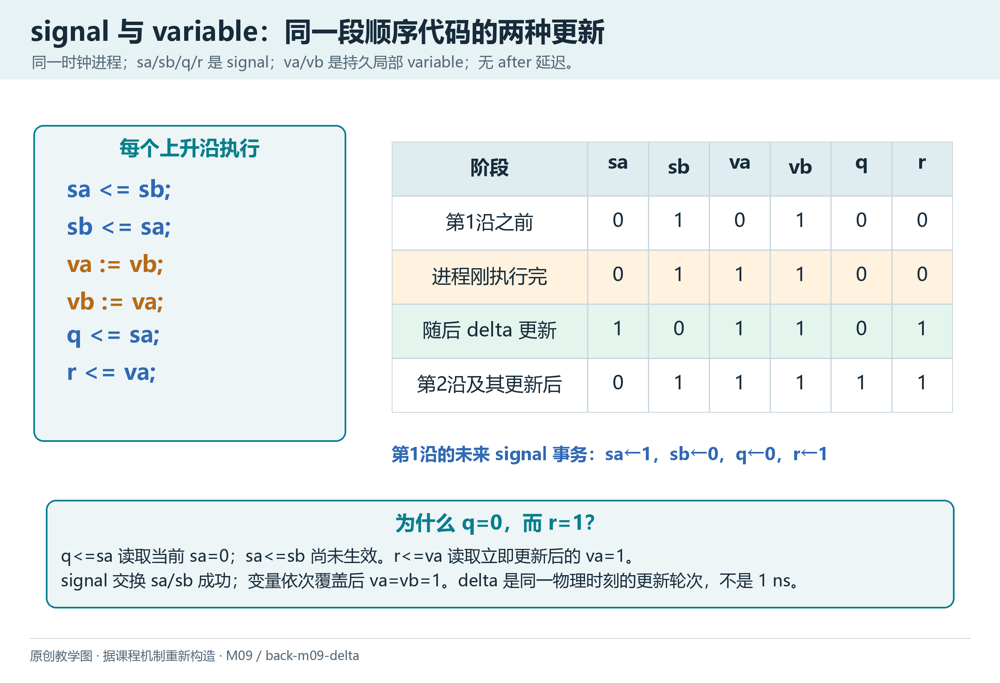{width=100%}

**完整条件：** 所有对象都只取0/1。sa、sb、q、r是signal，初值分别0、1、0、0；va、vb是process内变量，初值0、1，并在相邻时钟调用间保留值。clk使用std_logic；已引入对应的rising_edge函数。上升沿在10 ns和20 ns到来，进程没有其它驱动，也没有after延迟。

```vhdl
process(clk)
  variable va : bit := '0';
  variable vb : bit := '1';
begin
  if rising_edge(clk) then
    sa <= sb;
    sb <= sa;
    va := vb;
    vb := va;
    q <= sa;
    r <= va;
  end if;
end process;
```

先不用运行程序，只记两条规则：`<=`建立signal预约，不立刻改当前读数；`:=`立刻改变量，下一行会读到新值。下面的图把“执行进程”和“更新signal”分成两个框，它们都发生在10 ns这一物理时刻内。

**停一下 · m09-step-1**

哪四个对象使用预约更新，哪两个对象立即更新？

先写在纸上，再到附录A核对。

### 第2步 · 第一个沿：先只执行前两行

**现在做**：在“待更新”栏写sa←1、sb←0；暂时不要擦掉当前sa=0、sb=1。

10 ns上升沿唤醒process。第一行`sa <= sb`读到当前sb=1，预约sa=1。第二行`sb <= sa`读到的sa仍是0，因为第一行还没有执行signal更新，所以预约sb=0。

| 执行到哪一行 | 当前sa | 当前sb | 预约列表 |
|---|---:|---:|---|
| 尚未执行 | 0 | 1 | 空 |
| sa <= sb | 0 | 1 | sa←1 |
| sb <= sa | 0 | 1 | sa←1，sb←0 |

注意：这两行成功保留了两份旧值，因此稍后signal更新时可以完成交换。如果你第二行写成“sb预约1”，说明你把第一行误当成软件中的立即赋值。

**停一下 · m09-step-2**

执行完第二行之后，此刻读取sa得到0还是1？预约的sa又是多少？

先写在纸上，再到附录A核对。

### 第3步 · 再执行变量和两个观察输出

**现在做**：逐行改va、vb，再确定q和r分别预约什么值。

第三行`va := vb`读vb=1，立即把va变1。第四行`vb := va`现在读到的va已经是1，因此vb也变1。原来的va=0已经丢失，变量两行并没有交换成功。

第五行`q <= sa`仍读旧sa=0，预约q=0。第六行`r <= va`读新va=1，预约r=1。

| 执行后 | va | vb | 新增signal预约 | 理由 |
|---|---:|---:|---|---|
| va := vb | 1 | 1 | 无 | 立即覆盖va |
| vb := va | 1 | 1 | 无 | 读取已经改变的va |
| q <= sa | 1 | 1 | q←0 | sa尚未更新 |
| r <= va | 1 | 1 | r←1 | va已经更新 |

此时整个预约列表为sa←1、sb←0、q←0、r←1；当前signal仍为0、1、0、0。变量与signal在同一个process里服从各自的更新语义。

**停一下 · m09-step-3**

q和r的右边都只读一个对象，为什么一个预约0、另一个预约1？

先写在纸上，再到附录A核对。

### 第4步 · 进程暂停后，才执行signal更新

**现在做**：将预约值统一写入signal栏，标记为10 ns的下一delta；不要把时刻写成11 ns。

process走到结尾并等待下一次时钟事件，模拟器进入signal更新阶段。结果为：

| 观察时点 | sa | sb | va | vb | q | r |
|---|---:|---:|---:|---:|---:|---:|
| 10 ns上升沿前 | 0 | 1 | 0 | 1 | 0 | 0 |
| 本次process执行完、更新前 | 0 | 1 | 1 | 1 | 0 | 0 |
| 下一delta更新后 | 1 | 0 | 1 | 1 | 0 | 1 |

sa/sb交换了，va/vb都变成1，q仍为0而r变1。q被再次写0不造成值变化，因此这次q事务不产生q的event。sa更新成1也不会让这个进程立刻重跑：敏感列表只有clk，进程内还要通过rising_edge(clk)条件。

这解释了“为什么q没有立刻跟着sa变1”：q不是一条永久连接到sa的导线，而是在指定时钟沿读取sa并保存该值的寄存器行为。

**停一下 · m09-step-4**

sa变1后，q是否会在同一时刻再自动变1？解释触发条件。

先写在纸上，再到附录A核对。

### 第5步 · 第二个沿：不用重新初始化任何对象

**现在做**：把第一拍结束的值作为20 ns沿前值，重新运行同样六行。

第二次调用前sa=1、sb=0、va=vb=1。前两行预约sa←0、sb←1；变量仍然都是1；q预约旧sa=1，r预约va=1。更新后：

| 时点 | sa | sb | va | vb | q | r |
|---|---:|---:|---:|---:|---:|---:|
| 第1沿更新后 | 1 | 0 | 1 | 1 | 0 | 1 |
| 第2沿更新后 | 0 | 1 | 1 | 1 | 1 | 1 |

signal每次交换，变量则第一次把0覆盖丢失后再也恢复不了。若你想让变量真正交换，必须先保存旧va：`tmp := va; va := vb; vb := tmp;`。这与软件交换的思路相同。

变量在这里跨时钟保留数据；“立即更新”并不表示“不能形成寄存器”。应根据跨拍数据依赖判断硬件存储，而不是只看signal/variable关键字。至此，读懂本章代码所需的值、时序和规则都已在本页给齐。

**停一下 · m09-step-5**

把第三、四行改成使用tmp的真正交换后，若va=0、vb=1，执行后分别是什么？

先写在纸上，再到附录A核对。

### 合上示范，检查是否学会

**m09-exit**

独立再做一次：沿前sa=1、sb=0、va=1、vb=0，执行原来的六行代码。给出沿后sa、sb、va、vb、q、r，并说明q读取哪一版sa。

**接下来**：继续做本章的组合逻辑缺省赋值与敏感列表练习；然后进入第10章，用两份电路的输出差异理解测试。

## 把文件结构与硬件结构分开

`entity`说明接口：模块名、输入输出、类型与可配置generic。`architecture`说明实现，可以是逻辑表达式、若干并发process，也可以实例化子模块。不同architecture可实现同一entity，configuration或实例绑定负责选中具体实现。testbench通常没有外部端口，在内部生成激励并观察待测模块。

architecture中并列的语句是并发关系；process内部语句按书写顺序执行。这里的“并发”是语言语义，并不要求宿主电脑为每个process分配一个CPU线程。普通进程运行到`wait`暂停；带敏感列表的进程在结尾有等效等待。不要同时给一个普通process写敏感列表又在其内部写wait。没有任何等待的无限循环可能把模拟器卡在同一时刻。

课程教程保留了旧版VHDL写法，例如使用内部信号读取输出。VHDL-2008允许读取out端口，`process(all)`也是2008特性。考试若没有声明支持新语法，沿用课程的内部信号与显式完整敏感列表最稳妥。本文示例会标注版本，避免用一个版本的限制解释另一个版本的代码。IEEE1076来源只读取了公开元数据，完整标准条文需要购买或订阅；语义教学以L25/T25及GHDL文档交叉核验，不冒称查过未访问的条款号。

## 示范：一拍延迟来自哪里

看下面的时钟进程。`s,q,r,a`均为bit，初值$s=q=r=0$；`v`是process局部变量。`clk`使用std_logic，并已通过`use ieee.std_logic_1164.all;`引入对应的rising_edge函数。每个上升沿调用一次：

```vhdl
process(clk)
  variable v : bit;
begin
  if rising_edge(clk) then
    s <= a;
    q <= s;
    v := a;
    r <= v;
  end if;
end process;
```

若第一个上升沿到来前$a=1$，执行`s <= a`只是安排$s$将来更新为1，接下来的`q <= s`仍读到旧$s=0$。变量`v := a`立即把v变成1，所以`r <= v`安排$r=1$。该轮signal更新后得到$s=1,q=0,r=1$；若第二个沿前$a=0$，之后为$s=0,q=1,r=0$。

这不是“signal永远晚一拍”。零延迟signal在后续delta生效；此处$q$晚一拍，是因为它只在下一次时钟沿再次读$s$。若是组合进程且对$s$敏感，可能在同一物理时间的下一delta重新求值。也不是“variable不产生寄存器”：变量若跨时钟使用旧值，同样可能需要存储。判断硬件应看数据依赖和所有执行路径，而不是看到一个关键字就下结论。

## 组合逻辑：完整敏感、完整赋值

一个2:1多路选择器可写成：

```vhdl
process(a, b, sel) -- 兼容课程显式列表写法
begin
  if sel = '0' then
    y <= a;
  else
    y <= b;
  end if;
end process;
```

每条路径都给y赋值，所以输出仅依赖当前输入。若使用VHDL-2008模式，可改为`process(all)`减少遗漏风险。若写`process(a,sel)`却在分支里读取b，当sel=1而只有b变化时仿真进程不会唤醒，输出可能保持旧值；综合工具却可能推导出正常mux，产生仿真与综合差异。

若去掉else，sel=1时y不被赋新值，语言语义是保留旧值，综合通常需要锁存器。修复方法取决于设计意图：组合逻辑可先写默认`y <= b;`再由if覆盖；需要真正锁存器则应明确保持条件并检查时序。默认赋值不是随便填0：它必须符合规格。

单个进程同一轮对同一signal安排同一目标时刻的多个赋值，后面的赋值会覆盖相应旧事务，例如`y <= a; y <= b;`最终安排b。不同process同时驱动同一signal是多驱动问题，不适用“文件中最后一行胜出”。std_logic有解析函数；bit没有这种解析，不能依赖它来合并多个驱动。

## 寄存器、锁存器和延迟语句的边界

标准边沿寄存器结构是`if rising_edge(clk) then q <= d; end if;`。异步复位写在进程外层条件，复位信号也进入敏感列表；同步复位只在时钟沿内检查。是否有复位、有效电平、优先级都来自规格。不能为了让波形好看擅自添加复位。

`if en='1' then q<=d; end if;`若放在组合敏感进程中，描述电平敏感保持元件；相同if放在时钟沿内部描述带使能的触发器。画图时先找时钟事件判定，再找保持路径，这比背诵模板可靠。

`after 5 ns`是仿真时间模型，不应据此推断综合器会自动造出一个精确5 ns延迟单元。`wait for`常用于testbench时钟或激励，通常不属于目标RTL综合子集。可综合与否还依赖工具、目标器件和支持子集。编译通过仅表示语法和类型等检查通过，不表示行为符合需求，也不表示一定能映射到硬件。

std_logic的U通常表示尚未初始化，X可由冲突或运算不确定传播，Z表示高阻；bit只有0/1，可能掩盖初始化类问题。教学小例可用bit简化推演，工程测试需明确类型与初值，不能把二值实验的成功当成所有未知态都已处理。

## 自检比“波形看起来正确”更可靠

先确定输入组合和预期结果，再写断言。对于零延迟组合mux，可以在testbench中依次施加全部$a,b,sel$组合，在模型规定的稳定窗口检查输出。若施加输入后立即assert，进程可能读到尚未更新的旧输出；可等待足够的delta稳定，或在纯零延迟教学testbench中等待1 ns。这个1 ns是测试安排，不是电路真实延迟。

```vhdl
a <= '1'; b <= '0'; sel <= '0';
wait for 1 ns;
assert y = '1'
  report "mux selected wrong input" severity failure;
sel <= '1';
wait for 1 ns;
assert y = '0'
  report "mux selection failed" severity failure;
```

可选工具扩展（不影响只看网站/PDF学会本章）：独立实验可以使用`ghdl -a --std=08 file.vhd`分析、`ghdl -e --std=08 tb`展开、`ghdl -r --std=08 tb --assert-level=error --stop-time=100ns --wave=tb.ghw`运行。代码中的entity名须与tb匹配；三步标准模式要保持一致。这些是可复现实验说明，网站里的演示不是GHDL，也不声称支持任意VHDL程序。

验证至少包含正常选择、只有未选中输入变化、只有选中输入变化、sel边界切换、初始状态。时序电路还需复位、保持、连续多拍和使能停止。将断言失败定位到“输入施加、更新轮次、预期表达式”三个环节，而不是先改预期值去迎合错误输出。

## 案例：一个mux为何三种描述都能成立

问题是实现同一个$y=\bar s a+sb$。基线为门级结构描述：显式NOT、AND、OR，方便观察路径和毛刺；行为式条件赋值简洁，适合说明功能；process写法适合更复杂控制。统一比较前，要让三种描述使用相同类型、相同延迟假设与同样激励。一个有门延迟、另一个零延迟时，波形不同并不能证明功能不等价。

代价与适用条件：结构式暴露实现细节，修改成本高；行为式把技术映射交给综合器，更易维护，但不能仅从源码推断最终门数量和时序。反例是测试某路径冒险：零延迟条件赋值模型往往没有对应内部节点，不能用它证明门网络无毛刺。验证办法是先穷举稳态真值表检查功能，再对带延迟实现单独做事件仿真与时序检查。

完成本章的证据是：能口头说明“进程内顺序、进程间并发、signal延后更新”三者如何同时成立；能在纸上预测两次时钟沿的s/q/r；能指出一个遗漏敏感信号和一个未赋值分支。若这些已熟悉，可跳过语法速读，直接做后面的调试与迁移题。

## 练习：先作答，再查附录

### m09-q1 · 补全 · 4 分

本章s/q/r例中初始s=0；连续两个上升沿前a依次为1、0。写出每个沿后的(s,q,r)。

### m09-q2 · 补全 · 2 分

进程同一次执行依次写 x <= 1 after 5 ns; x <= 2 after 5 ns;。同一driver、同一目标时刻最终计划的数值是多少？

### m09-q3 · 独立 · 4 分

代码 process(a,sel) begin if sel='0' then y<=a; else y<=b; end if; end process; 存在什么问题？给出能暴露问题的激励。

### m09-q4 · 独立 · 4 分

process(d,en) begin if en='1' then q<=d; end if; end process; 是组合门、锁存器还是边沿触发器？若规格要求组合mux，该如何修改？

### m09-q5 · 迁移 · 4 分

设计一个反例说明“variable立即生效，所以不可能综合成寄存器”错误。

### m09-q6 · 迁移 · 4 分

一个组合电路刚改输入就assert失败，但等1 ns后通过。给出两种可能解释和验证办法，不直接宣布电路正确。

## 本章来源

- L25：II.4，印刷 pp.64–68；PDF pp.68–72
- T25：Tutorial 6，印刷 pp.65–71；PDF pp.67–73
- IEEE1076：IEEE 1076-2019官方元数据；仅核对规范身份、范围和发布日期
- GHDL-STD：Implementation of VHDL：VHDL standards；标准模式与部分实现限制
- GHDL-SIM：Simulation options：断言、时间与delta选项


# 10 故障模型与最小测试集

检测、诊断、故障等价与覆盖表

**关键问题**：测试通过能证明什么？怎样用少量输入检测一个明确定义的故障集合？

**学习目标**

- 区分设计验证、制造测试、故障检测和故障定位
- 建立单stuck-at故障字典与test-fault关系
- 用集合包含判断等价、支配及删除方向
- 计算带明确定义分母的覆盖率并求小规模最小测试集

**先修**：m02、m03；**横向联系**：m11、m12、m13。

## 图解跟做：第一次做故障题：并排算两份小电路

约25分钟。从一张AND-OR电路图出发，你会区分“故障发生”“故障被激活”和“故障在输出被检测”，不用先背覆盖率定义。

准备纸笔，按下列步骤做。“停一下”题的答案见附录 A 对应编号；不需要另开资料。

### 第1步 · 先认清电路和故障点

**现在做**：在图上找到两个门、三个输入、内部线n与输出y，用手指沿a→n→y走一遍。

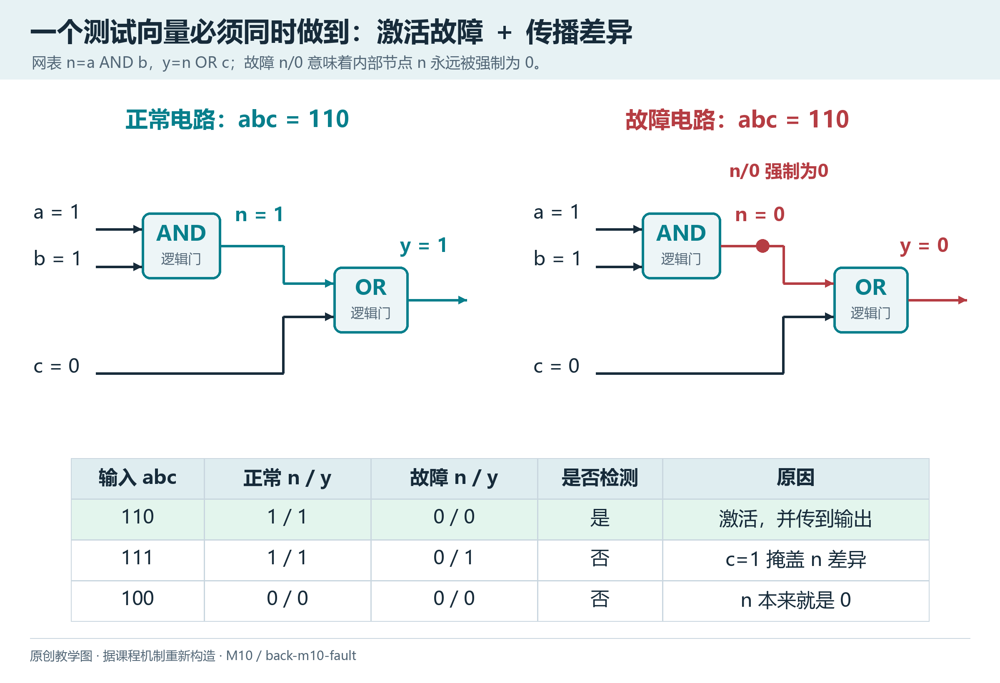{width=100%}

**完整题目：** 输入为a、b、c。第一个门是AND，内部输出$n=a\land b$；第二个门是OR，最终输出$y=n\lor c$。只观察y。今天只分析一个故障：n/0，即n这条线被永久固定为0。

你需要同时保留两份电路：正常电路按门函数计算；故障电路在指定位置强制固定值，其余部分照常计算。n/0不是“把a变0”，也不是“把整个电路输出都强制0”。故障只改n，后面的OR仍然会考虑c。

本页只用二值、无时延、单故障模型。输入写作abc，a是左边最高位，所以110表示a=1、b=1、c=0。先不讨论物理断线的电压，先把这个模型算清楚。

**停一下 · m10-step-1**

n/0发生后，c还能影响y吗？为什么？

先写在纸上，再到附录A核对。

### 第2步 · 施加110，先把正常电路算完

**现在做**：先写a=1,b=1,c=0，再算n，最后算y；不允许直接猜输出。

按从输入到输出的顺序：$n=1\land1=1$；$y=1\lor0=1$。把所有值记下来，下一步只改故障电路。

| 版本 | a | b | c | n | y |
|---|---:|---:|---:|---:|---:|
| 正常电路，输入110 | 1 | 1 | 0 | 1 | 1 |

这一步看起来很简单，却不能省略。判断stuck-at故障能否激活，必须知道该点在正常情况下是什么：正常n=1，而故障把n固定为0，二者确实有差异。

若正常n原本就是0，n/0虽然仍存在，这一次输入却看不出局部变化。这与“你没有按下开关，就无法观察开关坏了”的直觉相近；类比仅帮助记住激活条件，检测还要继续看输出。

**停一下 · m10-step-2**

同样输入110，n/1会不会在n处制造差异？

先写在纸上，再到附录A核对。

### 第3步 · 只强制n=0，再算故障输出

**现在做**：复制正常表，保持a、b、c不变，在故障版n列写0，然后重新计算y。

故障电路中AND按输入本会算出1，但故障位置把这条线强制成0；后面的OR看到的是故障后的n=0。因此$y_{fault}=0\lor0=0$。

| 版本 | a | b | c | n | y |
|---|---:|---:|---:|---:|---:|
| 正常 | 1 | 1 | 0 | 1 | 1 |
| n/0故障 | 1 | 1 | 0 | 0 | 0 |

正常输出1，故障输出0，所以这个输入能检测故障。用一个等式记录检测结果：$R(110,n/0)=y_{good}\oplus y_{fault}=1\oplus0=1$。覆盖表里的一个“1”，就是这么逐格算出来的。

请说完整句：“110使正常n为1，激活n/0；c=0不屏蔽OR的n输入；差异到达y，因此检出。”其中每一段都对应表中的可见数值。

**停一下 · m10-step-3**

这里“检测到”是因为n不同，还是因为最终可观察y不同？

先写在纸上，再到附录A核对。

### 第4步 · 改成111：故障激活了，却被挡住

**现在做**：只把c从0改1，重新做正常与故障两行，观察是哪一列让结论改变。

正常：n=1 AND 1=1，y=1 OR 1=1。故障：n固定0，y=0 OR 1=1。

| 输入 | 正常n | 故障n | 正常y | 故障y | 结论 |
|---|---:|---:|---:|---:|---|
| 110 | 1 | 0 | 1 | 0 | 激活，且检出 |
| 111 | 1 | 0 | 1 | 1 | 激活，但未检出 |

c=1是OR的控制值：无论另一个输入是0还是1，输出都为1。它把n的差异屏蔽了。传播n的故障效应时，需要OR旁路输入为非控制值0。

这就是“只把故障点设成相反值仍不够”的具体反例。你不需要相信一句抽象定义，只要看到两份电路的n不同而y相同，就知道哪里被屏蔽。

**停一下 · m10-step-4**

如果c一直被外部限制为1，还能仅通过y检测n/0吗？

先写在纸上，再到附录A核对。

### 第5步 · 改成100：这次连激活也没有发生

**现在做**：把a=1,b=0,c=0代入，补出两份电路并用一句话分类失败原因。

正常n=1 AND 0=0，正常y=0 OR 0=0；故障n/0仍为0，故障y也是0。因此失败原因不是OR屏蔽，而是正常n本来就等于故障值，根本没有激活差异。

现在把三种情况放在一起：

| 输入 | n处是否出现差异 | y处是否出现差异 | 失败/成功原因 |
|---|---|---|---|
| 100 | 否 | 否 | 未激活 |
| 111 | 是 | 否 | 已激活，被c=1屏蔽 |
| 110 | 是 | 是 | 激活且传播成功 |

下一章会倒着走：不再由输入判断“能否检测”，而是从“必须激活、必须传播”推导出该选哪个输入。你已经掌握了那套方法的全部因果关系，剩下只是把步骤组织起来。

**停一下 · m10-step-5**

“未激活”和“被屏蔽”能否用同一句“输出一样”区分？需要多记录哪个节点？

先写在纸上，再到附录A核对。

### 合上示范，检查是否学会

**m10-exit**

仍用同一电路，输入改为001，故障改为c/0。请写出正常与故障的n、y，并判断是否检测；这次不参考上表。

**接下来**：进入第11章，学习从目标故障反推110；本章其余正文用于把这张小表扩展成故障集合与覆盖率。

## 测试不是设计验证的另一个名字

设计验证关心“设计是否符合规格”，制造测试关心“做出来的这个器件是否带有目标缺陷”。正确的RTL可能被制造成有断线的芯片，错误的RTL也可能制造得完全忠实。ATPG通常假定无故障网表代表期望功能，再寻找可区分正常网表与故障网表的输入，因此不能自动发现规格本身错误。

物理缺陷复杂，课程使用逻辑故障模型降低分析成本。$x/0$表示该故障点永久取0，$x/1$表示永久取1。**单故障假设** 表示一次分析只注入一个故障，不表示芯片上物理上绝不可能同时发生多个缺陷。若有$N$个明确定义的故障位置，最直接的stuck-at故障表有$2N$项；这不是“所有真实失效模式数”。延迟缺陷、桥接故障、开路和模拟参数漂移可能需要其它模型。

扇出干线stem和分支branch要分开标号：stem故障影响全部分支，单个branch故障只影响一条连接。在重汇合逻辑中，两者的检测条件可能不同。列故障数前先画出故障位置，特别说明是否包含主输入、输出、stem和branch；否则同一电路出现不同的“总故障数”可能只是计数口径不同。

## 完整示范：二输入AND的故障字典

设$y=ab$，故障位置只有$a,b,y$，共六个故障$a/0,a/1,b/0,b/1,y/0,y/1$，输入排列为$ab=00,01,10,11$。正常输出依次为0,0,0,1。每次只改变一个故障点，然后与正常输出异或，得到检测关系。

```text
输入     检测到的故障
00       y/1
01       a/1, y/1
10       b/1, y/1
11       a/0, b/0, y/0
```

例如01时$a/1$把实际AND输入改成11，故障输出1与正常0不同，所以被检测；同样输入下$b/0$只让00，输出仍0，所以不可检测。做表时不要因为“故障点的值错了”就直接打勾，还要看错误是否到达可观察输出。

故障字典保存每个故障电路的响应；覆盖表保存“响应是否异于正常”。对于多输出，至少一个可观察输出不同时检测成立，可写 $R(t,f)=\bigvee_j(y_j(t)\oplus y_j^{f}(t))$。覆盖表丢掉了差异发生在哪个输出等细节，足够用于检测覆盖，但做更精细诊断时可能需要完整响应向量。

此例是本课程自行构造的穷举基准，不是某道历年题的标准答案；你应能用四行真值表独立复算全部六列。

## 检测、等价、支配：先写集合，再看名称

定义$F_t=\{f:R(t,f)=1\}$为测试t检出的故障集合；$T_f=\{t:R(t,f)=1\}$为能检出故障f的输入集合。若$T_{f_1}=T_{f_2}$，两故障在该输入/观察域下检测等价。AND例中$a/0,b/0,y/0$均只有11能检出，故可保留一个代表用于生成检测测试。等价不表示物理缺陷位置相同。

若$T_{hard}\subseteq T_{easy}$，任何检出hard的测试都能检出easy；为覆盖所有故障，只要保留hard的测试要求即可。AND例中$T_{a/1}=\{01\}\subseteq T_{y/1}=\{00,01,10\}$，所以检出$a/1$也保证检出$y/1$。不同资料对“谁支配谁”的命名方向可能不同，考试答案写出集合包含关系和“保留谁”最可靠。

覆盖表中测试行也可支配：若同成本测试$t_A$检出的故障是$t_B$的子集，则可删掉$t_A$这个较弱选择。不要混淆测试行与故障列：删测试时保留覆盖更多的行；删故障要求时保留更难满足的列。带权成本或附加诊断约束时，要重新核查该删除是否仍保持目标。

检测是区分“正常与故障”；诊断是区分“故障f1与故障f2”。如果两故障在所有可施加输入上的可观察响应都相同，增加相同观察域中的测试次数也无法区分它们，需要更多观察点或改变故障模型。

## 求最小测试集：与逻辑覆盖相同的数学骨架

给每个候选测试一个选择变量$u_t\in\{0,1\}$。对每个待检故障f，至少选择一个$t\in T_f$，因此整体条件为

$$C=\prod_{f\in F}\left(\sum_{t\in T_f}u_t\right)=1.$$

这个乘积中的和与积是布尔OR/AND。展开并吸收后，选择变量数最少的乘积项对应最小测试集；它与QM后面的覆盖选择有直接联系。不能把“去掉任何一条就不完整”的不可冗余集合，误叫成“全局最少条数”。

AND例中$a/1$只能由01检测，$b/1$只能由10检测，$a/0$只能由11检测。因此01、10、11都必选，三条已经覆盖其余故障，最小测试集唯一为$\{01,10,11\}$。这是严格下界加可行构造的证明，不只是贪心算法给出的一个结果。

大表可用贪心：每次选新增覆盖最多的测试，删去已覆盖故障后重新计算新增数量。有成本时可比较“新增覆盖/成本”。贪心快，但不保证最少，且并列选择可能影响后续结果。作答要写清并列处理与剩余集合，让别人能复现。小表尽量用必选项、支配、吸收或穷举核对最优性。

## 覆盖率的分母决定你到底声称了什么

以原始故障集合F为分母，故障覆盖率为$|F_{detected}|/|F|$。在AND例中只用测试11检测3/6=50%；用01与11检测5/6，仍漏$b/1$。若先做等价折叠得到四个代表，测试11检出1/4=25%的代表，这不能直接拿来与原始50%相比。报告要注明collapsed还是uncollapsed，并在需要时按等价类大小还原。

若存在已证明不可测故障U，某些工具另外报告以可测故障为分母的指标$|F_{detected}|/(|F|-|U|)$。例如100个原始故障、90个检出、10个已证明不可测，原始覆盖90%，可测域覆盖100%。若10个只是ATPG超时，不能把它们自动放入“已证明不可测”。教材和工具对fault coverage/test coverage的命名可能不同，必须写出分子分母。

100%单stuck-at覆盖只说明在该模型、故障位置与观察约束下所有故障被覆盖；不证明所有真实芯片都无缺陷，不证明所有延迟故障被检出，也不代表诊断分辨率100%。这是证据边界，不是测试无用。工程价值在于以统一、可计算的模型指导测试质量和成本权衡。

## 案例：功能测试与结构测试怎样配合

问题是确认一个组合数据选择模块的制造正确性。基线只运行若干“常见功能输入”，成本低且容易理解，但内部某些逻辑长期不被激活。结构测试先列stuck-at位置，再用ATPG找专门的激活/传播输入；证据是覆盖表中哪些列从未被命中，而不是“输入看起来够多”。

成本包括额外测试向量、测试时间和故障仿真。适用条件是存在可访问的输入输出及可信无故障网表。反例是一个物理延迟故障：即使静态stuck-at测试全部通过，也可能只在工作频率下失败。因此设计验证、功能测试、结构故障测试和at-speed测试承担不同证据角色。

验证方案：固定同一故障集合，先统计基线向量集的覆盖；追加结构向量后重新故障仿真；同时保留每条新增向量的增量覆盖和总耗时。若比较两个方案，统一故障折叠规则、不可测处理、测试频率和覆盖统计范围。独立迁移时试着把AND换成NAND，重新做表，观察等价类怎样改变，而不是直接背AND结论。

## 练习：先作答，再查附录

### m10-q1 · 补全 · 3 分

二输入AND例仅使用测试01和11，原始六故障口径下覆盖率为百分之几？保留两位小数。

### m10-q2 · 补全 · 3 分

若T_A={t1,t3}、T_B={t1,t2,t3}，为保证两个故障都被检出，应保留哪一列要求？说明理由。

### m10-q3 · 独立 · 4 分

重做y=NAND(a,b)的六故障覆盖表，给出一个最小测试集并证明至少需要这么多条。

### m10-q4 · 独立 · 4 分

1000个原始故障，900个检出，50个证明不可测，50个超时。计算原始覆盖率以及排除已证明不可测后的覆盖率；为何不能再排除超时项？

### m10-q5 · 迁移 · 4 分

两个故障总被同一组测试检出，是否就说明能定位到其中一个？如果不能，如何增加诊断能力？

### m10-q6 · 迁移 · 4 分

测试A覆盖{1,2,3,4}，B覆盖{1,2,5}，C覆盖{3,4,6}。贪心先选A后需几条？最优需几条？这个反例说明什么？

## 本章来源

- L25：III.1，印刷 pp.69–78；PDF pp.73–82
- T25：Tutorial 7，印刷 pp.72–75；PDF pp.74–77
- F071：Testing slides：fault models与制造测试引言，PDF pp.1–15


# 11 ATPG：激活故障，再把差异送到输出

布尔差分、D算法、重汇合与回溯

**关键问题**：看到一个内部stuck-at故障，怎样系统地构造会在输出暴露它的输入？

**学习目标**

- 从cofactor推导布尔差分与stuck-at检测条件
- 完整完成一个D算法的激活、传播、证明与回溯过程
- 识别重汇合的自掩蔽，避免错误套用单路径链式法则
- 解释PODEM的主输入决策与controllability近似的边界

**先修**：m02、m10；**横向联系**：m06、m12、m13。

## 图解跟做：从目标倒推输入：亲手走完一次D算法

约30分钟。不靠试遍所有输入，按激活、传播、证明三步推导n/0的测试110，再改故障极性找出三个n/1测试。

准备纸笔，按下列步骤做。“停一下”题的答案见附录 A 对应编号；不需要另开资料。

### 第1步 · 先把D读成一对具体数值

**现在做**：画n=a AND b、y=n OR c；先把a,b,c,n,y都写X，再圈定目标n/0。

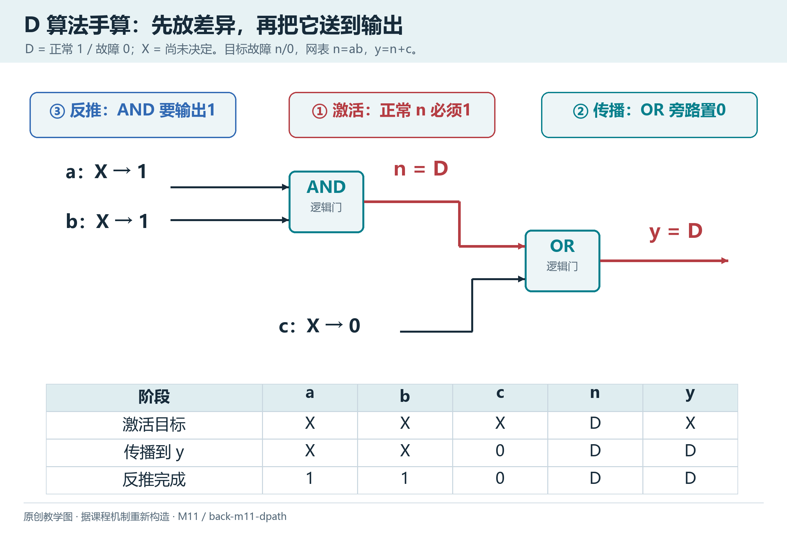{width=100%}

**完整条件：** 同一组合网络$n=ab$、$y=n+c$；a、b、c可以自由设0/1，只有y可观察，单故障目标n/0，无其它约束、无门延迟。要求找一个能检测该故障的输入abc。

D不是第三种电压，而是两份电路的简写。括号按“正常值、故障值”的顺序书写：$D=(1,0)$，表示正常1、故障0；$\bar D=(0,1)$，表示正常0、故障1。0代表(0,0)，1代表(1,1)，X代表当前尚未决定。最终成功必须让y出现D或$\bar D$。

不用先把所有输入乱填一遍。先问：正常n应是多少，才会与固定故障0不同？答案只能是1，所以目标是让n处出现D。

**停一下 · m11-step-1**

目标n/0激活后，n应该写D还是D-bar？把两份值展开说明。

先写在纸上，再到附录A核对。

### 第2步 · 激活：先固定目标，不急着选所有输入

**现在做**：在n位置写D，同时在草稿旁写“仍需证明正常n=1能由输入实现”。

激活后的暂存状态为：

| a | b | c | n | y |
|---|---|---|---|---|
| X | X | X | D | X |

注意n=D不是随意创造一个不受门逻辑约束的值。它表达目标：正常n要1，故障n被强制0。正常n=ab，稍后必须通过a、b的合法输入证明它确实能为1。

目前OR的一个输入n含D，而输出y仍X，因此这个OR位于D-frontier。直白地说，它是“故障差异已经走到门口、但还没确认能穿过”的门。我们先解决旁路c，不去猜与目标无关的值。

**停一下 · m11-step-2**

此时y能直接写D吗？还缺少什么条件？

先写在纸上，再到附录A核对。

### 第3步 · 传播：先试出错误选择，再保留正确选择

**现在做**：分别试c=1和c=0，直接用正常/故障二元值算OR输出。

| 旁路选择 | 正常输出 | 故障输出 | y的D记号 | 是否传播 |
|---|---:|---:|---|---|
| c=1 | 1 OR 1=1 | 0 OR 1=1 | 1=(1,1) | 否 |
| c=0 | 1 OR 0=1 | 0 OR 0=0 | D=(1,0) | 是 |

所以选择c=0，状态变为a=X,b=X,c=0,n=D,y=D。第一行就是一个被否决的分支：选择c=1会让观察点没有差异，应退回并试另一个值。不要把一次分支失败说成整个故障不可测。

一般规则由这张表而来：OR旁路取0让差异通过；AND旁路取1让差异通过；遇到反相门D与D-bar互换。你可以随时回到二元对重算，不必靠死记运算表。

**停一下 · m11-step-3**

y已经是D，是否可以立即交卷写a=X,b=X,c=0？

先写在纸上，再到附录A核对。

### 第4步 · 证明：把内部要求落到主输入

**现在做**：从正常n=1反推AND：在a、b两处都写1，再检查是否与已有c=0冲突。

AND输出1的唯一输入组合是11，因此a=1、b=1。它们是强制值，不是二选一：a=1或b=1只保证至少一个1，不能保证乘积为1。原来a,b均为X，所以没有冲突。

| 阶段 | a | b | c | n | y | 本步理由 |
|---|---|---|---|---|---|---|
| 开始 | X | X | X | X | X | 尚无赋值 |
| 激活 | X | X | X | D | X | n/0要求正常n=1 |
| 传播 | X | X | 0 | D | D | OR旁路取0 |
| 证明完成 | 1 | 1 | 0 | D | D | AND正常输出1要求两输入都1 |

现在得到完整测试abc=110。这个简单例子没有多种证明选择；在更大网络中，若要证明AND输出0，就可尝试让任意一个输入0，才会出现需要记账与回溯的可选分支。

**停一下 · m11-step-4**

为什么“a=1,b=X,c=0”不是本题有效的测试立方体？

先写在纸上，再到附录A核对。

### 第5步 · 最后用普通0/1再算一遍，摆脱对D符号的依赖

**现在做**：暂时擦掉所有D记号，分别算正常与n/0电路的输出，形成第二份验证证据。

110的正常电路：n=1 AND 1=1，y=1 OR 0=1。故障电路：n被固定0，y=0 OR 0=0。输出1≠0，验证通过。

也可以用布尔差分再核一次：把n当独立变量，$y|_{n=0}=c$，$y|_{n=1}=1$，所以$\partial y/\partial n=c\oplus1=\bar c$。n/0测试条件是正常$n=1$且差分1，也就是$ab\bar c=1$，再次得到110。

这不是要求每道题做三倍工作；第一次学习时，D路径、两份0/1响应、代数条件三者对齐，能帮你找出最常见的错误：忘记激活、旁路控制值选反、D经过反相后极性没改。熟练后仍应保留最后一行输出差异检查。

**停一下 · m11-step-5**

这里布尔差分只给出c=0，为什么还不能单独作为完整测试条件？

先写在纸上，再到附录A核对。

### 第6步 · 改成n/1，真正做一次迁移

**现在做**：保留同一网表，只把目标从固定0改成固定1，重新写激活条件与全部有效输入。

n/1要求正常n=0，所以n处为D-bar=(0,1)。传播仍需c=0：正常y=0 OR 0=0，故障y=1 OR 0=1，输出为D-bar。

剩下证明ab=0，这次有选择：a=0或b=0。把两个可选测试立方体写成0X0和X00，注意它们有重叠000；去重后的完整输入只有三条：

| abc | 正常n | 正常y | n/1故障y |
|---|---:|---:|---:|
| 000 | 0 | 0 | 1 |
| 010 | 0 | 0 | 1 |
| 100 | 0 | 0 | 1 |

不能把“a=0或b=0”误写成“a=b=0”，否则虽然找到一个测试，却漏掉另外两个；也不能把000因属于两个立方体而重复计数。

**停一下 · m11-step-6**

110能检测n/1吗？用激活条件立即判断。

先写在纸上，再到附录A核对。

### 合上示范，检查是否学会

**m11-exit**

独立求同一电路的b/1测试。先使正常b与故障1不同，再从b经过AND和OR传播到y。写出唯一完整输入与两份输出。

**接下来**：进入第12章，把这种逐故障比较扩展成完整检测矩阵，并亲手证明最少需要4个测试。

## 布尔差分不是连续微积分

布尔差分用两个cofactor的异或定义：

$$\frac{\partial y}{\partial z}=y\big|_{z=0}\oplus y\big|_{z=1}.$$

它回答“其它条件不变时，翻转z会不会翻转y”。结果为1表示在该输入条件下z的变化可观察，为0表示被屏蔽。这里没有无穷小，也没有正负导数，不能机械套连续微积分乘法法则。

对于内部信号$z=z(x)$，先把z作为一个独立切断变量计算输出对z的差分，再把真实的z函数和其它信号约束代回。检测$z/0$要求正常z为1且差分为1；检测$z/1$要求正常z为0且差分为1：

$$T_{z/0}:z(x)\frac{\partial y}{\partial z}=1,\qquad
T_{z/1}:\overline{z(x)}\frac{\partial y}{\partial z}=1.$$

第一项是激活，第二项是可观察性，缺一不可。多输出时将各输出的差分以OR合并。若故障点是stem，切断变量必须替代其所有分支；若仅是branch，就只替代该连接，不能用同一式子混算。

AND-XOR表示便于差分：用$u+v=u\oplus v\oplus uv$、$\bar u=1\oplus u$逐步替换，重复出现两次的同一项异或抵消。例如$ab+ac=ab\oplus ac\oplus abc$，对a求差分得到$b\oplus c\oplus bc=b+c$。不要把OR直接换成XOR；当两项同时为1时，补上的乘积项正是修正两者差异所需。

## 完整示范：一个内部故障的两种解法

构造网络 $n=ab$、$y=n+c$，目标$n/0$。布尔法先求$y_{n=0}=c$、$y_{n=1}=1$，所以$\partial y/\partial n=\bar c$。检测条件为$ab\bar c=1$，唯一完整输入为$(a,b,c)=(1,1,0)$。正常$n=1,y=1$；故障$n=0,y=0$，差异确实到达输出。

用D记号重复同一过程：$D=(1,0)$表示正常1、故障0；$\bar D=(0,1)$表示正常0、故障1；0和1分别表示两电路都为0或都为1，X表示未确定。先在n放D（激活）；OR的旁路输入必须取非控制值$c=0$才能传播，于是$y=D$；最后把正常$n=1$向输入证明，AND两输入需$a=b=1$。这个“激活→传播→证明”循环是手做ATPG的核心。

若目标改成$n/1$，激活要求$n=0$，因此$a=0$或$b=0$，同时$c=0$。测试集合为000、010、100。别把“a=0或b=0”错写成二者都0；只写000虽然是一个有效测试，却没有列出全部测试。若题目只要求一个向量，可以写$0X0$，并说明X为可任选输入位；这里的测试立方体X与仿真未知态X用途不同。

## D算法的每一张表都要有理由

五值运算可以理解为同时计算正常和故障两个布尔电路。例如$D\land1=D$、$D\land0=0$、$D\lor0=D$、$D\lor1=1$、$\neg D=\bar D$。传播AND/NAND时把其它输入设1，传播OR/NOR时设0。X不是可不加约束地穿过任何门：$D\land X$尚不能确定是否被阻断。

**D-frontier** 是含D或$\bar D$输入、输出还未确定的门集合，它标出可能继续传播的边界；挑一个门并设置旁输入为非控制值。**J-frontier** 用于跟踪已要求输出值、但输入赋值尚未证明的门。对AND输出1，两个输入都被强制为1；对AND输出0，有多个可选输入置0，产生搜索分支。

每次新赋值后立即做前向/后向蕴含：能确定的值先传播，冲突就回溯，不要等整张图填满才检查。成功条件是至少一个可观察主输出出现D或$\bar D$，且所有内部要求可由主输入一致实现。某条尝试路径失败只证明该选择失败；只有所有必要分支被完整排除，才能证明目标故障不可测。搜索预算耗尽应标成未解决，而不是不可测。

纸面作答建议每行记录“选择/强制、赋值、理由、尚存D-frontier、冲突”。最终再单独跑一次正常与故障真值计算，避免记号在传播途中反相了一次却漏改D极性。

## 重点补充：global implication与学习准则

令$d=ab$、$e=ac$、$f=d+e$。从$a=0$出发，局部前向推导得到$d=e=0$，进而$f=0$。按逆否律，可靠结论是$f=1\Rightarrow a=1$，不是$f=0\Rightarrow a=0$；后者可被$a=1,b=c=0$反驳。

为什么值得学习$f=1\Rightarrow a=1$？只从OR输出1反推，局部门规则不能决定d或e究竟谁为1，往往会产生可选分支；全局关系提前强制a=1，减少无意义搜索。课程强调优先学习那些不能仅靠一串局部蕴含恢复的关系，并要求所考虑的局部网络没有故障效应，避免把仅正常电路成立的关系强套到D值网络。

讲义p98的双分支重汇合示意中，前向赋值若满足局部可观察性$y_z\,y_w=1$，则其逆否方向是值得记录的候选。上述a=0例使d=e=0，OR对d、e的局部差分均为1，符合该学习准则。做题时必须把正向赋值、局部差分、逆否结论和“不能由局部直接推出”的原因写全；准则不是把任何相关信号都任意连成蕴含。近年卷也单独考过这一项。[F088 Problem 4(c)]

## 重汇合：一条能走通的路并不等于整个故障能被看见

令$u=ab$、$v=ac$、$y=u\oplus v$，a是扇出干线。对于$a/0$，若$a=b=c=1$，正常$u=v=1,y=0$；故障$u=v=0,y=0$。两条路径都有差异，但在XOR重汇合时互相抵消，形成self-masking。只看任意一条路径会误判“已检测”。

直接化简$y=a(b\oplus c)$，得到$\partial y/\partial a=b\oplus c$，检测$a/0$的条件为$a(b\oplus c)=1$。因此$a=1$且$b\ne c$，例如110或101，才有效。若目标只是a到u的单个分支故障，则111反而可以检测，因为另一支v仍为1。故障位置不同，答案就不同。

对于无扇出、无相关旁路的单条路径，可用局部差分连乘，例如$\partial y/\partial a=(\partial y/\partial n)(\partial n/\partial a)$；有多路径依赖时应保留所有变化关系，最稳妥的方法是直接比较两个cofactor。布尔差分的AND规则含交叉项：

$$\partial_a(uv)=u\,\partial_a v\oplus v\,\partial_a u\oplus(\partial_a u)(\partial_a v).$$

式中的u、v取同一基准输入的值；丢掉最后一项会在两路都受a影响时出错。考场若不确定复杂规则，回到“翻转前输出 XOR 翻转后输出”总能重新推导。

## PODEM与可控性：把搜索空间和估算边界说清楚

PODEM把显式决策限制在主输入：先选内部目标（例如让故障点取相反值，或让D-frontier门的旁输入非控制），再沿网表回溯到一个主输入赋值，执行蕴含；若不能继续传播则反转该输入尝试，仍失败就撤回。内部目标本身不是自由变量，必须由可实现的主输入驱动。这与直接在许多内部线作选择的D算法思路不同。该段为拓展概念；补考优先熟练课程D算法，原始PODEM全文本次访问受限，不引用其性能倍数。[GOEL80]

讲义用$C_0,C_1\in[0,1]$估计信号取0/1的容易程度，并假设主输入独立均匀。若AND输入独立，$C_1(out)=C_1(a)C_1(b)$；OR有$C_0(out)=C_0(a)C_0(b)$；NOT交换0/1概率。两输入各为0.5时，AND输出1为0.25，OR输出1为0.75。这些是解析估算，不是实际芯片测量。

重汇合带来相关性：令$b=a$，则$a\land b=a$，真实$P(1)=0.5$，错误独立乘法却给0.25。故课程概率递推对合适独立树结构精确，对相关网络仅作启发式，不能用来证明某输入不可达。它也不同于SCOAP的整数可控性成本；不要把两个体系的数值混在一起。

## 案例：代数ATPG与结构ATPG怎样交叉检查

问题是给一个小组合网络的内部stuck-at故障找测试。基线穷举全部$2^n$输入，结果直接且容易核对，但输入数增加后成本指数增长。布尔差分把问题变为布尔条件求解，适合表达式不大时手算；D算法利用网表结构、传播路径和回溯，适合结构信息清楚的网络。

证据用同一故障列表和同一观察端口：对每个找到的测试，必须验证$y_{good}\ne y_{faulty}$；在小输入范围穷举，检查“算法说不可测”的目标是否真的无检测输入。成本比较应记录搜索节点、失败回溯和运行时间，不能只比较输出向量数。一个算法生成较短测试集与单故障搜索较快是两个不同指标。

反例是有逻辑冗余的网表：某内部故障可能不可测，并不是算法故障。反过来，仿真只检查了十个向量而未命中，也不能证明不可测。实验中的随机尝试、穷举、D算法或BDD求解要明确标名，不能把一个小网表的穷举工具称为工业ATPG实现。能力证据是你能为每次输入赋值说明它服务于激活、传播还是内部证明，并处理一次失败回溯。

## 练习：先作答，再查附录

### m11-q1 · 补全 · 4 分

y=n+c、n=ab，目标n/0。补全：激活条件____，传播条件____，完整输入____。

### m11-q2 · 补全 · 4 分

求 y=ab+ac 对a的布尔差分，并给出a/1的检测条件。

### m11-q3 · 独立 · 4 分

y=(ab) XOR (ac)，检测a干线的stuck-at-0，一共有多少个3位完整输入向量？

### m11-q4 · 独立 · 4 分

用D算法分析n=ab、y=n+c，目标n/1。列出一个含X的测试立方体，说明D或D-bar的值如何传播。

### m11-q5 · 迁移 · 4 分

一个算法因D-frontier为空而结束本分支。能否立刻宣布故障不可测？给出完整结论所需条件。

### m11-q6 · 迁移 · 4 分

a为均匀随机位，b=NOT a。按独立假设估计P(a AND b=1)是多少？真实值是多少？说明为什么该估算不能用来证明可控。

### m11-q7 · 独立 · 4 分

网络d=ab、e=ac、f=d+e。由a=0推出f=0之后，应学习哪个逆向蕴含？为什么不能写f=0推出a=0？按课程准则解释学习价值。

## 本章来源

- L25：III.2，印刷 pp.79–89；PDF pp.83–93
- L25：III.4，印刷 pp.93–99；PDF pp.97–103
- T25：Tutorial 8，印刷 pp.76–81；PDF pp.78–83
- T25：Tutorial 10，印刷 pp.87–94；PDF pp.89–96
- F088：21_exam.pdf，Problem 4(c)，PDF p.12：global implication学习准则与可控性
- ROTH66：D算法原始论文；出版信息与可索引摘要，全文抓取受限
- GOEL80：PODEM原始会议版本FTCS-10，1980，pp.145–151；仅索引摘要，全文403


# 12 故障仿真：给定测试到底检出了谁

可观察性、扇出干线与四类仿真方案

**关键问题**：ATPG给出一个向量后，怎样知道它是否顺便覆盖其它故障，又怎样避免重汇合误判？

**学习目标**

- 给定输入向量，先计算无故障值再找全部被检出故障
- 区分扇出干线与分支的传播和掩蔽
- 用局部可观察性构造无扇出区域的故障树
- 解释serial、parallel、deductive、concurrent的成本与模型限制

**先修**：m08、m10、m11；**横向联系**：m13。

## 图解跟做：亲手填完8×10矩阵，再证明最少4个测试

约35分钟。把第10、11章的小电路算到底：每个矩阵格都有正常/故障响应依据，最后既给出可行集合，也证明三条为什么不够。

准备纸笔，按下列步骤做。“停一下”题的答案见附录 A 对应编号；不需要另开资料。

### 第1步 · 固定计数口径，别让分母变化

**现在做**：列出a,b,c,n,y五条线，每条各写/0、/1，得到十个列名。

**完整题目：** 仍为$n=a\land b$、$y=n\lor c$。三个输入可自由取0/1，全部8个候选向量为000、001、010、011、100、101、110、111。故障位置只选a、b、c、n、y，每次注入一个stuck-at故障，输出只观察y。

故障顺序固定为：a/0、a/1、b/0、b/1、c/0、c/1、n/0、n/1、y/0、y/1，共10个。此网络每个输入只用一次，不另外添加分支故障。

矩阵的行是“用哪个输入”，列是“假设哪个故障”，格子1表示这个输入能让正常y与该故障y不同。它不是故障电路的输出值本身。例如正常y=1、故障y=0时，检测格仍填1；正常y=0、故障y=1时也填1。

下一张完整矩阵可先遮住。先把110这一行自己做出来，再扩到其它行。

**停一下 · m12-step-1**

五个位置为什么是十个故障，而不是同时注入十个故障？

先写在纸上，再到附录A核对。

### 第2步 · 做完整一行：输入110

**现在做**：正常n=1、y=1写在左边，然后对十个故障依次只改一个位置。

| 单个故障 | 故障输出y | 检测格 | 为什么 |
|---|---:|---:|---|
| a/0 | 0 | 1 | a变0使n变0，再到y |
| a/1 | 1 | 0 | a原本1，未激活 |
| b/0 | 0 | 1 | b变0使n变0，再到y |
| b/1 | 1 | 0 | b原本1，未激活 |
| c/0 | 1 | 0 | c原本0，未激活 |
| c/1 | 1 | 0 | c虽变1，但n=1已让OR输出1 |
| n/0 | 0 | 1 | 内部差异传播到y |
| n/1 | 1 | 0 | n原本1，未激活 |
| y/0 | 0 | 1 | 观察输出直接强制为0 |
| y/1 | 1 | 0 | y原本1，未激活 |

这一行检出集合为{a/0,b/0,n/0,y/0}，共4个，覆盖率$4/10=40\%$。请特别看c/1：它在本向量下被激活，却没有被检测。不能只根据“正常值相反”在矩阵中打1。

**停一下 · m12-step-2**

110这一行的c/1格为什么是0，而y/0格为什么是1？

先写在纸上，再到附录A核对。

### 第3步 · 展开全矩阵，用一个陌生格检查你是否真会读

**现在做**：先查010行的a/1列：手算正常y=0、故障y=1，再看矩阵对应格。

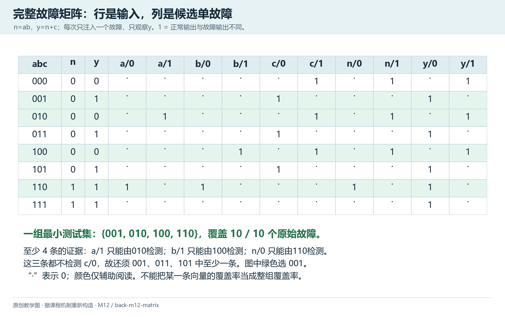{width=100%}

正常输出依次为0、1、0、1、0、1、1、1。下面把十个故障列拆成两半，避免小屏幕或纸面表格过宽。两张表的同一行是同一个输入，合起来才是完整十列。

**前五个故障列：**

| 输入abc | 正常y | a/0 | a/1 | b/0 | b/1 | c/0 |
| --- | --- | --- | --- | --- | --- | --- |
| 000 | 0 | 0 | 0 | 0 | 0 | 0 |
| 001 | 1 | 0 | 0 | 0 | 0 | 1 |
| 010 | 0 | 0 | 1 | 0 | 0 | 0 |
| 011 | 1 | 0 | 0 | 0 | 0 | 1 |
| 100 | 0 | 0 | 0 | 0 | 1 | 0 |
| 101 | 1 | 0 | 0 | 0 | 0 | 1 |
| 110 | 1 | 1 | 0 | 1 | 0 | 0 |
| 111 | 1 | 0 | 0 | 0 | 0 | 0 |

**后五个故障列：**

| 输入abc | 正常y | c/1 | n/0 | n/1 | y/0 | y/1 |
| --- | --- | --- | --- | --- | --- | --- |
| 000 | 0 | 1 | 0 | 1 | 0 | 1 |
| 001 | 1 | 0 | 0 | 0 | 1 | 0 |
| 010 | 0 | 1 | 0 | 1 | 0 | 1 |
| 011 | 1 | 0 | 0 | 0 | 1 | 0 |
| 100 | 0 | 1 | 0 | 1 | 0 | 1 |
| 101 | 1 | 0 | 0 | 0 | 1 | 0 |
| 110 | 1 | 0 | 1 | 0 | 1 | 0 |
| 111 | 1 | 0 | 0 | 0 | 1 | 0 |

例如010时a=0,b=1,c=0：正常n=0,y=0；a/1把a强制1后n=1,y=1，所以a/1格为1。再看011：c=1让OR输出恒1，因此同一个a/1故障被屏蔽，这一格变0。

图片是同一矩阵的整体视图，1用点/颜色双重标记。不是统计推测：每格都来自正常电路与一个故障电路的确定比较。

**停一下 · m12-step-3**

111看起来三个输入都开了，是否检测能力最强？它到底检出哪些故障？

先写在纸上，再到附录A核对。

### 第4步 · 用并集累计覆盖，不把重复检出重复计数

**现在做**：按110→100→010→001的顺序选行，每加一行只圈“以前没圈过”的列。

| 新加入测试 | 本次新检出的故障 | 累计检出数 |
|---|---|---:|
| 110 | a/0、b/0、n/0、y/0 | 4 |
| 100 | b/1、c/1、n/1、y/1 | 8 |
| 010 | a/1（其它命中已覆盖） | 9 |
| 001 | c/0（y/0以前已覆盖） | 10 |

所以{001,010,100,110}是一个完整测试集，原始十故障覆盖率100%。若把各行命中数4+4+4+2相加得到14，再写140%，就把重复检测错当成新增故障了；正确运算是集合并集。

现在可以在“激活、传播与最小测试集”实验中选择这四个复选框。若取消001，应该只剩9/10并明确漏c/0；恢复001又变10/10。实际操作的每次变化都应该能在纸面矩阵上找到原因。

**停一下 · m12-step-4**

选110和100共覆盖8/10；再加010为什么不是12/10？具体新增谁？

先写在纸上，再到附录A核对。

### 第5步 · 证明最少：先找谁只能被唯一一行检测

**现在做**：沿a/1、b/1、n/0三列往下找1，分别圈出唯一对应的输入。

a/1列只有010为1，因此完整测试集必含010。b/1列只有100为1，必含100。n/0列只有110为1，必含110。任何完整方案至少包含这三条，不能用别的行替代。

但这三条的c都为0，无法激活c/0；c/0列仍未覆盖，所以至少还需第四条。检查该列，001、011、101都可以，111不行，因为n=1屏蔽c。

这就得到下界“至少4条”，而上一步已给出4条可行解，因此**全局最少就是4条** 。全部三组最小集合为：{001,010,100,110}；{010,011,100,110}；{010,100,101,110}。

这比“贪心程序刚好找到4条”强：你既知道一个答案，也能解释为什么3条永远不够。考试要求最小性时，应写出这种强制行与漏项证明。

**停一下 · m12-step-5**

把集合中的001换成111，还完整吗？为什么111虽能检测y/0却没有帮助？

先写在纸上，再到附录A核对。

### 第6步 · 读出证据边界：全覆盖还不能定位每个位置

**现在做**：比较a/0、b/0、n/0三列，再比较c/1、n/1、y/1三列，看看哪些列完全相同。

前一组三列都只在110行有1，因此在这个输入/观察模型下等价；后一组三列都在000、010、100行有1，也等价。无论从八个向量中再挑哪条，都不能仅靠y区分同组的故障。

因此“十个故障100%被覆盖”表示它们都能与正常电路区分，并不表示能确定故障发生在哪个具体位置。检测与定位是不同任务。若要增加定位能力，可增加内部观察点，再重建响应字典；不能靠重复现有测试次数创造新信息。

也不要把这里的100%说成真实芯片所有缺陷检出率100%。本题明确只包括十个单stuck-at假设，没有桥接、时延、多故障与电压异常。这些限制已经在题目前给出，不需要额外阅读才能理解结论。

**停一下 · m12-step-6**

三列完全相同，但代表三个不同位置，应按原始故障数算3项还是1项？

先写在纸上，再到附录A核对。

### 合上示范，检查是否学会

**m12-exit**

独立判断集合{010,100,110,111}覆盖了多少故障？漏谁？仅替换一条向量，给出一个四条完整方案，并说明它为何最小。

**接下来**：进入第13章，把“输入如何送进去、响应如何读出来”加入时间轴，理解scan与片上图样发生器。

## 把问题方向与ATPG反过来

ATPG的输入是故障，输出是可检测它的向量；故障仿真的输入是向量集，输出是它们检测的故障。两者配合：为一个难故障生成向量后，用故障仿真找到这条向量顺便覆盖的故障，从待生成列表中删去已检项，称fault dropping。若目标是诊断、多次检测或统计各向量覆盖关系，不能不加记录就提前丢掉这些故障。

先计算无故障电路所有节点值，这是“激活哪些故障”的基础。某点正常值为$v$时，仅该点stuck-at-$\bar v$被激活；与正常相同的stuck-at-$v$不会在此向量下产生局部差异。激活仍不等于检出：还要证明该差异能传播到某个观察输出。

课程的高效流程是：无故障前向仿真；对扇出干线显式检查故障影响；在合适的无扇出区域组合局部可观察性；最后对所有可观察节点加入与正常值相反的固定故障。抽取讲义文字时反相横线可能丢失，因此一定用“相反故障被激活”这一逻辑检查公式，而不要照抄缺横线的文本。[L25 pp.90–92]

## 完整示范：一个向量检出六个故障

用 $u=ab$、$v=ac$、$y=u\oplus v$。故障位置仅选$a,b,c,u,v,y$六个节点，不另列branch，共12个单stuck-at故障。施加$(a,b,c)=110$，无故障值$u=1,v=0,y=1$。逐点只需尝试相反固定值：

```text
故障   故障传播后的(u,v,y)   检出？
a/0    (0,0,0)             是
b/0    (0,0,0)             是
c/1    (1,1,0)             是
u/0    (0,0,0)             是
v/1    (1,1,0)             是
y/0    (1,0,0)             是
```

另外六个同值固定故障没有被激活。因此本向量检出集合是$\{a/0,b/0,c/1,u/0,v/1,y/0\}$，原始覆盖为6/12=50%。这张表提供了后续优化算法的穷举参考。

将输入改成111时$u=v=1,y=0$。a/0会同时把u、v改0，y仍0，a干线故障不可见；b/0只改u，c/0只改v，均可见。若独立加入a到u的branch，那个branch/0也可见。这说明“同一逻辑值”“同一根源信号”“同一故障位置”是三个不同概念。

## 局部可观察性与故障树

在当前输入赋值下，AND某输入的局部可观察性等于其它输入全部为1；OR对应其它输入全为0；XOR单个输入翻转总使输出翻转。若输出已经可观察，可以沿满足局部条件的边反向标记输入。无扇出单路径区域内可把条件连乘，形成连续的故障树。

例：$u=ab$、$y=u+c$，输入110时$y=1$。从输出y往回：OR的c=0，所以u可观察；AND的a=b=1，所以a和b都可观察。c的旁输入u=1，对OR是控制值，所以c不可观察。于是可观察节点为$\{a,b,u,y\}$；它们的正常值均1，所以检出$a/0,b/0,u/0,y/0$。这与直接故障注入一致。

遇到扇出干线不能简单把“各分支可观察”做OR。上节111例中，a两分支分别翻转都能改变y，但同时翻转互相抵消；需要模拟stem故障后合并全部受影响路径。故障树应连续接到观察点，不能在网表中随意标几个看似敏化的局部门就宣称检测成立。

做本章走读与练习时，可用三种颜色分别标正常节点值、局部敏化边和stem故障引起的变化；最终故障集合只从已证实可观察节点导出。颜色是辅助，交卷仍需保留明确的0/1及故障标号，避免只画箭头而没有可复核证据。

## 四种方案：共同目标，不同共享方式

**串行serial** ：每个故障单独改网表并模拟，与正常响应比较。实现最直观，可作为小网表正确性参考；若F个故障、T个向量、每次求值成本G，粗略工作量为$O(FTG)$，实际还受事件活动影响。

**并行parallel** ：把同一节点在多个故障电路中的逻辑值塞进机器字位中，用位运算一次计算多个电路。最简单w位实现留1位给正常电路，最多$w-1$位给故障；64位可放63个故障。多值逻辑、不同延迟事件及故障分批会增加额外开销，所以“63倍加速”只是理想计算上限类比，不是实测结论。

**演绎deductive** ：只做一次正常逻辑仿真，同时在每个节点传播“哪些故障会让该节点异于正常”的集合；门操作变为集合并、交、差或对称差。收益来自共享正常求值，成本来自故障集合大小与集合运算。其简单规则通常针对两值、单故障、零延迟模型。

**并发concurrent** ：正常事件共享，某故障与正常电路状态发生分歧时才维护局部故障活动，恢复一致的部分可以合并。它利用大量故障电路与正常电路相同的区域，却付出动态事件和状态管理成本。上述后三种属于扩展视野；补考核心仍是L25/T25的可观察性与扇出处理方法，不能因扩展名词而忽略手算。

## 选学示范：集合传播如何保留重汇合相关性

设$L_a$表示能使当前输入节点a与正常值不同的故障集合。对于二值单故障AND：若正常输入全为1，任一输入翻转都令输出变0，因此输出传播集合为输入集合的并；若存在正常0输入，必须把所有0输入都翻为1，并且不能把任何正常1输入翻为0，因此用“0输入列表的交集，减去1输入列表的并集”。再加入门输出本身与正常值相反的stuck-at故障。

对于XOR，导致奇数个输入变化的故障才传播；二输入时是对称差$L_a\triangle L_b$，即只属于一个集合的故障。若同一stem故障同时出现在两输入列表，它被抵消。这正是上节重汇合自掩蔽的集合版本。普通并集会错误地保留这个故障。

例如正常XOR输入为1、1，$L_u=\{f,g\}$、$L_v=\{f,h\}$，则输出传播集合为$\{g,h\}$；f同时翻转两路，不改变输出。正常输出为0，加入本地输出stuck-at-1后得到$\{g,h,y/1\}$。每个集合元素代表**同一个故障身份** ，不能因它沿两条路径出现就当成两个独立随机事件。

这里是为理解数据共享而构造的小例，不是完整工业故障仿真器。时序电路、X/Z、延迟故障、桥接、多故障组合都需要扩展模型与算法；未经实现和验证不能声称这些情形也被支持。

## 怎样比较工具，又怎样验证自己的手算

问题是加速覆盖统计，基线采用串行故障注入。选择另一算法时，先统一网表、故障位置、折叠口径、向量序列、初态、逻辑域和时序模型，再比较总时间、内存峰值与完全相同的检出集合。少计算了一些故障或提前丢弃数据后的“更快”，不构成同任务加速证据。

最有价值的微型验证集包括：无故障、输出固定故障、未激活故障、AND控制值屏蔽、XOR两路抵消、stem与branch分离，以及不可测冗余故障。每个都能用手算或穷举给出答案，再让优化算法对齐。单看总体覆盖率相同不够：两个工具可能各错一列却碰巧总数相等，必须比较故障ID集合。

学习流程先预测某节点是否可观察，再改变一个输入，观察事件与故障集合如何变化，解释新检出或被掩蔽的原因，最后解决改变扇出位置的变式。每次复习从一张空网表重新算；只有看过解答的勾选不计为独立证据。若写程序，故障列表和网表必须分离，让同一组输入可用于正常与逐故障电路，减少误注入的风险。

## 练习：先作答，再查附录

### m12-q1 · 补全 · 3 分

当前节点x的正常值为0，x/0与x/1中哪一个被激活？被激活是否必然被检出？

### m12-q2 · 补全 · 3 分

w位并行故障仿真保留1位模拟正常电路。w=32时一次最多装多少个故障实例？

### m12-q3 · 独立 · 4 分

u=ab，y=u+c。输入(a,b,c)=110，故障位置a,b,c,u,y。列出全部被检出单stuck-at故障。

### m12-q4 · 独立 · 3 分

XOR两输入的故障列表为{f1,f2,f3}与{f2,f3,f4}，不计本地输出故障，输出列表是什么？

### m12-q5 · 迁移 · 4 分

两种算法报告覆盖率都是90%，是否足够证明它们等价？设计一个更强检查。

### m12-q6 · 迁移 · 4 分

用a分两路接XOR两输入，构造一个“每条分支可观察，但stem不可观察”的反例；再说明增加一个branch故障位置后的区别。

## 本章来源

- L25：III.2，印刷 pp.85–89；PDF pp.89–93
- L25：III.3，印刷 pp.90–92；PDF pp.94–96
- T25：Tutorial 9，印刷 pp.82–86；PDF pp.84–88
- AGRAWAL-FAULTSIM：作者课程Lecture 7：Fault Simulation；四类方法为选学扩展


# 13 时序测试、Scan与BIST

把状态变得可控可见，再理解压缩的代价

**关键问题**：内部状态既不能直接设置也不能直接读出时，怎样使测试仍然可管理？

**学习目标**

- 通过时间展开解释为什么时序故障需要输入序列
- 画出scan移位、capture、卸载的状态与资源时间线
- 计算明确装载重叠假设下的scan测试周期数
- 按明确定义递推手算LFSR与GF(2)签名，并解释aliasing限制

**先修**：m07、m09、m11、m12；**横向联系**：m01、m10。

## 图解跟做：逐拍看见状态：LFSR与扫描测试时间线

约40分钟。先用四位寄存器手算15态LFSR，再换到一条四位scan链，逐拍理解移位、捕获及为什么装载与卸载可以重叠。

准备纸笔，按下列步骤做。“停一下”题的答案见附录 A 对应编号；不需要另开资料。

### 第1步 · 先固定比特方向，手算第一次更新

**现在做**：画四个格子，从左到右写s3、s2、s1、s0；初值0001，圈出最右边s0与s1。

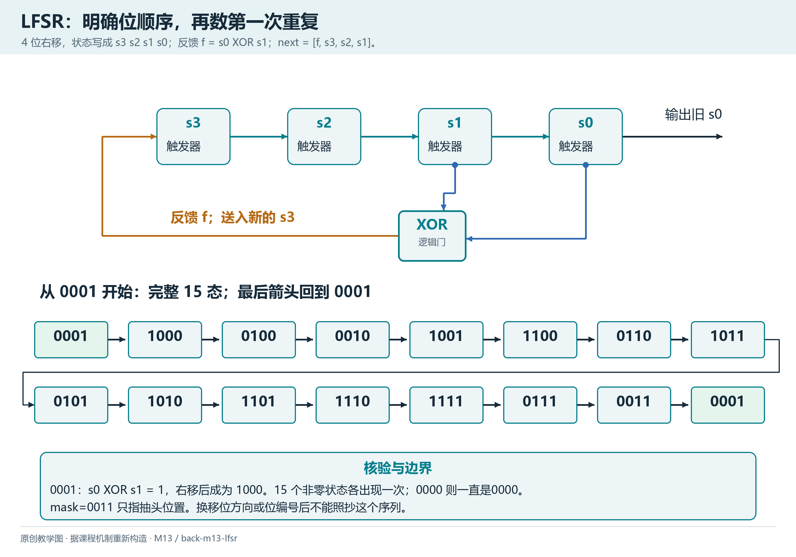{width=100%}

**LFSR完整规则：** 这是4位右移寄存器，反馈$f=s_0\oplus s_1$；新状态从左到右为$[f,s_3,s_2,s_1]$。四位同时使用旧状态更新，输出为旧s0。初始种子0001，不注入额外输入。

第一次：旧s0=1、s1=0，所以f=1。旧状态向右移一格得到0000，再把f=1放到新最左位，得到1000。不要把1放回最右位，否则你算的是另一种方向的电路。

第二次：旧1000的s0=0、s1=0，反馈0；右移后是0100。第三次0100的反馈也是0，变0010。第四次0010的s0=0、s1=1，反馈1；右移得到0001，再在最高位填1，得到1001。

因此前五个状态含种子为0001→1000→0100→0010→1001。图上每个箭头都只用“先算XOR，再右移再填最高位”这一条规则。

**停一下 · m13-step-1**

从1001出发，反馈f是多少，下一状态是什么？

先写在纸上，再到附录A核对。

### 第2步 · 一直算到第一次重复，周期才有依据

**现在做**：先遮住下一状态列，至少独立算前五行，再用完整表核对并数不同状态。

下面把每一拍都列出来，不用记抽头表或跳到外部软件。t=0是初始状态，不是已经更新过一次。

| 拍号t | 当前s3s2s1s0 | s1 | s0 | f=s0 XOR s1 | 下一状态 |
|---|---|---:|---:|---:|---|
| 0 | 0001 | 0 | 1 | 1 | 1000 |
| 1 | 1000 | 0 | 0 | 0 | 0100 |
| 2 | 0100 | 0 | 0 | 0 | 0010 |
| 3 | 0010 | 1 | 0 | 1 | 1001 |
| 4 | 1001 | 0 | 1 | 1 | 1100 |
| 5 | 1100 | 0 | 0 | 0 | 0110 |
| 6 | 0110 | 1 | 0 | 1 | 1011 |
| 7 | 1011 | 1 | 1 | 0 | 0101 |
| 8 | 0101 | 0 | 1 | 1 | 1010 |
| 9 | 1010 | 1 | 0 | 1 | 1101 |
| 10 | 1101 | 0 | 1 | 1 | 1110 |
| 11 | 1110 | 1 | 0 | 1 | 1111 |
| 12 | 1111 | 1 | 1 | 0 | 0111 |
| 13 | 0111 | 1 | 1 | 0 | 0011 |
| 14 | 0011 | 1 | 1 | 0 | 0001 |

到t=14仍是新的状态0011，再更新一次才回到0001。此前共出现15个不同状态，所以周期是15。不能只看到4个寄存器就自动写15；寄存器只有16个可能状态，而实际走过多少状态由递推决定。

你也可以在同页LFSR实验中设seed=1、mask=3，逐项比对。实验把四位显示成二进制，输入种子框用十进制；seed=1对应0001，两种写法不要混淆。

**停一下 · m13-step-2**

周期15是否包含最后再次出现的0001？为什么？

先写在纸上，再到附录A核对。

### 第3步 · 故意换一个坏条件，理解“最大周期”的边界

**现在做**：先把种子改0000，再把反馈改为只取s0，分别手算到重复。

零种子时s0=s1=0，反馈0，右移后仍0000，所以它被锁在零状态，周期1。之前那条15态环没有访问0000。

若种子仍0001，但反馈改成f=s0，则每次只是把移出的最低位搬回最高位：0001→1000→0100→0010→0001，周期4。四个寄存器没有变化，周期却从15变4，这就是“位数相同不保证最大周期”的具体反例。

合适反馈和非零种子可获得最大周期；用多项式语言要区分本原与仅不可约。此处无需先掌握抽象多项式理论：你已经通过完整状态表验证了本例的15与反例的4、1。后面的深入正文再解释这些结构性条件。

LFSR产生的是确定序列。每次相同种子和规则都得到同一结果，这有利于重复测试，但不代表密码学安全随机性，也不等于所有故障都会被这些图样检测。

**停一下 · m13-step-3**

如果从0001重复得到相同15态序列，这说明实验可复现，还是说明它没有随机测试用途？

先写在纸上，再到附录A核对。

### 第4步 · 换到scan链：亲手把1010装进去

**现在做**：另画一条独立的四位扫描链Q3…Q0，初态0000；每个shift沿新Q3=scan_in，其余右移，scan_out读旧Q0。

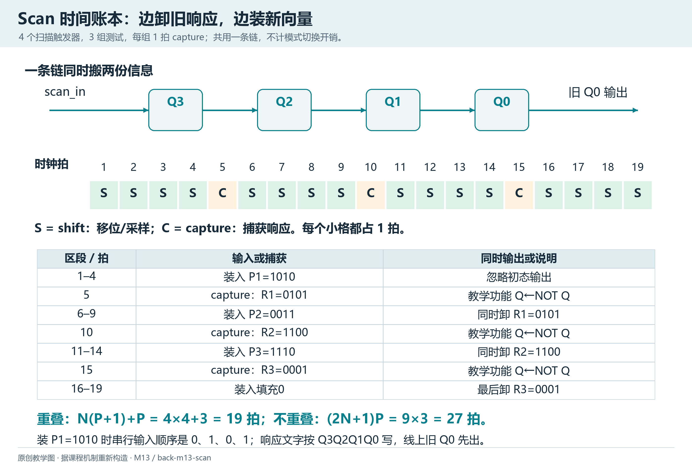{width=100%}

**这是第二个独立实验，不是上一LFSR的反馈模式。** 这里scan_in由我们控制。目标是4拍后让Q3Q2Q1Q0=1010，所以依时间先后输入0、1、0、1：先送的位最终移动到最右边。

| 周期 | scan_in | 边沿前状态 | 边沿后状态 |
|---|---:|---|---|
| 1 | 0 | 0000 | 0000 |
| 2 | 1 | 0000 | 1000 |
| 3 | 0 | 1000 | 0100 |
| 4 | 1 | 0100 | 1010 |

装载结束后，关闭shift模式并进行capture。本例给出一个完全确定的教学功能：capture时$Q\leftarrow\neg Q$，因此第5拍把1010变成响应R1=0101。真实待测电路的capture逻辑可以复杂得多；此处用取反只为让你看清时序和数据，不声称这是通用扫描功能。

**停一下 · m13-step-4**

目标状态1010为什么不是按时间先后输入1、0、1、0？

先写在纸上，再到附录A核对。

### 第5步 · 同一批4拍：一边读R1，一边装P2

**现在做**：R1=0101已在链里。下一目标P2=0011，因此第6–9拍输入1、1、0、0，并在每拍记录旧Q0。

| 周期 | 输入位 | 边沿前状态 | scan_out旧Q0 | 边沿后状态 |
|---|---:|---|---:|---|
| 6 | 1 | 0101 | 1 | 1010 |
| 7 | 1 | 1010 | 0 | 1101 |
| 8 | 0 | 1101 | 1 | 0110 |
| 9 | 0 | 0110 | 0 | 0011 |

输出序列按时间为1、0、1、0，这是R1=0101从最低位先移出的顺序。与此同时，链内已经装好P2=0011。没有必要先花4拍把R1移空，再花4拍装P2；同一条链的每拍同时完成“旧位出、新位入”。

第10拍capture，把P2取反得到R2=1100。第11–14拍同理可一边移出R2，一边输入0、1、1、1装P3=1110。第15拍capture得到R3=0001；第16–19拍最后卸载R3，输入填0即可。

**停一下 · m13-step-5**

第6–9拍读出的四位是1010，而R1写作0101，这是不是数据错了？

先写在纸上，再到附录A核对。

### 第6步 · 用时间线计数，不先套公式

**现在做**：按图圈出4段shift和3次capture：首装、两次重叠交换、末卸载。

| 周期段 | 模式 | 这段完成什么 |
|---|---|---|
| 1–4 | shift | 初次装入P1 |
| 5 | capture | 得到R1 |
| 6–9 | shift | 卸R1，同时装P2 |
| 10 | capture | 得到R2 |
| 11–14 | shift | 卸R2，同时装P3 |
| 15 | capture | 得到R3 |
| 16–19 | shift | 卸最后响应R3 |

总周期$4+1+4+1+4+1+4=19$。现在才推广：链长N、P组测试、每组capture c拍，允许中间卸载/装载重叠时，$C=N(P+1)+Pc$。代入N=4、P=3、c=1，同样是19。

若不重叠，每组都单独装4拍、捕获1拍、卸4拍，共$3(4+1+4)=27$拍。这里节省8拍来自两个中间交接，每次少花4拍；不是凭空让移位更快。这个教学模型不计模式切换额外等待，也没有多链、压缩、功耗降频等额外因素。

**停一下 · m13-step-6**

为什么最后还要第16–19拍？第15拍不是已经capture了吗？

先写在纸上，再到附录A核对。

### 合上示范，检查是否学会

**m13-exit**

两个小测一起独立做：①按本章LFSR规则，从0010更新一次；②一条8位scan链测试2组，每组capture1拍，中间允许卸载与装载重叠，含首装与末卸，共几拍？

**接下来**：现在再读本章签名压缩与混叠的深入正文，并完成练习；你已有具体状态和时间轴，可以把每个抽象术语放回相应步骤。

## 先看一段状态序列，而不是一个输入向量

组合电路的输出只由当前输入决定；时序电路还依赖状态。写成$q_{t+1}=F(q_t,x_t)$、$y_t=G(q_t,x_t)$后，测试问题自然变成：先把电路带到能激活故障的状态，再让故障效应经过若干拍传播到输出。时间展开把每拍组合逻辑复制一层，前一层寄存器D连接后一层Q。

注意同一个永久stuck-at故障在每个时间帧都存在，不能只在某一层注入后就让它自动恢复。正常与故障电路的状态也可能逐渐分歧，要分别追踪。把故障效应传播到寄存器D并不一定已经检测，通常还需capture并继续观察Q或输出。

小例：$q_{t+1}=x_t$、$y_t=q_t$，目标为寄存器输入连接D/0，初态$q_0=0$。在$t=0$施加$x_0=1$，此时$y_0$仍0；下一有效沿后正常$q_1=1$，故障$q_1=0$，才在$y_1$出现差异。若读输出过早，会误判没有检测；若不知道初态，必须考虑初始化序列或扫描装载。

## Scan怎样让寄存器成为可访问的边界

全扫描将寄存器改成可在正常D输入与串行scan输入之间选择的单元。scan_enable=1时，寄存器串成移位链，从scan_in逐位设置内部状态并把旧状态从scan_out移出；scan_enable=0时执行正常逻辑，在功能时钟边沿capture响应。对组合ATPG而言，寄存器输出可看作伪主输入、寄存器输入可看作伪主输出。

```text
装载状态（shift） -> 施加主输入 -> 功能捕获（capture）
         -> 卸载响应，同时装载下一个状态（shift）
```

“扫描把时序电路变成组合问题”是测试抽象：真实电路仍有寄存器、移位时钟、scan模式和时序约束。扫描链本身也可能有缺陷，capture可能需要一拍或多拍，at-speed测试还要明确launch/capture协议，不能从普通单拍模型直接外推。

全扫描提升可控性与可观察性，代价是mux、布线、面积、时序负载和大量shift周期；部分扫描只连接部分寄存器，成本较低，但剩余状态仍需时序ATPG。多链缩短最长链，通常需要更多并行I/O或压缩结构。高shift切换活动可能带来功耗问题，不能只用“链越多越好”做设计结论。

## 手算测试时间：先声明有没有重叠

设单链长度N，有P组测试，每组capture占c个周期；shift和capture用同一频率f。采用常见重叠方式：初次装载N周期，之后每次capture后卸载旧响应时同时装载下一向量，最后还要卸载最后响应。总周期为

$$C=N(P+1)+Pc,\qquad t=C/f.$$

例：N=1000、P=10、c=1、f=10 MHz。初装1000，10次capture共10，中间9次重叠shift共9000，最终卸载1000，合计11010周期，时间1.101 ms。若每组均单独装载再单独卸载且不重叠，则是$P(2N+c)=20010$周期，不能混用两个公式。

若改成4条完全平衡的250位链，且4位输入输出能并行传送、频率和capture条件相同，用最长链长度250替换N，得到2760周期、0.276 ms。这个数字是教学解析估算；并未包含模式切换、链不平衡、压缩初始化、ATE协议和功耗降频。比较资源预算时必须把多出的I/O或解压缩硬件列出来。

边界检查：P=0时没有测试，不应硬套公式仍要求装载；N=0退化为无扫描状态，只剩capture；P=1时必须保留首次装载和最终卸载，得到2N+c。实际工具可能把最后响应采样定义不同，所以作答开头写清时间线。

## LFSR：先固定比特顺序，再谈多项式

LFSR在GF(2)上工作：加减都是XOR，没有进位。为避免抽头图的左右约定混乱，本例直接定义3位状态$q_2q_1q_0$表示$s(X)=q_2X^2+q_1X+q_0$，每步执行$s'=Xs\bmod p(X)$，取$p(X)=X^3+X+1$。因此状态递推为$(q_2',q_1',q_0')=(q_1,q_0\oplus q_2,q_2)$。

从001开始逐拍为：

```text
001 -> 010 -> 100 -> 011 -> 110 -> 111 -> 101 -> 001
```

共访问7个非零状态，周期$2^3-1=7$；000会一直保持000。最大周期需要对应**本原多项式primitive polynomial** 、合适实现和非零种子。仅“不可约irreducible”并不充分：$X^4+X^3+X^2+X+1$在GF(2)不可约，却使从0001开始的余式序列为0001、0010、0100、1000、1111，然后回到0001，周期只有5而非15。这是对讲义p105简略表述的重要补充。

Fibonacci与Galois、XOR与XNOR、左移与右移可能使用不同抽头写法和锁死态。OpenTitan的参数化实现明确区分XOR全零与XNOR全一的寄生态，并设计重置种子保护；这是具体工程实现，不能把其中的保护自动算进课堂普通LFSR。该工程资料的验证范围也与自己只遍历3位实例不同。[OPENTITAN-LFSR]

## 签名分析与aliasing：压缩不会凭空创造信息

把响应位流表示成多项式$a(X)$，用生成多项式$p(X)$相除，余式作为n位签名。约定比特串最高位先读，初始余式0，不额外补零；例$a=1101$对应$X^3+X^2+1$，$p=1011$对应$X^3+X+1$。GF(2)除法只需一次XOR：1101 XOR 1011 = 0110，因此签名为110，即$X^2+X$。

错误响应0110也得到签名110。两响应之差为1011，恰是生成多项式的倍数，所以被压缩掩蔽。这叫aliasing：响应已经不同，最终签名却相同。它不同于故障根本没激活、没传播到响应，后两种属于测试图样覆盖不足。

若长度L的所有非零错误序列等可能，且压缩映射满秩到n位签名，漏检比例为

$$P_{alias}=\frac{2^{L-n}-1}{2^L-1}\approx 2^{-n}\quad(L\gg n).$$

此式包含分布和映射假设，不是任意确定故障的保证。上面指定错误1011的掩蔽概率就是1；对均匀抽取的4位非零错误且n=3，比例为1/15，不能直接精确写成1/8。MISR将多路响应并行注入签名寄存器；具体递推还依赖输入映射、初值、时钟和多项式，必须按电路定义手算。

## BIST的取舍：图样生成、响应压缩与控制缺一不可

BIST把图样发生器、待测电路、响应压缩和测试控制放在片上。基线为外部设备送入确定性向量、逐响应比较；BIST可减少外部数据传输并支持系统内自检，但增加硬件、切换功耗和设计验证成本。一个LFSR本身不是完整BIST：还需正确的模式切换、时钟/复位、测试时长、黄金签名和pass/fail判定。

伪随机向量对某些随机模式难测故障很低效。若单次独立随机输入检出某故障的概率为p，K次独立试验未检出的概率是$(1-p)^K$；LFSR序列确定且相关，这个公式只能作为明确独立假设下的估算，不能直接证明真实LFSR覆盖。可用加权随机、确定性top-up向量、测试点插入等办法改善覆盖，各有额外成本。

反例是所有测试图样都未激活某个故障，此时增加MISR位数也无济于事；相反，图样已导致错误响应，却恰被签名压缩掩蔽，则改图样、改变签名设计或扩大签名才相关。验证应分别报告故障覆盖、响应压缩aliasing模型、总测试周期与硬件代价。最大周期LFSR并不等于密码学安全随机数发生器，确定性结构不提供那种安全保证。

本章结束应能画出shift/capture状态时间线、列出至少一条LFSR完整周期、完成一次GF(2)长除法，并用一句话区分“未激活”和“签名碰撞”。这些是独立能力证据，背出Scan、BIST缩写不算完成。

## 练习：先作答，再查附录

### m13-q1 · 补全 · 3 分

单链N=100，P=5，capture每组1周期，允许卸载与下一组装载重叠。包括首装与末卸，总周期是多少？

### m13-q2 · 补全 · 3 分

按本章3位LFSR递推，当前状态100，下一状态是什么？请填写三位字符串并解释XOR。

### m13-q3 · 独立 · 4 分

按最高位先读、初始余式0、不补零的约定，1101除以1011的3位签名是什么？再找一个不同的4位响应具有同签名。

### m13-q4 · 独立 · 4 分

为什么“不可约多项式+非零种子一定获得2^n−1周期”不正确？用本章4位例子说明。

### m13-q5 · 迁移 · 4 分

8位签名寄存器是否保证每一种故障只有1/256的漏检概率？若不是，给出反例与正确适用条件。

### m13-q6 · 迁移 · 4 分

比较一条1000位链与四条250位链测试10组向量：capture各1周期、10 MHz、均允许重叠。说明时间收益及至少三项未计成本。

## 本章来源

- L25：III.5，印刷 pp.100–107；PDF pp.104–111
- T25：Tutorial 11，印刷 pp.95–97；PDF pp.97–99
- OPENTITAN-LFSR：prim_lfsr文档：参数、锁死态保护和验证范围；master于2026-11-08所见
- XAPP052：Peter Alfke, XAPP052 v1.1, 1996-07-07；最大周期抽头与编号约定

# 交互实验的模型、手算与边界

## 把真值表压成最小 SOP

**先预测**：先写下你预计的 PI 数、EPI 数与最优 literal 数。再运行核对。

**模型**：最多4变量、单输出、两级 SOP。先穷举 QM 合并，再按总 literal 最少、项数最少的字典序选择覆盖；保留最多32个并列解。

**参数与假设**：a 为最高位。On-set 与 don’t-care 不相交。DC 可用于合并，却不是必须覆盖的列。门延迟、反相器共享、负载和工艺映射不计成本。

**手算校验**：n=3，On={1,3,5,7}，DC={}：001、011、101、111 合为 --1，即 c，1 个 PI、1 个 literal。

**边界校验**：空 On-set → 0；全部为1 → 1（0个literal）；On 与 DC 重叠必须拒绝。

**迁移问题**：用 On={0,1,2,5,6,7}，解释为什么没有EPI仍然存在最优覆盖。再加入DC={3,4}，说明为什么可以化成1。

**限制**：不是完整 Espresso 或工业综合器；literal 最小不保证实际面积/时序最优。

来源：L25、T25。

## 改变顺序，观察 BDD 大小

**先预测**：比较 a,c,b,d 与 a,b,c,d，先预测哪一种能更早合并相同余因子。

**模型**：真值表递归 Shannon 展开；删除 low=high 的节点；通过 (变量,low,high) 唯一表共享节点。计数仅包括非终端节点。

**参数与假设**：四个变量 a,b,c,d；全图统一顺序；不使用补边，不进行动态变量重排；0、1终端不计数。

**手算校验**：默认 f=(a↔c)(b↔d)，On={0,5,10,15}。a,c,b,d 顺序有6个非终端节点；a,b,c,d 有9个。数值由本模型穷举验证。

**边界校验**：空 On-set 只剩终端0；全 On-set只剩终端1；f=d只有一个非终端节点。

**迁移问题**：改为奇校验函数 On={1,2,4,7,8,11,13,14}，尝试两种顺序，解释为什么并非所有函数都对顺序同样敏感。

**限制**：仅教学规模；构建阶段仍枚举真值表，不能把这个实现的运行时间当工业BDD性能。

来源：L25、BRYANT86。

## 短脉冲与事件队列

**先预测**：默认 w=2ns、d=3ns，分别画出transport与inertial波形，再执行。

**模型**：单个非反相门，输入在1ns上升，在1+w ns下降；transport传递两个事务，简化inertial拒绝宽度小于d的脉冲。显示事件、delta、挂起事务与队列占用。

**参数与假设**：初值全部0，门延迟常数d。采用 w<d 拒绝、w=d通过的边界定义；d=0时更新发生在下一delta。输入只包含这一段脉冲。

**手算校验**：transport：t=4ns输出1、t=6ns输出0。inertial：t=3ns输入下降时撤销计划t=4ns的上升；输出始终0。

**边界校验**：w=d边界通过；d=0不会增加物理时间但delta加1；w≤0拒绝。

**迁移问题**：令w=3ns，d=3ns，观察阈值两侧。再解释两个零延迟串联赋值为何需要多个delta而不是延长物理时间。

**限制**：不是IEEE VHDL完整波形事务/拒绝时间实现，也不模拟模拟电压、亚稳态、完整多驱动解析或真实电路毛刺宽度。队列占用是教学事务数，不是CPU性能预测。

来源：L25、F073、GHDL-SIM。

## 激活、传播与最小测试集

**先预测**：在计算前先求n/0的测试：激活要求n=1，传播经过OR要求c=0，因而abc=110。

**模型**：固定网络 n=a∧b，y=n∨c；在a,b,c,n,y五条声明信号线上枚举单stuck-at-0/1，共10个故障。穷举8个向量的无故障与有故障输出。

**参数与假设**：输入位顺序abc，单故障，确定二值逻辑，输出仅观察y。每个输入仅出现一次，因此此网络没有单独列出的扇出分支故障。

**手算校验**：测试110检出a/0、b/0、n/0、y/0，共4/10=40%；100检出b/1、n/1、c/1、y/1。联合后仍需检查剩余故障。

**边界校验**：不选向量覆盖率0%；全部8个向量覆盖10/10。相同检测向量集合才是本模型下等价。

**迁移问题**：尝试找到4个向量覆盖全部10个故障，并证明3个不够。提示：a/1、b/1、n/0各有一个不同的唯一检测向量；c/0还需要c=1。再解释删去冗余故障后的分母为何不能与原10故障分母混用。

**限制**：不包含桥接、时延、瞬态、多故障，也不将故障覆盖率等同于实际芯片缺陷检出率。

来源：L25、T25、F071。

## LFSR 的状态与周期

**先预测**：seed=0001时先手算五拍，再预测零种子和mask=1的行为。

**模型**：4位右移 Fibonacci LFSR。显示s3s2s1s0；f=各mask置1位置对应状态位的XOR；next=(state>>1)|(f<<3)。输出旧s0。追踪直至状态重复。

**参数与假设**：位方向、抽头和反馈式均显式定义，不能只凭一个多项式字符串套另一资料的移位图。默认mask=3，即f=s0⊕s1。

**手算校验**：默认mask=3：0001→1000→0100→0010→1001；周期15。对应本约定输出序列满足u(t+4)=u(t+1)⊕u(t)，特征多项式x⁴+x+1。

**边界校验**：全零seed锁定零，周期1；mask=1且seed=1只轮转，周期4。不可约并不自动等于本原。

**迁移问题**：改mask并记录周期，找一个短周期反例。说明MISR的2^-r混叠近似还需要什么错误分布假设。

**限制**：这是确定性小型递推，不验证某个实际MISR的别名概率、不代表随机测试覆盖率。

来源：L25、T25。

## 接受坏解的温度

**先预测**：Δ=2、T=2、r=0.4，该移动是否接受？先算p。

**模型**：最小化代价，Δ=Cnew−Cold。Δ≤0接受；否则p=exp(−Δ/T)，若均匀随机数r∈[0,1)满足r<p则接受。T=0时不接受变差。

**参数与假设**：代价与温度同一归一化尺度；此实验显示单步接受规则，非完整布局或逻辑综合的退火过程。r为可手动固定的随机样本以便复现。

**手算校验**：p=e^-1≈0.367879，小于0.4，因此拒绝。保持r不变，提高T至4，p≈0.606531，因此接受。

**边界校验**：Δ≤0必接受；T=0且Δ>0拒绝；r不能等于1；负温度不合法。

**迁移问题**：比较T=0.5、2、10；再说明高接受率为什么不能证明更优最终解，提出同预算、多seed的验证办法。

**限制**：不声称退火保证在有限考试步数或有限运行时间内得到全局最优。

来源：L25、F006。

# 机制、成本与方案比较

## 同一函数：精确 QM 与启发式覆盖

### 问题与基线

给定同一单输出函数及相同 On/Off/DC 集，求覆盖 On 且不覆盖 Off 的 SOP。基线是全部最小项组成的 CSOP。固定代价为 literal 总数；若相同再比较项数。不能用一种算法的项数和另一种算法的 literal 数直接比较。

### 机制与证据

精确方法先生成完整 PI，再求全局最小覆盖。启发式通常先取必要项，再按局部覆盖收益选项，或在合法 expand/reduce/remove 之间迭代。本网站 QM 实验以独立全cube枚举和精确覆盖 oracle 校验全部3变量函数以及带DC的全部6561种三值规范；这是有限教学规模上的穷举证据，不是算法任意规模的性能测量。

### 成本与适用条件

精确法给出指定代价下的最优性，但候选与覆盖搜索可能指数增长。启发式可在较大问题上寻求可用解，成本取决于具体规则、起点和停止条件；本站没有测量工业工具运行时间。小变量考试题适合把全过程写完整，大规模综合则必须考虑预算。

### 反例与验证办法

PI集合不是最小覆盖。没有 EPI 不代表无解；DC不要求覆盖。用 On={0,1,2,5,6,7} 的六环覆盖表说明局部第一选择可能造成不同后续搜索。验证至少包含：每个On被覆盖、每个Off未被覆盖、成本口径一致、最优性有穷举或下界依据。比较运行时间时需同一输入、同一机器、相同停止条件与多次统计，不能凭一次迭代次数宣布更快。

## 同一函数：两级 SOP 与因式分解

### 问题与基线

实现 f=ab+ac+db+dc。固定二值组合功能、只有二输入AND/OR、每门单位延迟、不计导线/负载/反相器。基线用四个二输入AND形成乘积，再用三只OR做平衡树。

### 机制与证据

利用分配律得到 f=(a+d)(b+c)。先两个OR，再一个AND。本例可对16种输入逐行证明等价；SOP有8次literal出现，因式形式4次。按上述统一库，基线7门、最长3门延迟；分解后3门、最长2门延迟。所有数字都是明确教学模型下的手算，不是标准单元面积或ns实测。

### 成本与适用条件

因式分解复用结构，往往减少literal与门数；更一般的网络会增加扇出，改变逻辑深度、线长和重汇合。若门库提供大扇入复杂门，基线的计数与深度会改变，不能沿用7与3。

### 反例与验证办法

面积更少不自动保证更快。例如提取一个被许多路径共享的项，可能增大该节点负载。先进行等价验证，再在相同门库、负载、输入转换时间和约束下做技术映射与静态时序比较。本课的literal代价是抽象代理，不能外推功耗或芯片面积。

## 同一函数：ROBDD 两种变量顺序

### 问题与基线

表示 f=(a↔c)(b↔d)。固定同一个函数、无补边的约简有序BDD、相同归约规则，统计非终端节点。基线顺序a,b,c,d。

### 机制与证据

基线需要先记住a和b的取值，再和c、d核对。交错顺序a,c,b,d更早完成第一对相等判断，使余函数共享更快出现。教学模型穷举得到基线9个非终端、交错6个；两者仍表示同一个16行真值表。原始Bryant论文讨论固定顺序下规范表示和变量顺序的重要性，本站小例不代表该论文性能实验。

### 成本与适用条件

好的顺序可以降低表示大小，但寻找好顺序也有成本。固定顺序下的规范性不能被误读为任意变量顺序的图完全相同。规模增大后某些函数仍有指数级最坏情况。

### 反例与验证办法

奇校验函数对本例几种顺序的节点数可能不变，不能将“交错总更好”当规律。对每个输入沿低/高边走到终端，确认与函数一致；检查同一变量在所有路径的相对顺序一致、low≠high、无重复同构节点。性能评估需固定补边机制、动态重排策略、缓存以及统计终端是否计入。

## 同一测试任务：串行与并行故障仿真

### 问题与基线

给定固定网表、固定向量集和固定10个单stuck-at故障，返回每个向量检测哪些故障。基线分别运行无故障电路和每个故障电路。这里比较的是完成同一检测矩阵的计算组织，不能随意改变故障分母。

### 机制与证据

串行组织对每个故障注入、传播、比较。位并行把多个故障机的同名信号打包成机器字；若一个32位字中保留1位正常机，则最多31位表示故障机。10故障可放入一批。这是位宽容量计算，不是实测31倍加速。真正时间还受字宽、数据搬运、故障注入、检测后丢弃策略以及波形复杂度影响。

### 成本与适用条件

并行法适合相同逻辑操作同时作用于许多故障机；串行法结构直观，便于逐故障调试。复杂多值逻辑可能需要额外位平面；带时间的故障仿真还需处理不同故障机不同事件，不能直接套零延迟位并行性能。

### 反例与验证办法

若只看最终覆盖率而不逐项比检测矩阵，两个错误实现可能都得到100%。应以简单电路的独立穷举结果作oracle，逐向量、逐故障核对，再比较相同输入和统计范围内的墙钟时间与内存。重汇合处不能简单合并故障集合，必须计算差异会否互相抵消。

## 同一状态机：二进制编码与 one-hot

### 问题与基线

实现同一个4状态、相同输入输出及复位语义的FSM。基线用2个状态触发器二进制编码。这里先固定状态转移，不改变可达行为，再比较编码。

### 机制与证据

二进制用2位表示4个状态；one-hot用4位，每个合法状态恰有一位为1。触发器数量的2与4是编码定义下的精确计数。one-hot可能简化部分状态判断与转移逻辑，但逻辑级数、面积和最大频率由具体转移图及门库决定，本课程不虚构百分比收益。

### 成本与适用条件

二进制节省状态位；one-hot增加寄存器和时钟负载，可能使某些转移译码更直接。若状态位便宜、时序紧张且状态图稀疏，可考虑one-hot。若寄存器与时钟功耗重要，必须评估二进制。

### 反例与验证办法

最少状态数不必对应最少门或最快实现；编码也会引入不同数量的非法状态组合。验证须同时检查：复位落在合法状态、所有可达输入序列输出等价、非法状态恢复政策一致、综合约束与目标技术相同。只比较寄存器数不足以声称总面积最优。

# 历年卷地图与模考

## 先问自己“哪一步不会”，再安排学习

挂科后的复习很容易变成不断重看讲义。一个更可检查的起点是拿白纸做短诊断：给定一个三变量函数，写on-set、cofactor和一个化简；给定覆盖表，选最小覆盖；给定FSM表做一轮划分；给定两门电路做一条事件；给定stuck-at故障写激活条件。每题只花5分钟，不会就写出卡在哪一步。

把卡点分成四层。第一层是符号：反相、变量权重、cube的星号、信号值与故障编号。第二层是操作：合并、cofactor、划分、排队、D传播。第三层是停止条件：哪些项已成为PI、划分是否稳定、队列是否空、搜索是否穷尽。第四层是边界：don’t-care能否覆盖、启发式是否最优、指定路径无解是否等于整个故障不可测。补最早出错的一层，后面的计算才有意义。

诊断是调度工具，不是能力判决。一次做不出表明需要一条示范路径；一次看懂答案也不等于能够独立完成。

## 每个题型都走“示范—补全—独立—迁移”

示范阶段逐行追问为什么。例如Quine合并时，不只读“00-1”，而要说出哪两项只有一个固定位不同，以及为何其余星号位置相同。补全阶段遮住关键一列，自己填PI列表或新事件；保留题干和前一步，不马上重做整题。

独立阶段换一道未见过的同结构题，不打开答案、不复制示范中的数字。作答后按量表检查：前提、方法、过程、结果、验证。开放题采用自评，站点不把关键字匹配冒充可靠自动评分。

迁移阶段只改一个条件：变量顺序改了，函数应不变但BDD大小可能变；故障极性反转了，激活条件会变；门延迟变了，事件次序可能变；相邻两个cube分别可删，并不意味着一起可删。能够说出“不变的是什么、变化的是什么”，才说明学到了机制。

## 60分钟训练卷如何分配时间

五份历史样本均标60分钟、60分，可以先用“每分约1分钟”作为训练标尺。正式考试若时间或分值不同，要按通知调整。建议前2分钟扫卷、按题号标记熟悉程度，最后保留5分钟检查；剩余时间按分值分配。不是每个问题都值得同样多的时间。

先写能够确定的入口：QM的minterm二进制、BDD的两条cofactor、FSM的初始输出分组、仿真的稳定初值、ATPG的激活值。入口正确且过程清楚，后续即使没有收敛，也比只写一个猜测的答案容易核查。

某个分支卡住超过预算的一半，保留中间结果、标明待查处并跳到可独立完成的小题。不要在覆盖表上无限试组合，也不要为了一个D算法分支吞掉整卷测试题时间。历史试卷声明小题可独立解答，但具体题目仍要看是否共享定义。

最后检查五件事：变量顺序；反相横线；cover是否漏掉on-set或误含off-set；时刻是否加了门延迟；D向量是否真的让好坏电路输出不同。参考答案与自己的变量排列不同时，先统一表示再比较。

## 错题记录要留下可验证的修复

每条错题只需记录六项：题目来源与页码、自己的原答案、首次错误步骤、错误类型、正确规则、下一次验证时间。不要只记“粗心”，而要写“把cofactor当成乘法保留了绑定变量”“删除cube时仍把被删项放在h内”“事件表按输入顺序处理，未按执行时刻排序”。这种描述才对应可练习的动作。

复盘先找首次错误，不把由同一错误连带产生的十个错误当成十个知识缺口。规则修复后，立刻做一个微小反例，再隔一天做同类新题。若只会背原答案，把状态或变量改名；若改名就不会，说明依赖视觉记忆，需要重新解释机制。

间隔复习默认1、3、7天，剩余时间不足时可改为1、2、4天。每次复习优先在白纸上重建步骤，再打开记录核对。阅读、复习提醒到期、真正通过独立题是三种不同状态。

## 这份路线怎样做到不另开资料

每个模块先给完整图解跟做课：题目条件、符号、图、逐步计算与验证都在同一页。每个“停一下”的补全题带参考答案；章末题带独立量表。本站的卷A与卷B包含全部所需条件，不要求先打开历史PDF。

按每日路线点章号，先完成图解，再做指定题号。遇到不懂的词，先查本章与站内中英术语；卡在计算时回图解中同一操作。来源编号用于追溯课程口径，完全可以在学完以后再查。历史卷地图保留作扩展选择，不是必做任务。

这些图为依据课程机制重新绘制的教学图，题目为站内完整练习或原创变式。它们用于训练课程能力，不冒充学校正式题库，也不能保证本次补考覆盖范围。

## 把新知识接到熟悉的计算机知识上

如果你熟悉CPU/GPU/存储：把cube看成对输入地址的一组位掩码，把QM看成把相邻且等价的地址区间合并；边界是cube不要求连续十进制地址，它对应布尔维度，而非一般数值区间。把ROBDD看成共享的条件决策图；边界是规范性需要固定变量顺序及归约规则，不是任意if树都有唯一结构。

把事件仿真队列类比成按时间排序的任务队列；边界是模拟时间和墙钟时间不同，同一时刻可能还有delta迭代，排队操作不能任意改变信号语义。把scan类比成给内部状态开调试读写通道；边界是扫描模式、功能模式和capture时序必须分开，不能把scan位移当作正常工作状态转移。

如果这些背景并不熟悉，可以直接从真值表、门电路和纸笔事件表开始。类比只用于建立入口，所有计算最后回到布尔语义和题目明确的模型。

## 2019_retake 标签卷（卷面日期 2020-06-29）

来源 F086；卷面日期 2020-06-29；60 分钟 / 60 分；可用于限时作答，先隔离答案。

- 1a（5分）：cube、multiple implicant 与 CompSOP 概念。对应 m02、m03、m05；PDF p.2。
- 1b（4分）：覆盖表的启发式选择。对应 m03；PDF p.2。
- 1c（5分）：Quine 算法求全部素蕴含项。对应 m03；PDF p.3。
- 1d（3分）：NAND-only 与 NOR-only 代数转换。对应 m02；PDF p.3。
- 1e（3分）：函数分解矩阵及中间编码位数。对应 m05；PDF p.4。
- 1f（3分）：从 ROBDD 求 SOP、POS、CompSOP。对应 m06、m03；PDF p.4。
- 1g（4分）：cube 图和 on-set。对应 m02；PDF p.5。
- 2a（4分）：通过恒真检验删除 literal。对应 m04；PDF p.6。
- 2b（4分）：FSM 分组最小化。对应 m07；PDF p.6。
- 3a（5分）：事件驱动仿真。对应 m08；PDF p.7。
- 4a（3分）：全局蕴含、可测性和 AND-XOR。对应 m10、m11；PDF p.8。
- 4b（5分）：故障覆盖、检测与区分。对应 m10；PDF p.8。
- 4c（4分）：AND-XOR 与输入 stuck-at 的布尔差分。对应 m11；PDF p.9。
- 4d（4分）：内部信号的布尔差分。对应 m11；PDF p.9。
- 4e（4分）：故障路径及 D 算法。对应 m11；PDF p.10。

## 2020 正考（2020-12-03）

来源 F087；卷面日期 2020-12-03；60 分钟 / 60 分；可用于限时作答，先隔离答案。

- 1a（6分）：布尔函数计数、真值表、CSOP 与表示。对应 m02、m03；PDF p.2。
- 1b（5分）：覆盖条件、MinSOP 与 EPI。对应 m03；PDF p.3。
- 1c（2分）：POS 到 CompSOP。对应 m03；PDF p.3。
- 1d（5分）：给定顺序构造 ROBDD。对应 m06；PDF p.4。
- 1e（6分）：多输出共享 implicant 的成本。对应 m05；PDF p.5。
- 1f（4分）：售货机 FSM 读图。对应 m07；PDF p.6。
- 1g（4分）：分别/同时删除 cube 与扩张。对应 m04；PDF p.7。
- 1h（6分）：FSM 最小化和最小状态图。对应 m07；PDF p.8。
- 2a（5分）：事件驱动仿真表。对应 m08；PDF p.9。
- 2b（2分）：带触发器的波形。对应 m08；PDF p.10。
- 3a（3分）：AND-XOR、零布尔差分与回溯原因。对应 m11；PDF p.11。
- 3b（4分）：故障覆盖与删除测试后的漏测。对应 m10；PDF p.11。
- 3c（5分）：结构故障路径与 D 算法。对应 m11；PDF p.12。
- 3d（3分）：局部可观测性组合与故障树。对应 m12；PDF p.13。

## 2021 正考（2021-12-10）

来源 F088；卷面日期 2021-12-10；60 分钟 / 60 分；可用于限时作答，先隔离答案。

- 1a（6分）：代数恒等、on-set、cofactor、真值表。对应 m02；PDF p.2。
- 1b（7分）：CSOP、覆盖条件和启发式比较。对应 m03；PDF p.3。
- 1c（4分）：Resolution layer algorithm。对应 m03；PDF p.4。
- 1d（4分）：状态编码与状态/输出函数。对应 m07；PDF p.4。
- 2a（6分）：配置图、恒真检验与 cube 扩张。对应 m04；PDF p.5。
- 2b（5分）：多输出共同 implicant 的收益。对应 m05；PDF p.6。
- 2c（4分）：售票机 Mealy FSM 设计与找零变式。对应 m07；PDF p.7。
- 2d（4分）：1/2/3-equivalent 状态划分。对应 m07；PDF p.8。
- 3a（3分）：含触发器的事件仿真。对应 m08；PDF p.9。
- 3b（3分）：补全 VHDL 电路描述。对应 m09；PDF p.10。
- 4a（2分）：ATPG 冲突与分区降低复杂度。对应 m11、m13；PDF p.11。
- 4b（3分）：布尔差分求 x/0 与 x/1 全部向量。对应 m11；PDF p.11。
- 4c（6分）：学习全局蕴含与 D 算法。对应 m11；PDF p.12。
- 4d（3分）：组合局部可观测性构造故障集。对应 m12；PDF p.13。

## 21_retake 标签答案卷（卷面日期 2022-05-06）

来源 F089；卷面日期 2022-05-06；60 分钟 / 60 分；含答案，不宜用于未见题盲测。

- 1a（7分）：cube、共同 implicant、Quine 最坏情况。对应 m02、m03、m05；PDF p.2。
- 1b（3分）：启发式覆盖与真正 MinSOP。对应 m03；PDF p.2。
- 1c（3分）：含 don’t-care 的最小化。对应 m02、m03；PDF p.3。
- 1d（3分）：函数分解与 LUT 存储值。对应 m05；PDF p.3。
- 1e（5分）：删除 cube / literal 的恒真条件。对应 m04；PDF p.4。
- 1f（5分）：ROBDD 分解条件和 cofactor。对应 m06、m05；PDF p.4。
- 1g（3分）：cube 图与 MinSOP。对应 m02、m03；PDF p.5。
- 2a（3分）：FSM 状态表与寄存器数量。对应 m07；PDF p.6。
- 2b（3分）：FSM 等价划分。对应 m07；PDF p.6。
- 3a（5分）：事件驱动仿真。对应 m08；PDF p.7。
- 4a（3分）：全局蕴含、可测性、AND-XOR。对应 m10、m11；PDF p.8。
- 4b（5分）：检测集与故障区分集。对应 m10；PDF p.8。
- 4c（4分）：输入故障的布尔差分。对应 m11；PDF p.9。
- 4d（4分）：内部信号的布尔差分。对应 m11；PDF p.9。
- 4e（4分）：结构路径与 D 算法。对应 m11；PDF p.10。

## DMA22_retake 标签卷（卷面日期 2023-06-20）

来源 F055；卷面日期 2023-06-20；60 分钟 / 60 分；可用于限时作答，先隔离答案。

- 1a-g（8分）：cube、on-set、CSOP/MinSOP、Quine 计数与 ROBDD 唯一性。对应 m02、m03、m06；PDF p.2。
- 1h（5分）：五变量 Quine-McCluskey。对应 m03；PDF p.3。
- 1i（3分）：覆盖表与启发式选择。对应 m03；PDF p.3。
- 1j（3分）：ROBDD 与简化 SOP。对应 m06；PDF p.4。
- 1k（3分）：Shannon 展开和二输入门实现。对应 m02、m06；PDF p.4。
- 2a-b（2分）：literal removal 恒真检验。对应 m04；PDF p.5。
- 2c（3分）：单独与共同 cube removal。对应 m04；PDF p.5。
- 2d（4分）：ROBDD 到 LUT 分解表。对应 m05、m06；PDF p.6。
- 2e（2分）：分解后不可达编码形成 don’t-care。对应 m05；PDF p.6。
- 2f（6分）：四轮状态等价和最小 Mealy 图。对应 m07；PDF p.7。
- 3（6分）：完整事件表和波形。对应 m08；PDF p.8。
- 4a-c（3分）：故障模型、fanout stem、D 算法失败边界。对应 m10、m11、m12；PDF p.9。
- 4d（3分）：故障覆盖条件。对应 m10；PDF p.9。
- 4e（3分）：AND-XOR 与布尔差分。对应 m11；PDF p.10。
- 4f-g（6分）：结构路径与指定路径 D 算法。对应 m11；PDF p.11。

## 本站训练卷 A · 综合能力（Day 8）

60分钟，60分。本卷是针对课程目标编写的原创练习，不是历年原题、不预测补考试题。,建议先用60分钟独立作答，再展开参考答案。学习过程中可以分模块完成，此时不要把用时作为整卷速度证据。,未特别说明时使用完全指定的组合布尔函数，+表示OR，乘积表示AND，横线表示NOT。,开放题按量表自评；等价表示与不同正确算法都可得分。只要前提、过程、结果和验证正确，不要求与参考文字一致。

### mock-01 · 布尔表示与 cofactor · 6分

变量顺序为 $(a,b,c)$，$a$ 是最高位。给定 $f=ab+\bar a c$。

1. 列出全部 on-set（用十进制 minterm 编号）。
2. 写出 $f_{a=0}$、$f_{a=1}$，并用 Shannon 展开重建 $f$。
3. 解释为什么 $f$ 不是 $b+c$，给出一个反例输入。

### mock-02 · Quine 到最小覆盖 · 8分

变量顺序 $(a,b,c,d)$。给定完全指定函数 $f=\Sigma m(0,1,2,3,8,9,10,11,14,15)$。

用 Quine 合并求全部素蕴含项，说明哪些是本质素蕴含项，给出 MinSOP。优化次序先最少乘积项，再最少 literal；不能只报最终化简式。

### mock-03 · 删除项与扩张的边界 · 5分

给定 $f=ab+\bar a c+bc$。

1. 证明 $bc$ 可以删除。
2. 在删除 $bc$ 后，能否分别从 $ab$ 中删除 $b$ 或删除 $a$？每种情况用合法性条件或一个反例说明。
3. 一次操作合法是否自动意味着连续多个操作都合法？

### mock-04 · ROBDD 的大小与语义 · 5分

继续使用 $f=ab+\bar a c$。不用补边（complemented edges），只用普通0/1分支。

1. 按 $a\prec b\prec c$ 画 ROBDD，并给出非终端节点数。
2. 改为 $b\prec c\prec a$，给出不同的非终端节点总数并解释。
3. 变量顺序改变时，函数是否改变？如何验证？

### mock-05 · 函数分解与编码成本 · 5分

取绑定变量 $X=(x_1,x_2)$，自由变量 $Y=(y_1,y_2)$。四个绑定赋值对应cofactor依次为：

|X|00|01|10|11|
|---|---|---|---|---|
|$f(X,Y)$|$y_1$|$y_2$|$y_1$|$y_1+y_2$|

求不同cofactor的数量、最少中间编码位数。采用 $y_1\mapsto00$、$y_2\mapsto01$、$y_1+y_2\mapsto10$，求$z_1,z_2$和一个正确的$g(Z,Y)$。这是否必然减少总门数或LUT数？

### mock-06 · FSM 稳定划分与反例序列 · 9分

Mealy机的转移表如下，单元格为“后继/输出”，复位状态为E。

|状态|x=0|x=1|
|---|---|---|
|A|B/0|C/1|
|B|A/0|D/1|
|C|C/1|A/0|
|D|D/1|B/0|
|E|A/0|E/1|

逐轮划分等价状态直到稳定，给出最小状态表与二进制编码需要的寄存器位数。从E输入101，写出输出序列。再找一个能区分E与A的输入序列。

### mock-07 · 窄脉冲与待处理事务 · 6分

网络为 $e=\neg a$（门延迟2 ns），$y=e\land b$（门延迟3 ns）。初始稳定值$a=0,b=1,e=1,y=1$。输入事件：1 ns时$a\leftarrow1$；2 ns时$a\leftarrow0$。

1. 在纯transport延迟模型下列出e、y的全部值变化时刻。
2. 2 ns时e的当前值还是1，是否可以因此不安排未来的$e=1$事务？解释。
3. 在“输入目标值连续稳定达到门延迟才改变输出”的简化惯性模型下，输出有何不同？

### mock-08 · 检测与诊断的区别 · 5分

可选测试的故障检测集合为：$t_0=\{f_0,f_1\}$，$t_1=\{f_1,f_2\}$，$t_2=\{f_2,f_3\}$，$t_3=\{f_0,f_3,f_4\}$，$t_4=\{f_1,f_4\}$。预算相同，每次测试成本1。

求最小检测测试集并证明其最小性。只保留$t_3$时，针对这5个模型故障的覆盖率是多少？所求最小检测集能否诊断区分这5个故障？

### mock-09 · 内部故障、布尔差分与 D 传播 · 7分

电路为$n=a\land b$，$y=n\lor c$，信号顺序$(a,b,c)$。

1. 为内部节点$n/0$求全部测试向量，同时写出激活、传播、输入可实现条件，并用D符号标注传播。
2. 为输入端$a/1$求全部测试向量。用好电路和坏电路输出确认结果。

### mock-10 · 扫描测试时间估算 · 4分

单条scan chain有12个触发器，要运行100个测试pattern。每个pattern一次capture；scan shift时钟为10 MHz，capture也按一个同长度时钟周期计。相邻pattern允许“扫描输出上一个结果”和“扫描输入下一个向量”重叠，第一组需要先装载，最后一组需要完全读出。忽略模式切换等开销。

求总周期数和时间。若完全不重叠是多少？给出一项本估算忽略的真实成本。

## 本站训练卷 B · 变式迁移（Day 9）

60分钟，60分。所有条件已在题内给出。先计时独立完成，暂不展开答案。共6题，每题10分；建议前2分钟扫题、最后5分钟检查。该卷为原创迁移练习，不是官方考题，也未与卷A做难度校准。

### transfer-01 · QM、覆盖与因式分解 · 10分

变量顺序$(a,b,c,d)$，$a$为最高位。完全指定函数$f=\Sigma m(0,2,8,10,12,14)$，无don't-care。

1. 用Quine合并列出全部PI和覆盖表。
2. 求MinSOP并解释最小性，计数项数与literal数。
3. 把MinSOP因式分解。若AND、OR均按2输入门计，忽略输入反相成本，比较分解前后门数与最长逻辑层数。

### transfer-02 · 沿BDD和状态图验证 · 10分

第一部分：$f=ab+c$。在普通边、无补边、顺序$c\prec a\prec b$下画ROBDD，明确0/1边与终端，并求输入$(a,b,c)=100$的输出。

第二部分：设计能重叠检测连续两个1的Mealy机。状态S0表示“最近一位不是1或尚无输入”，S1表示“最近一位是1”。初始S0。当当前输入与上一位均为1时输出1，否则0。填出完整转移表；从S0输入11011，逐拍写状态与输出，并说明111为什么应输出011。

### transfer-03 · 合法扩张与退火决策 · 10分

给定$f=ab+a\bar b c$。有人把$ab$直接扩为$a$；另一人把$a\bar b c$扩为$ac$。

1. 分别判断是否合法：非法者给具体反例，合法者证明没有新增OFF输入。
2. 写出合法优化后的因式分解式。
3. 另一个优化搜索中代价增加$\Delta=3$，温度$T=1$，随机数$r=0.1$。采用$p=e^{-\Delta/T}$及$r<p$规则，是否接受？若T=0呢？如果接受坏解，是否意味着最终结果一定更好？

### transfer-04 · 事件队列与delta更新 · 10分

输入x初始0，在2 ns变1，在5 ns变0；缓冲门y=x，初始y=0，延迟2 ns。

1. 在transport模型下列出x、y所有变化，并写出2 ns处理后的未来队列。
2. 在“目标值连续稳定至少门延迟才输出”的简化惯性模型中，y怎样变化？若输入下降改为3 ns呢？
3. 独立代码片段，初值p=1,q=0，同一process一次执行`p <= q; q <= p;`，均为无显式延迟的signal赋值。执行期间与下一delta稳定后各是什么值？若改成variable并用`p := q; q := p;`呢？

### transfer-05 · 激活、传播、测试集下界 · 10分

网络n=a AND b，y=n OR c，只有y可观测。考虑a信号线stuck-at-1故障，且该线仅连接到这个AND。

1. 写出激活和传播条件，求全部能检测此故障的abc输入。
2. 对010和011分别算好/坏n和y，并解释屏蔽。
3. 对a、b、c、n、y这5条信号线各有sa0、sa1，共10个单故障。已知a sa1只能由010检测，b sa1只能由100检测，n sa0只能由110检测，c sa0的检测必须c=1。证明至少需要4个测试，并检查{010,100,110,001}是否全覆盖。

### transfer-06 · 扫描链与反馈寄存器 · 10分

扫描链3位，状态按q2q1q0书写，扫描移位规则为(q2,q1,q0)←(q1,q0,si)，初始000。依次移入si=1,0,1。

1. 写出三拍状态。切换到功能捕获模式后，功能下一状态为(q1,q0,q2 XOR q0)，做一次capture，状态是什么？捕获前后扫描使能各应是什么？
2. 独立4位LFSR按整数s书写，更新规则为s'=(s>>1) OR (((bit0 XOR bit1))<<3)。从s=8起算4次更新，写每次反馈位和状态。
3. 从零种子出发为何不能产生非零序列？一个4位非零LFSR是否必然周期15？

# 附录 A：练习参考答案与自评量表

数值题仅核对答案值，不自动判断推导。文字题、图形题与设计题必须按评分点自评；看到答案后做对，应另找变式，不能算首次独立能力证据。

## 课程地图与数字设计的三种视角

### m01-step-1 · 跟做检查

亮。第一条规则已满足，A、B 是否成立都不影响这个输入的结果。这也说明不能把需求误写为 $a(b+c)$；那个式子在本行输出 0。

### m01-step-2 · 跟做检查

$5=4+1$，故 $abc=101$；$n=1\land0=0$；$y=0\lor1=1$。

### m01-step-3 · 跟做检查

不等价。输入 $abc=001$：原需求因 $c=1$ 输出 1；错误结构 $a(b+c)=0(0+1)=0$。一个反例足以否定等价；只检查 111 会漏掉这个错误。

### m01-step-4 · 跟做检查

$a$ 路径为 $2+3=5\text{ ns}$；$c$ 路径为 $3\text{ ns}$。输入同时到达时的最长组合路径为 5 ns。

### m01-step-5 · 跟做检查

它只覆盖八行中的一行；且 $c=1$ 会让 OR 输出恒为 1，与 $n$ 的真实值无关。要证明二值功能应核对全部八行；要测 $n$ 卡 0 则需先让正常 $n=1$，并设 $c=0$ 使差异传播，得到 110。

### m01-exit · 合上示范

① ON={1,3,5,6,7}，变量序 abc；② a,b→AND→n，n,c→OR→y；③ a 路径 2 级、c 路径 1 级；④ 001 时原式 1、错误式 0。反例也可用 011。

### m01-q1 · 2分

分别属于行为域、结构域、物理域。可以都在逻辑层对应同一设计，域与抽象层级不同。

评分点：

- 三个域对应正确
- 指出可处于同一抽象层

### m01-q2 · 4分

规范→架构→RTL→逻辑优化→映射→布局布线→制造→测试。例：时序不满足时回到映射/逻辑/架构；可测性不足时回到插入扫描链或逻辑设计。反馈应说明发现的证据。

评分点：

- 主干顺序合理
- 库与约束进入流程
- 两个反馈点
- 反馈原因具体

### m01-q3 · 2分

110 的整数和为 2，因此 carry=1、sum=0。布尔 OR 的 1+1=1，而整数加法的 1+1=2；这两个记号环境必须区分。

评分点：

- 输出正确
- 解释布尔与整数加法差异

### m01-q4 · 2分

2+1+1=4 个时间单位。只适用于正文固定的门延迟模型。

评分点：

- 正确相加
- 报告时间单位和假设

### m01-q5 · 4分

20 输入共有 2^20=1,048,576 组；1000 随机向量不是穷举且可能重复。可做完全穷举或形式等价；还需说明输出检查器、约束与模型。不能只增加随机数量就称完整证明。

评分点：

- 指出未穷举
- 计算输入空间
- 提出有效验证方法
- 检查约束和判定器

### m01-q6 · 3分

问题是实现相同全加器；基线为独立 SOP；机制是共享 a XOR b；成本可能减少重复逻辑但增加 carry 路径；carry 关键时可能不利；用八行真值表、统一库面积和最长路径验证。

评分点：

- 六项分析齐全
- 功能与性能证据分开
- 不把例子数字说成硬件实测

## 布尔空间、cube 与 Shannon 展开

### m02-step-1 · 跟做检查

编号 2 是 010，minterm 为 $a\prime b c\prime$。不能加入，因为它是 OFF 点；加入后函数会在输入 010 从 0 变为 1。

### m02-step-2 · 跟做检查

不可以，两点差了三位，不能用一次相邻合并消去三位。$---$ 覆盖全部八点，例如 OFF 点 000，因此不再表示原函数。

### m02-step-3 · 跟做检查

格 m7 需要同时帮助形成四格圈 c 和二格圈 ab。禁止重叠会迫使你把 m6 单独写成 $abc\prime$ 等较长项，妨碍简化。cover 的要求是每个 ON 至少覆盖一次，而非恰好一次。

### m02-step-4 · 跟做检查

$f_{c=0}=ab$，$f_{c=1}=1$。所以 Shannon 形式也可写成 $c\prime ab+c$，即 $ab+c$。

### m02-step-5 · 跟做检查

漏查 OFF 点。$b+c$ 确实覆盖全部 ON，但也覆盖输入 010（编号 2）；原函数在该点为 0，新式为 1，因此不等价。

### m02-exit · 合上示范

中间两列四格合为 $--1$，最简式 $f=c$。两个余函数都为 $c$，因此不依赖 a；同理也不依赖 b。

### m02-q1 · 2分

有 4 个固定 literal、3 个横杠，维数 d=7−4=3，覆盖 8 个点。

评分点：

- 维数正确
- 区分维数与覆盖点数

### m02-q2 · 2分

先选 1 个自由位置，有 4 种；余下三位各有 0/1，共 8 种；结果 32。

评分点：

- 组合式正确
- 结果正确

### m02-q3 · 4分

cofactors 分别是 c、b，差分 b XOR c。b=c 时差分为 0，因此 a 不影响输出；函数整体仍依赖 a。

评分点：

- cofactors 正确
- 差分正确
- 条件 b=c
- 局部不敏感与整体独立区分

### m02-q4 · 3分

没有相反固定值，距离 0；交集为 110。前者还含 100，后者还含 010，所以集合不同。

评分点：

- 距离 0
- 交集 110
- 给出集合不同证据

### m02-q5 · 3分

取 f=a：a=1 分支恒为 1，a=0 分支为 0。正确判据是两个 cofactor 都恒为 1。

评分点：

- 有效反例
- 两分支正确判据
- 说明量词是全部输入

### m02-q6 · 4分

b=1,c=0 时 a:0→1 使 f:0→1；b=0,c=1 时使 f:1→0。两种单调方向都被反例否定，因此 a 是 binate。

评分点：

- 两组输入正确
- 变化方向正确
- 结论 binate
- 不只凭表达式同时出现 a 与 a' 下结论

## 精确两级综合：从全部 PI 到最小覆盖

### m03-step-1 · 跟做检查

011 是编号 3，属于 OFF 集。只有题目明确给出的 DC 可以作为可选覆盖点；擅自加入 OFF 会改变函数。

### m03-step-2 · 跟做检查

不能。横线位置不同，合并后的 $0--$ 还覆盖 011，即 OFF 点 3。P、Q 的并集只有 {0,1,2}，不是一个覆盖四点的合法 cube。

### m03-step-3 · 跟做检查

P 盖 {0,1}，T 盖 {5,7}，还漏 {2,6}。不能；加入 S 恰好把缺的两列补齐。

### m03-step-4 · 跟做检查

可行：并集为 {0,1,2,5,6,7}。但用了四个乘积项，已知 PST 只用三个，因此它不是本题的最少项解；“删任何一行都会漏点”的包含极小性也不等于全局最小。

### m03-step-5 · 跟做检查

没找到可能只是漏搜。这里的明确下界来自每个合法 PI 最多盖两点，而总共需盖六点；任何两项最多盖四点，必然不足。这是对所有两项候选的排除。

### m03-step-6 · 跟做检查

原解仍合法，因为 DC 允许取 0。新变式也不能只用两项：ON 点 0 只能被新 PI $a\prime$ 覆盖，点 5 只能被 $c$ 覆盖，点 6 只能被 $b$ 覆盖，三个都必选。但 literal 数从 6 减为 3。

### m03-exit · 合上示范

PI 为 P=00-、Q=0-0、R=-01、S=-10、T=1-1、U=11-；表格由各二点集合填写；每列两个勾所以无 EPI；PST 或 QRU 均为三项六 literal。任何 PI 至多盖两点，六点至少需三项，故达到下界。

### m03-q1 · 3分

00- 覆盖 {0,1}；0-0 覆盖 {0,2}。二者并集是 {0,1,2}，0-- 还包含 3；若 3 是 off-set 就非法。横杠位置必须相同且只有一个固定比特不同。

评分点：

- 正确展开 cube
- 指出多覆盖点 3
- 给出合法合并条件

### m03-q2 · 2分

至少 ceil(6/2)=3 项。下界只是必要条件；还需展示能覆盖六点的三项解，才能证明最优。

评分点：

- 给出 3
- 说明下界与可行构造缺一不可

### m03-q3 · 4分

PI 为 0-0、01-、-11。0 仅被 0-0 覆盖，7 仅被 -11 覆盖，二者是 EPI。最优 f=a'c'+bc，共 2 项、4 literal。01- 不必选。

评分点：

- 全部 PI 无遗漏
- EPI 的独占点正确
- 最终式和成本正确
- 验证 off-set 无新增

### m03-q4 · 4分

c 的 on-set 为 {1,3,5,7}，包含 F 且不触及 off-set，因此合法。D 允许取 0 或 1，不是必须取 1；把 D 设为必盖会错误缩小合法解空间。本例碰巧 c 盖住全部 D，不代表一般必须如此。

评分点：

- 检查 F 被覆盖
- 检查没有 off-set
- 解释 D 非必需约束
- 指出本例与一般情况的区别

### m03-q5 · 4分

不能。行支配还要求更大覆盖者的成本不高于被删者。可能另有便宜行覆盖 3，使 B 加其他行比 A 更优。应给出反例，如 C 只盖 {3}、成本 1，则 B+C 成本 3。

评分点：

- 拒绝错误删除
- 写成本条件
- 构造反例
- 区分行与列支配

### m03-q6 · 4分

不共享按两个 SOP 的输入 literal 出现次数计为 8；共享 AND 平面 ab、ac、ad 共 6 个输入 literal，输出连接 4 个。共享 ab 的扇出增加，线负载或缓冲可能增加延迟。只有库映射和时序评估才能决定实际面积/速度。

评分点：

- 两种 literal 成本正确
- 注明输出连接另计
- 解释共享负载
- 不把逻辑成本当硬件实测

## 启发式优化与恒真检验

### m04-step-1 · 跟做检查

删掉后仅剩 $abc\prime+a\prime bc$，覆盖 {6,3}，漏掉 ON 点 7。虽然字面数下降，但功能错误。

### m04-step-2 · 跟做检查

必须枚举扩大后新增点，确认它们属于 ON 或 DC。本题 $ab\to a$ 会引入 OFF 点 100、101；只比较字符串长度无法保证等价。

### m04-step-3 · 跟做检查

删掉 $a\prime bc$ 会漏编号 3；删掉 $ab$ 会漏编号 6、7。因此当前两项都不可直接删除。

### m04-step-4 · 跟做检查

011：$ab+bc=0+1=1$；110：$1+0=1$；010：$0+0=0$。第三行是靠近 ON 的 OFF 点，能发现把 ab 错扩成 b 的错误。

### m04-step-5 · 跟做检查

不合法。$abc+bc=bc$ 只覆盖 {3,7}，漏掉 ON 点 6。reduce 也必须保持整个 cover 覆盖 ON；它不是任意缩小单个 cube。

### m04-step-6 · 跟做检查

不再冗余。剩余 $c_2+h$ 中，点 7 只由 $c_2$ 覆盖，删除它会漏 ON，因此必须保留。

### m04-exit · 合上示范

$abc\to ab$ 新增 6，9→8；删 $abc\prime$，6 仍由 ab 覆盖，8→5；$a\prime bc\to bc$ 新增 7，5→4。无冗余只排除了直接删项，未排除扩大、替换、重构或多步改进。

### m04-q1 · 2分

应检查 h|c 是否恒为 1。f 已含 c，因此 f|c 天生为 1，不能说明其他项能替代 c。

评分点：

- 选择 h|c
- 解释错误检查为何恒真

### m04-q2 · 3分

固定 a=b=1 得 c+c'=1，扩张合法；最终 ab+bc 有 2+2=4 literal。

评分点：

- cofactor 正确
- 恒真结论
- 成本正确

### m04-q3 · 3分

被移走的是 abc，它由 bc 覆盖，故合法。修改后为 ab c'+bc，虽然等价但 literal 从 4 增至 5。

评分点：

- 移走区域正确
- 覆盖者正确
- 区分合法与成本更好

### m04-q4 · 4分

分别都可行。删 ab 后 abc 由 ac 盖、abc' 已存在；删 ac 对称。一起删会漏 111；取 111 即反例。

评分点：

- 分别结论正确
- 两个覆盖理由
- 同时删除否定
- 111 反例

### m04-q5 · 4分

先定义允许邻域和成本；需检查所有允许的改善邻居不存在，或给等价完备判定。只访问了三个邻居仅说明未在这三处发现改进。若预算有限应报告停机条件和当前可行成本。

评分点：

- 邻域定义
- 完整性要求
- 区分搜索失败与最优证明
- 报告预算/停止条件

### m04-q6 · 4分

枚举全部输入，先算原函数和候选删后函数；对每个必需 on-set 确保候选为 1，对 off-set 确保为 0；若存在 DC 不要求其与原实现一致。返回首个反例，记录本次修改后的 cover。

评分点：

- 穷举输入
- F/R 两种检查
- 正确处理 D
- 给反例和当前 cover

## 多级逻辑与函数分解

### m05-step-1 · 跟做检查

两个 AND 并行计算，不先后串联。任一路径只穿过其中一个 AND，再穿过 OR，因此总门数 3，最长串联级数 2。

### m05-step-2 · 跟做检查

基线中 a 经 AND、OR，最晚 $5+1+1=7\text{ ns}$。新结构 z 在 1 ns 已就绪，末级 AND 等 a 到 5 ns 后再用 1 ns，故 6 ns。输入到达条件改变后，即使最长逻辑级数都为 2，实际到达时间也可能不同。

### m05-step-3 · 跟做检查

取 a=0、b=0、c=0、d=1。原式输出 1；错误重构 a(b+c+d)=0。正确余项是 d。

### m05-step-4 · 跟做检查

令 a=1。bc=00 时原函数为 0，bc=01 时为 1；若编码 z 相同，后级只看到相同的 a、z 就无法输出两个不同结果，因此二者不能合并。

### m05-step-5 · 跟做检查

成立。新前级是 $z=(b+c)\prime$，后级改为 $g=a z\prime$。类别编码本身可换，但前后级必须一致；不能只改 h 不改 g。

### m05-step-6 · 跟做检查

不意味着。μ 只给需要多少不同编码，未指定哪些 bound 输入属于同类。本例 h=b+c，异或变式可取 h=b⊕c；类别成员不同。

### m05-exit · 合上示范

基线两个 AND 加 OR 为 3 门/2 级；分解 z=b+c、f=az 为 2 门/2 级。bc 四余函数为 0,a,a,a，μ=2，所以一位 z 足够；h=OR、g=AND。总门数变少，但最长串联路径仍为两级，真实延迟还依赖单元、负载与输入到达时间。

### m05-q1 · 3分

ceil(log2 5)=3 位，因为 2 位只能区分 4 类，3 位能区分 8 类；3<4，满足课程宽度压缩条件。

评分点：

- 编码位数正确
- 容量理由
- 有利分解判断

### m05-q2 · 3分

只有一个 bound 输入为 1，所以 z1=0,z0=1；g=0+1×1=1。原式 ab=ac=bc=0，d(a+b+c)=1，输出也为 1。

评分点：

- 中间码正确
- 后级输出正确
- 原式复算

### m05-q3 · 3分

在 d=0 时两者输出分别为 0 与 1；相同 z 且相同 d 会要求 g 同时输出两个值，矛盾。

评分点：

- 给 d=0 反例
- 说明 g 确定性矛盾
- 全体 y 的等价要求

### m05-q4 · 3分

h 有两个独立输出，在普通单输出 LUT 模型中 h1、h0 各需一块；g 再一块，总共 3 块。只有目标器件明确提供可用的双输出结构时才能按其规则重新计数。

评分点：

- 指出 h 的两个输出
- 三块结论
- 模型依赖边界

### m05-q5 · 4分

kernel 可为 b+c，co-kernel 可为 a 或 d；f=(a+d)(b+c)+e。kernel 来自对特定 cube 的代数除法商；cofactor 是将变量固定后的函数，需处理所有项。

评分点：

- kernel 正确
- co-kernel 正确
- 分解正确
- 与 cofactor 区分

### m05-q6 · 4分

枚举全部原输入 x,y，比较 f(x,y) 与 g(h(x),y)。仅检查 z 会忽略 h 是否把每个 x 正确映射；而不可达 z 上的 g 值可能是允许的 DC，不应误判。

评分点：

- 原输入枚举
- 检查组合等式
- 包含 h 的正确性
- 处理不可达内部码

## ROBDD：共享余函数的决策图

### m06-step-1 · 跟做检查

不会。输入仍是 a=0、b=1、c=0、d=1；只是读图的询问顺序变成 a 的 0、c 的 0、b 的 1、d 的 1，即按图序读取 0011。输入的变量标签不能随绘图层次偷偷交换。

### m06-step-2 · 跟做检查

前者删除 c 测试，直接成为 D+；后者不能删除，它表示 c·d，c 的取值会影响结果。两者也不是相同三元组，不能合并。

### m06-step-3 · 跟做检查

它们在 c=0 时分别要求 $d\prime$ 与 d，low 子图不同。例如 d=0 时前者输出 1、后者输出 0，因此表示不同余函数。

### m06-step-4 · 跟做检查

C0 的 low 是 E、high 是 0，C1 的 low 是 0、high 是 E，两个三元组不同。a=0 与 a=1 要求 c 的值相反，这一信息必须保留。

### m06-step-5 · 跟做检查

BDD 一般允许跳过无关变量，所以不能仅凭“走到 1”就认定测试了所有变量。本例要确认两对都相等，接受路径会检查四个变量；拒绝路径可能在第一对不匹配时提前到 0。

### m06-step-6 · 跟做检查

在相同表示约定且都正确约简的前提下，不可能；同函数应有同构的规范图。如果补边约定不同，计数口径已不同，不能仅凭节点数判定。

### m06-exit · 合上示范

六节点为 A、C0、C1、E、D−、D+，连线见步骤 4。分组顺序遇到 c 前已固定四种 ab，各要求不同 cd 余函数；交错顺序只需检查 c 是否与 a 匹配，匹配后共享 E。输入 1010 是 a=1,b=0,c=1,d=0，在交错图 A→C1→E→D−→1。

### m06-q1 · 2分

直接用 g 替代该节点，因为 x'g+xg=g，函数不依赖此处的 x。

评分点：

- 约简结果
- Shannon 等式理由

### m06-q2 · 2分

根 a 加 b、c 两个节点，共 3 个非终端；若计 0/1 终端则是 5。

评分点：

- 正确构造
- 计数口径明确

### m06-q3 · 4分

5 个。b 根、两个 c 节点、两个 a 节点；a 与 a' 的 low/high 分别为(0,1)和(1,0)，三元组不同，无补边约定下不能合并。

评分点：

- 节点数正确
- cofactor 分支正确
- a节点不能合并理由
- 明确无补边

### m06-q4 · 3分

补函数为 a'c'+ab'，原函数为 (a+c)(a'+b)。逐项取反、和变积。

评分点：

- 补函数 SOP
- De Morgan 正确
- 最终 POS 正确

### m06-q5 · 3分

不能无条件断言。变量序可能不同；本章 MUX 在两种顺序下分别 3/5 非终端但功能相同。同一固定序、相同边/终端约定的 ROBDD 才有规范性。

评分点：

- 否定无条件结论
- 给顺序反例
- 列规范性前提

### m06-q6 · 4分

常量0/1应只有终端；f=a应只有一个非终端；low=high节点应被删除。非平凡用MUX遍历6种变量序，穷举8组输入均与原函数一致，核对a优先3与b,c,a顺序5的无补边计数。

评分点：

- 常量边界
- 单变量或冗余边界
- 全部输入一致性
- 计数约定明确

## FSM：状态建模、最小化与编码

### m07-step-1 · 跟做检查

应在 S1，因为最长且同时为目标 101 前缀的后缀是“1”。前面的 00 已不影响未来是否出现 101，无须保存；末尾两个 1 中只需保留最后一个。

### m07-step-2 · 跟做检查

输入 1101 在第 4 拍包含后缀 101，正确机器应命中。如果第二个 1 使 S1 错回 S0，就丢掉了可作为新开头的那个 1，后续 01 无法完成检测。

### m07-step-3 · 跟做检查

最后在 S1；随后 0 使其到 S2，再来 1 命中并回 S1。因此整个 1010101 会在第 3、5、7 拍命中。

### m07-step-4 · 跟做检查

它们对未来有不同响应。输入 0 后分别到 S0 与 S2，再输入 1 时后者输出 1、前者输出 0；后缀 01 把它们区分开。

### m07-step-5 · 跟做检查

10、1 时 $D_1=0,D_0=1,y=1$，即命中后去 S1；11、1 时 $D_1=0,D_0=0,y=0$，符合恢复规则。如果误用 $D_0=x$，第二个检查会得到 01，违反指定恢复到 00 的规则。

### m07-step-6 · 跟做检查

前者优先检查 S1 输入 1 是否仍去 S1/0；后者优先检查 S2 输入 1 是否输出 1 后去 S1，而非错误回 S0。测试串应与具体可疑机制对应。

### m07-exit · 合上示范

输出 000101，命中第 4、6 拍；拍后状态 S1,S1,S2,S1,S2,S1。S0 对后缀 01 输出 00，S1 输出 01。使用 S0=00、S1=01、S2=10 且 11 恢复 00 的约定：$D_1=q_1\prime q_0x\prime$，$D_0=x(q_1q_0)\prime$，$y=q_1q_0\prime x$。

### m07-q1 · 2分

Mealy 依赖当前状态与当前输入；Moore 只依赖当前状态。本文 y_t 在更新前按 s_t 计算，下一状态为 s_(t+1)。

评分点：

- 两种函数正确
- 当前/下一时间约定正确

### m07-q2 · 4分

出货1、找零1单位、下一余额0。若不找零规格，则找零应为0；不要混用两个规格。

评分点：

- 出货正确
- 找零正确
- 下一状态正确
- 说明规格变化

### m07-q3 · 4分

E不可达。Π1={{A,B,D},{C}}；Π2={{A,B},{C},{D}}；Π3=Π2，稳定。

评分点：

- 可达性正确
- Π1正确
- Π2正确
- 稳定条件正确

### m07-q4 · 3分

11。A经C返回A输出10；D经B到C输出11。单输入0或1时输出相同，因此两拍已经是最短。

评分点：

- 输入序列
- 两条轨迹/输出
- 解释最短性

### m07-q5 · 2分

ceil(log2 5)=3。3位能表示8种码，剩余3码仍需决定非法状态行为。

评分点：

- 结果正确
- 未使用编码策略

### m07-q6 · 4分

q1=q0=1时D1=0、D0=0、y=0，下一拍回X=00。若11作为DC化简，任何行为都可能被允许，不再保证恢复；要根据复位、故障模型与安全要求选择。

评分点：

- 代入三式正确
- 恢复结论
- DC影响
- 假设与要求一致

## 逻辑仿真：把变化放回时间轴

### m08-step-1 · 跟做检查

脉宽是3−1=2 ns。3 ns既是输入下降时刻，也是本题碰巧给定的门延迟；这两个量的含义不同，不能因为数字相同而混淆。

### m08-step-2 · 跟做检查

输出仍为0；队列仍有4 ns→1。当前时间尚未到4 ns，不能提前执行。

### m08-step-3 · 跟做检查

因为4 ns上升是1 ns输入上升产生的延迟响应。transport保留该事务，随后6 ns再执行下降；输出反映的是延迟后的输入，不是当前输入。

### m08-step-4 · 跟做检查

稳态终值相同，时间过程不同。transport在4–6 ns出现高脉冲，inertial没有。若后级在5 ns采样，它们会读到不同结果。

### m08-step-5 · 跟做检查

前者在[4,7) ns为1；后者在[1,4) ns为1，输出相对输入在同一物理时刻的下一delta更新。

### m08-exit · 合上示范

输入脉宽w=5−1=4 ns。上升执行时刻1+2=3 ns，下降执行时刻5+2=7 ns；w=4≥d=2，所以两种模型均在[3,7) ns为1，脉宽4 ns。先算两个执行时刻，再判断inertial是否撤销，不用猜图。

### m08-q1 · 2分

按生成与执行分开：NOT在11 ns更新，AND再过6 ns，因此17 ns。此处无其它路径、惯性取消或反馈。

评分点：

- 先算第一门11 ns
- 再相加得到17 ns

### m08-q2 · 4分

10 ns先排1@13；12 ns恢复0发生在待执行上升沿之前，宽2 ns小于拒绝时间3 ns，上升响应被取消，输出保持0。不能把输出画成13–15 ns的脉冲；那是transport结果。

评分点：

- 写出1@13
- 识别宽2<3
- 说明取消
- 输出保持0

### m08-q3 · 3分

p在12 ns下降；q在10+5+2=17 ns上升；y在13 ns下降、18 ns上升，低脉冲宽5 ns。

评分点：

- 分别计算两路
- 得到输出13与18
- 宽度5

### m08-q4 · 4分

NAND(0,0)=NAND(0,1)=1，因此NAND(0,X)=1；NAND(1,0)=1而NAND(1,1)=0，因此NAND(1,X)=X。完整对称表三行分别为[1,1,1]、[1,0,X]、[1,X,X]，列序0,1,X。

评分点：

- 表完整
- 控制值0使输出1
- 非控制值1保留不确定
- 不把X当don't-care

### m08-q5 · 4分

可能是零延迟组合反馈或非法锁存器激励后的对称状态。查看100 ns前后的输入、初值、敏感列表与驱动者，逐delta追踪循环，必要时采用有依据的门延迟模型。delta不消耗物理时间，既没有可量化周期，也没有模拟亚稳态电气参数。

评分点：

- 给出组合反馈
- 给出非法激励/初值
- 逐delta定位
- 指出无物理频率

### m08-q6 · 4分

固定延迟5单位和初值0，分别输入宽4、5、6的孤立脉冲，再测宽0与延迟0。transport应保留所有非零宽度；本实验惯性规则应滤除4、保留5和6。记录队列插入/取消与波形两份证据；复核实际VHDL时要注明标准、reject设置与边界事务规则。

评分点：

- 固定模型参数
- 测试小于等于大于边界
- 测零边界
- 双重记录并注明限制

## VHDL：读懂并发与赋值的真实含义

### m09-step-1 · 跟做检查

sa、sb、q、r是signal，使用<=预约；va、vb是variable，使用:=立即更新。

### m09-step-2 · 跟做检查

当前读取仍为0，预约值是1。这两者必须分栏记录；预约存在不意味着当前值已变化。

### m09-step-3 · 跟做检查

q读未更新的signal sa=0；r读已被:=立即更新的变量va=1。差异来自更新时点，不是变量名或代码所在行号。

### m09-step-4 · 跟做检查

不会。这个process仅由clk事件唤醒并在上升沿执行；sa的变化不会再次执行q<=sa。下一上升沿到来时q才会读取新的sa。

### m09-step-5 · 跟做检查

tmp先保存0，再把va改1，最后vb取tmp=0，因此va=1、vb=0。

### m09-exit · 合上示范

sa←旧sb=0，sb←旧sa=1；va先取vb=0，vb再取新va=0；q预约旧sa=1，r预约新va=0。因此沿后为(sa,sb,va,vb,q,r)=(0,1,0,0,1,0)。q读取该次process执行前的sa，而非下一delta才生效的新sa。

### m09-q1 · 4分

第一沿(1,0,1)，第二沿(0,1,0)。q读取本轮执行前的s；r读取本轮立即更新的v。

评分点：

- 第一沿正确
- 第二沿正确
- signal读取旧值
- 变量立即赋值

### m09-q2 · 2分

最终为2。第二条赋值覆盖该driver同一目标时刻的旧事务；这不能推广成多个进程中的“最后写入者胜出”。

评分点：

- 结果2
- 限定单driver

### m09-q3 · 4分

敏感列表缺b。先置sel=1、b=0使输出0；保持a与sel不变，把b改1，进程不会唤醒，仿真输出可能仍0。修复为process(a,b,sel)，或在VHDL-2008模式使用process(all)。

评分点：

- 发现缺b
- 构造只有b变化
- 解释不会唤醒
- 给出版本正确修复

### m09-q4 · 4分

它描述en高时透明、低时保持的锁存器，没有时钟沿条件。若规格是en?d:r，补else q<=r；若规格是en?d:0，补else q<='0'。缺省值必须由规格决定。

评分点：

- 认出锁存器
- 指出保持分支
- 指出没有边沿
- 按明确规格补赋值

### m09-q5 · 4分

在时钟进程内先令q<=v，再执行v:=d；v需要保存上一次时钟的值，通常需要寄存器。立即生效描述的是本次process执行的变量语义，不排除跨时钟保留状态。

评分点：

- 时钟进程
- 先读取旧v
- 再赋新v
- 区分语义与硬件存储

### m09-q6 · 4分

可能只是零延迟signal尚未经过delta更新，也可能真实模型含非零传播延迟或组合反馈。检查driver、模型延迟与delta日志；在模型规定的稳定窗口比较全部关键输入，另外检查中间毛刺或不收敛。等1 ns一次通过不覆盖其它输入，也不证明物理时序。

评分点：

- 考虑delta未更新
- 考虑非零延迟/反馈
- 定义采样窗口
- 指出一次通过的限制

## 故障模型与最小测试集

### m10-step-1 · 跟做检查

能。故障只把n固定为0，输出仍由y=n OR c计算，所以故障电路的y=0 OR c=c。

### m10-step-2 · 跟做检查

不会。正常n已经是1，stuck-at-1和正常值相同，因此n/1在此输入下未被激活。

### m10-step-3 · 跟做检查

最终判据是可观察y不同。n不同只说明局部故障被激活；还要传播到输出。

### m10-step-4 · 跟做检查

不能。在此限制下y恒为1，n的任何变化都不影响y；要改变输入限制、增加观察点或改测试模式。

### m10-step-5 · 跟做检查

仅看输出一样不能区分。还要记录故障点n的正常值与故障值：n也一样是未激活；n不同而y相同是传播被屏蔽。

### m10-exit · 合上示范

输入001使a=b=0,c=1。正常n=0，y=0 OR 1=1；c/0时n仍0、故障c=0，y=0。因此输出不同，检出c/0。此时n=0给OR另一输入留下可观察性。

### m10-q1 · 3分

01覆盖a/1与y/1；11覆盖a/0、b/0、y/0，合计5项，漏b/1；覆盖率5/6≈83.33%。

评分点：

- 集合并集去重
- 指出漏b/1
- 分母为六

### m10-q2 · 3分

保留A这一较难要求。任意检测A的输入也属于T_B，因而检测B；反向不成立，t2只检出B。以集合关系解释可避免支配命名方向歧义。

评分点：

- 包含关系T_A⊂T_B
- 保留A
- 给出反例t2

### m10-q3 · 4分

00:{y/0}；01:{a/1,y/0}；10:{b/1,y/0}；11:{a/0,b/0,y/1}。a/1、b/1和a/0分别强制01、10、11，故最少三条，集合{01,10,11}达到下界。

评分点：

- 四行覆盖表
- 必选01与10
- 必选11
- 下界与可行解一致

### m10-q4 · 4分

原始900/1000=90%；可测域口径900/(1000−50)≈94.74%。超时表示未完成搜索，不是不可测证明；把它们排除会夸大结果。

评分点：

- 原始90%
- 950分母
- 94.74%
- 超时不等于不可测

### m10-q5 · 4分

不能。若在当前输入和观察域下可观察响应完全相同，它们是不可区分故障；覆盖只证明与正常不同。可增加内部观察点、利用更多响应位或不同测试模式，并重新建立响应字典。需注意多输出下单个检测位相同不必意味着完整响应向量相同。

评分点：

- 检测与诊断区分
- 限定观察域
- 提出额外观察
- 注意多输出完整响应

### m10-q6 · 4分

贪心A后剩5、6，须再选B和C，共3条；B∪C覆盖全部六故障，仅2条。单条最多覆盖4<6，故两条是最优。最大新增覆盖贪心不保证全局最小。

评分点：

- 贪心三条
- B与C两条
- 一条不够的下界
- 解释贪心局限

## ATPG：激活故障，再把差异送到输出

### m11-step-1 · 跟做检查

应写D，正常n=1、故障n=0，即(1,0)。D-bar对应(0,1)，适用于这里相反的故障极性。

### m11-step-2 · 跟做检查

不能。c若为1，OR会把差异屏蔽；必须先决定c的传播条件。

### m11-step-3 · 跟做检查

还不行。还需要证明正常n=1；若a或b取0，激活条件不成立。

### m11-step-4 · 跟做检查

当X取0时，n=1 AND 0=0，n/0未激活。有效测试立方体中的X必须任取0/1都保持检测条件；这里b必须1。

### m11-step-5 · 跟做检查

差分表达传播/可观察性，缺少激活。还必须正常n=ab=1，因此需要a=b=1。

### m11-step-6 · 跟做检查

不能。110使正常n=1，与固定1相同，未激活；不需要继续算传播就能排除。

### m11-exit · 合上示范

激活要求b=0；经AND传播b差异要求a=1；经OR传播n差异要求c=0。因此abc=100。正常n=0,y=0；b/1故障使n=1,y=1，检出。每个输入位都对应一个清楚的激活或旁路敏化条件。

### m11-q1 · 4分

激活n=1即a=b=1；传播要求c=0；输入(a,b,c)=110。正常y=1、故障y=0。

评分点：

- 激活ab=1
- 传播c=0
- 输入110
- 输出差异核验

### m11-q2 · 4分

y=a(b+c)。a=0时y=0，a=1时y=b+c，所以差分b+c。a/1需要正常a=0，检测条件为a取0且(b OR c)=1；例如010、001、011。

评分点：

- 两个cofactor
- 差分b+c
- 激活a=0
- 至少b或c为1

### m11-q3 · 4分

a必须1，b和c必须不同，因此110与101，共2个。111中两路故障效应在XOR抵消。

评分点：

- 激活a=1
- b≠c
- 列出110与101
- 排除111

### m11-q4 · 4分

可选a=0,b=X,c=0，即0X0。正常n=0、故障n=1，所以n=D-bar；OR旁输入c=0使y=D-bar。a=0证明n=0，b不受约束。

评分点：

- 激活n=0
- 正确使用D-bar
- 传播c=0
- 证明并说明X

### m11-q5 · 4分

不能立即宣布。D-frontier为空可能只是当前主输入或传播选择将所有路径屏蔽；需回溯其它尚未尝试决策。只有在算法假设成立、搜索完整且全部可行分支被排除时才可给不可测结论；超时是未解决。

评分点：

- 局部分支与全局分开
- 需要回溯
- 完整性条件
- 超时不等于不可测

### m11-q6 · 4分

独立估算0.5×0.5=0.25；真实a与b互补，AND恒0，概率0。两个信号源于同一变量，完全相关。可控性启发式的非零数值不能证明该内部值实际可实现。

评分点：

- 估计0.25
- 真实0
- 相关性来源
- 不作可达性证明

### m11-q7 · 4分

正确为f=1推出a=1。f=0推出a=0是逆命题，a=1,b=c=0给出反例。前向a=0时d=e=0，OR对两输入局部差分均1，符合双分支学习准则；反推f=1时局部规则只能给d=1或e=1的选择，全局关系直接约束a。

评分点：

- 正确逆否
- 反例
- 局部差分均1
- 减少可选分支

## 故障仿真：给定测试到底检出了谁

### m12-step-1 · 跟做检查

每个位置有/0和/1两个不同假设，所以共10列；每次只在一列对应的故障电路中注入一个故障。十列是十次独立比较。

### m12-step-2 · 跟做检查

c/1虽让c从0变1，但n=1使正常/故障y都为1，所以0；y/0直接让可观察y从正常1变0，所以1。

### m12-step-3 · 跟做检查

不是。111使n=y=1，c=1屏蔽前级变化，唯一检出的是y/0，共1/10；输入全1不等于覆盖最多。

### m12-step-4 · 跟做检查

010检出a/1、c/1、n/1、y/1，其中后三个已被100覆盖，只有a/1新增，因此累计9/10。

### m12-step-5 · 跟做检查

不完整，会漏c/0。y/0已被110检测，111只重复这项；c/0在111下被n=1屏蔽。

### m12-step-6 · 跟做检查

原始十故障覆盖率中算3项；若采用等价折叠代表口径可算1个代表，但必须改变并说明分母，不能混用。

### m12-exit · 合上示范

覆盖9/10，漏c/0。把111替换成001（也可011或101）后覆盖10/10。010、100、110分别由a/1、b/1、n/0的唯一检测要求强制；这三条不能检测c/0，故至少4条，所给方案达到下界。

### m12-q1 · 3分

x/1被激活，因为故障值与正常0不同。若下游被控制值屏蔽或重汇合抵消，差异仍到不了输出，所以不保证检出。

评分点：

- 相反值x/1
- 激活与检测分开
- 举出屏蔽机制

### m12-q2 · 3分

最简单二值位并行表示可装32−1=31个。多值编码或其它额外状态会改变容量；这不是31倍实测速度保证。

评分点：

- 31个
- 限定模型
- 不等于速度倍数

### m12-q3 · 4分

正常a=b=u=y=1,c=0。a/0、b/0、u/0均使y降0；y/0直接检出。c/1把c升1但y原本已1，不改变输出；同值故障均不激活。因此集合{a/0,b/0,u/0,y/0}。

评分点：

- 正常值正确
- 三条传播故障
- 输出故障
- 排除c/1

### m12-q4 · 3分

对称差为{f1,f4}。f2与f3各自同时翻转两输入，XOR输出不变。

评分点：

- 使用对称差
- f1,f4保留
- f2,f3抵消

### m12-q5 · 4分

不够，可能检出的故障身份不同。固定同一网表、向量、故障列表、折叠/分母与模型，逐向量比较检出ID集合；对差异故障用串行注入和手算定位。若使用fault dropping，还要明确首次检出与完整向量故障矩阵的区别。

评分点：

- 总数不够
- 统一任务口径
- 比较ID集合
- 独立基准复核

### m12-q6 · 4分

y=a XOR a恒0。stem的任意固定故障同时改变两路，y仍0，所以不可观察。若只有一条branch固定为0，a=1时另一输入仍1，y从0变1，可检测；branch/1则a=0可检测。

评分点：

- 明确y=a XOR a
- stem同时改两路
- 差异抵消
- branch独立可检

## 时序测试、Scan与BIST

### m13-step-1 · 跟做检查

s0=1、s1=0，所以f=1；右移为0100，在最高位填1得到1100。

### m13-step-2 · 跟做检查

不重复计入。初始0001和返回时的0001是同一个状态；两次出现之间有15次状态更新，周期为15。

### m13-step-3 · 跟做检查

首先说明它是可复现的伪随机序列；这不排除测试用途，但覆盖效果仍需故障仿真，不能单凭周期推断。

### m13-step-4 · 跟做检查

因为每拍新位从Q3进入并向右移动；四拍后状态顺序是“最后送入、倒数第二、倒数第三、最先送入”。送1,0,1,0会装成0101。

### m13-step-5 · 跟做检查

不是。R1按Q3到Q0书写，串行输出却从旧Q0开始，先后顺序相反。比较黄金响应时必须使用相同的位序约定。

### m13-step-6 · 跟做检查

第15拍只是把R3存进内部寄存器，外部还没完整读到它；必须再移出4位。若漏掉末卸载，就少计4拍且最后响应未观察。

### m13-exit · 合上示范

①s0=0,s1=1，反馈1；右移为0001，新最高位填1，得到1001。②首装8＋capture1＋中间卸旧装新8＋capture1＋末卸8＝26拍；也可用8×(2+1)+2=26核对。

### m13-q1 · 3分

C=N(P+1)+P=100×6+5=605周期。逐段为首装100、中间4×100、末卸100以及5次capture。

评分点：

- 首装末卸
- 重叠四段
- 公式与结果

### m13-q2 · 3分

下一状态011。q2=1,q1=0,q0=0，所以新状态(q1,q0 XOR q2,q2)=(0,1,1)。

评分点：

- 比特顺序正确
- 反馈XOR正确
- 结果011

### m13-q3 · 4分

余式110。1101 XOR 1011=0110，故响应0110也有同余式。两个响应差值是生成多项式1011的倍数。

评分点：

- GF(2)减法为XOR
- 余式110
- 另一个响应0110
- 倍数解释

### m13-q4 · 4分

最大周期需要本原多项式；不可约只保证相关商环构成域，不能保证X的乘法阶就是2^n−1。p=X^4+X^3+X^2+X+1，余式序列0001→0010→0100→1000→1111→0001，周期5而不是15。

评分点：

- 区分不可约与本原
- 列正确序列
- 周期5
- 指出目标15

### m13-q5 · 4分

不是。固定错误响应若与正常响应之差是生成多项式倍数，则每次都发生aliasing。2^-8是足够长且错误序列按假设均匀分布、映射条件成立时的近似；另外图样未激活或未传播的故障不属于签名aliasing问题。

评分点：

- 否定逐故障保证
- 倍数反例
- 均匀分布等假设
- 区分覆盖不足

### m13-q6 · 4分

单链11010周期=1.101 ms；四链2760周期=0.276 ms。后者要求4路并行输入输出或额外压缩硬件；未计链不平衡、模式切换、ATE带宽、布线和shift功耗/降频等。保持相同故障覆盖和capture协议后才可比较。

评分点：

- 单链结果
- 四链结果
- I/O或压缩资源
- 至少三项限制及统一覆盖

## 本站训练卷 A · 综合能力（Day 8） · 参考答案

### mock-01 · 布尔表示与 cofactor

依次代入 $000$ 到 $111$，输出为 $0,1,0,1,0,0,1,1$，所以 $F=\{1,3,6,7\}$。

$f_{a=0}=c$，$f_{a=1}=b$。Shannon 展开为 $f=\bar a f_{a=0}+a f_{a=1}=\bar a c+ab$。

反例取 $(a,b,c)=(1,0,1)$：$f=0$，但 $b+c=1$。这是带选择条件的 MUX，不能把两路数据直接 OR。

- on-set 完整且变量权重正确：2分。
- 两个 cofactor 各1分：2分。
- Shannon公式与条件一致：1分。
- 给出实际使两函数不同的反例：1分。

### mock-02 · Quine 到最小覆盖

先用四位二进制写minterm：0000、0001、0010、0011、1000、1001、1010、1011、1110、1111。按1的个数分组，每次只合并一个固定位不同且其余位相同的cube。

第一轮可得 000-、00-0、-000、00-1、-001、001-、-010、-011、100-、10-0、10-1、101-、1-10、1-11、111-（其中同一结果只保留一次）。第二轮得到 00--、-00-、-0-0、-0-1、-01-、10--、1-1-。第三轮得到 -0--。1-1-不能再合法扩张。

全部 PI 为 $p_1=\bar b$（-0--）和 $p_2=ac$（1-1-）。$p_1$覆盖0、1、2、3、8、9、10、11；$p_2$覆盖10、11、14、15。minterm0只能由$p_1$覆盖，14只能由$p_2$覆盖，故二者均为EPI。覆盖条件强制选择二者，$f=\bar b+ac$，2项、3个literal。

复核：$b=0$的8个输入全部为1；$b=1$时只有$a=c=1$、$d$任意的2个输入为1，共10个，与给定集合一致。

- 二进制及合法逐轮合并：3分。
- 完整PI且没有把非素项留作PI：2分。
- 给出独占minterm说明两个EPI：1分。
- MinSOP与成本：1分。
- on-set/真值表复核：1分。

### mock-03 · 删除项与扩张的边界

令$h=ab+\bar a c$。把$bc=1$代入，得到$h_{bc}=a+\bar a=1$，所以$bc\subseteq h$，可删除。也可以使用共识定理。

删除$b$把$ab$扩为$a$。输入100原函数为0而扩张后为1，非法。删除$a$把$ab$扩为$b$。输入010原函数为0而扩张后为1，非法。

每次修改之后的其余覆盖可能已经变化，后续步骤必须对当前函数/当前cover重新检查。分别合法不推出一起合法；例如两个重复项各自都能从原cover中删除，但不能同时全部删掉。

- 写出h并以cofactor恒真/共识证明删除：2分。
- 两个非法扩张的有效反例：各1分。
- 说明连续操作需要重新检查并有解释：1分。

### mock-04 · ROBDD 的大小与语义

顺序$a,b,c$：根为$a$。根的0边到$c$节点，1边到$b$节点；$b,c$各自0边到终端0、1边到终端1。共3个非终端节点。

顺序$b,c,a$：根$b$的0分支为$\bar a c$，1分支为$a+c$。前者的$c$节点0边到0、1边到$\bar a$节点；后者的$c$节点0边到$a$节点、1边到1。普通边约定下$a$和$\bar a$节点的两个孩子相反，不能合并。共1个$b$、2个$c$、2个$a$节点，合计5个非终端节点。

两图语义相同，8种输入求值必须完全一致。固定变量顺序的归约图具有规范性；这个性质并不保证不同顺序具有相同大小。若允许补边，节点计数口径会改变，不能与本题混比。

- 第一张图的边方向与标签正确：2分。
- 第二张结构与5节点计数：2分。
- 同函数验证及固定顺序条件：1分。

### mock-05 · 函数分解与编码成本

不同cofactor有3种，因此至少需要$\lceil\log_2 3\rceil=2$位中间编码。

由给定映射：$h(00)=00,h(01)=01,h(10)=00,h(11)=10$。所以$z_1=x_1x_2$，$z_2=\bar x_1x_2$。编码11不可达。

一个可用的组合函数为 $g=\bar z_2 y_1+(z_1+z_2)y_2$。代入00得$y_1$，01得$y_2$，10得$y_1+y_2$。编码11的值由实现选择，本例输出$y_2$，并不违反原函数约束。

原来绑定变量2位，编码后仍2位，没有减少此接口宽度。分解增加$h$逻辑，是否节省门/LUT还取决于目标库、LUT输入数、共享机会和深度限制，不能仅凭“进行了分解”宣称改进。

- 3类与2位：1分。
- 两个编码函数：2分。
- g在可达编码上正确，解释11：1分。
- 说明成本/资源假设，否定必然节省：1分。

### mock-06 · FSM 稳定划分与反例序列

按当步输出向量，第一轮$P_1=\{\{A,B,E\},\{C,D\}\}$。按$P_1$对后继编码：A/B的后继组对是(第一组,第二组)，E是(第一组,第一组)，所以E被分离。C/D仍具有相同后继组对。

第二轮$P_2=\{U=\{A,B\},V=\{C,D\},W=\{E\}\}$。使用$P_2$再计算：U在0下到U/0、在1下到V/1；V在0下到V/1、在1下到U/0；W在0下到U/0、在1下到W/1。各组内签名仍相同，划分稳定。

|最小状态|x=0|x=1|
|---|---|---|
|U|U/0|V/1|
|V|V/1|U/0|
|W|U/0|W/1|

3个状态二进制编码需2位。全部原状态从E可达，不能以不可达为由删掉E。从E输入101：E --1/1→ E --0/0→ A --1/1→ C，输出101。

用输入10区分E和A：E产生10；A先1进入C输出1，后0在C输出1，产生11。因此输出向量相同只是第一轮等价，不足以说明所有未来行为一致。

- 首轮按输出正确分组：2分。
- 第二轮正确细化并验证稳定：2分。
- 最小状态表/图正确：2分。
- 2位寄存器和输出101：1分。
- 有效区分序列及两条输出：2分。

### mock-07 · 窄脉冲与待处理事务

transport保留每次输入变化所产生的延迟事务。1 ns的输入上升安排$e=0$于3 ns；2 ns的输入下降安排$e=1$于4 ns。3 ns时e变0，安排$y=0$于6 ns；4 ns时e变1，安排$y=1$于7 ns。因此e在[3,4) ns为0，y在[6,7) ns为0，其余仍1。

不能因为2 ns时e当前为1就省略4 ns的恢复事务：队列里已经有3 ns的$e=0$。只比较当前输出会丢失未来恢复，使仿真错误地永久停在0。应区分事务（计划写值）与event（信号值实际改变）。

简化惯性模型中$a=1$只维持1 ns，小于反相器的2 ns延迟，在3 ns到来前目标已经返回原值；待处理脉冲被取消。e、y都保持1。这是本题明示的稳定窗口模型，不宣称覆盖VHDL全部惯性事务删除语义。

- e的3/4 ns变化：2分。
- y的6/7 ns变化：2分。
- 说明不能按当前值丢恢复事务：1分。
- 惯性无输出脉冲及模型范围：1分。

### mock-08 · 检测与诊断的区别

选$t_1$和$t_3$，并集为全部5个故障。任何单个测试最多覆盖3个，不可能单测覆盖全部，所以2个测试达到最小数量。枚举其他两两并集会发现它是本表唯一的两测试全覆盖解。

只有$t_3$时覆盖率为$3/5=60\%$，分母是题目给出的5个单故障模型，不能解释为60%的真实物理缺陷。

按$(t_1,t_3)$写检测签名：$f_0=(0,1)$，$f_1=(1,0)$，$f_2=(1,0)$，$f_3=(0,1)$，$f_4=(0,1)$。虽然所有故障至少被检测一次，仍有重复签名，不能唯一诊断。

- 给出{t1,t3}：1分。
- 下界证明不能1个测试：1分。
- 60%及正确分母：1分。
- 签名或等效理由证明不能区分：2分。

### mock-09 · 内部故障、布尔差分与 D 传播

内部$n/0$要激活，正常$n=1$，故$a=b=1$。输出对n的布尔差分为$(1+c)\oplus(0+c)=1\oplus c=\bar c$，故需$c=0$。唯一向量为110。D表示好值1/坏值0，n处为D；OR另一输入c取非控制值0，输出y也为D。好电路输出1，故障电路输出0。

输入$a/1$需要正常$a=0$。$y_{a=1}=b+c$，$y_{a=0}=c$，差分$(b+c)\oplus c=b\bar c$。因此$b=1,c=0$，唯一向量010。好电路n=0、y=0；故障电路a固定1导致n=1、y=1，产生$\bar D$。没有满足激活条件的向量，即使传播条件成立也不能检测该故障。

- n/0激活与输入可实现条件：1分。
- 正确差分与c=0：1分。
- 唯一110与D传播：1分。
- 好坏输出验证：1分。
- a/1激活和差分：2分。
- 唯一010且好坏输出正确：1分。

### mock-10 · 扫描测试时间估算

重叠时：首次装载12周期；100次capture共100周期；100次读出共1200周期（前99次读出同时装载下一组）。总数$12+100+1200=1312$周期。10 MHz的周期是0.1 μs，因此总时间131.2 μs。

不重叠时每组装载12、capture1、读出12，共25周期，100组为2500周期，即250 μs。以一个pattern检查边界：两模型都应得到25周期，这能查出漏掉初次装载或最后读出的公式。

本模型忽略scan enable切换、压缩/解压结构、capture与shift不同时钟、功耗限制造成的停顿及测试机I/O带宽。测试周期估算不等于真实芯片测试时间测量。

- 重叠的1312周期及完整装载/读出边界：2分。
- 131.2 μs与不重叠2500周期/250 μs：1分。
- 明确至少一个现实开销或边界检查：1分。

## 本站训练卷 B · 变式迁移（Day 9） · 参考答案

### transfer-01 · QM、覆盖与因式分解

二进制为0000、0010、1000、1010、1100、1110。第一轮合并：00-0、-000、-010、10-0、1-00、1-10、11-0。第二轮：-0-0与1--0，分别对应$\bar b\bar d$与$a\bar d$，不能再扩大，否则覆盖4或6等OFF输入。

|PI|0|2|8|10|12|14|
|---|---|---|---|---|---|---|
|$\bar b\bar d$|1|1|1|1|0|0|
|$a\bar d$|0|0|1|1|1|1|

0只能由第一个PI覆盖，12只能由第二个覆盖，所以两者都是EPI且必须选，MinSOP为$\bar b\bar d+a\bar d$，2项、4个literal。因式分解为$(\bar b+a)\bar d$。SOP实现需2个AND+1个OR，共3门、最长2层；分解后1个OR+1个AND，共2门、最长仍2层。不含反相器；不由逻辑门数直接推断真实芯片延迟。

- 合法逐轮合并与完整PI：3分。
- 覆盖表和两个EPI理由：3分。
- MinSOP、项数与literal：2分。
- 分解及统一门数/层数口径：2分。

### transfer-02 · 沿BDD和状态图验证

BDD根为c；c=1直接到终端1，c=0到a；a=0到0，a=1到b；b=0到0，b=1到1。共3个非终端节点。100使c走0边、a走1边、b走0边，输出0。

|状态|x=0|x=1|
|---|---|---|
|S0|S0/0|S1/0|
|S1|S0/0|S1/1|

输入11011时，旧状态依次S0,S1,S1,S0,S1；新状态S1,S1,S0,S1,S1；输出01001。输入111的第二位与第三位都结束一个11，因此输出011；检测后若错误回S0就会漏掉重叠的第二次匹配。

- BDD所有边与端点：3分。
- 3节点和100输出0：1分。
- 完整转移表：3分。
- 11011的输出/状态轨迹：2分。
- 解释111重叠反例：1分。

### transfer-03 · 合法扩张与退火决策

将ab扩为a非法：100原输出0，新输出1。将$a\bar b c$扩为ac合法：新增部分为abc，而这部分已经由ab覆盖；覆盖原ON且不加入OFF。

因此$f=ab+ac=a(b+c)$。也可用$b+\bar b c=b+c$验证。对所有abc=000..111，输出为0,0,0,0,0,1,1,1。

$p=e^{-3}\approx0.049787$。0.1大于p，所以拒绝。T=0时正代价增量也拒绝。退火接受坏解只提供跳出局部最小值的机会，有限次随机搜索不保证全局最优；应另外保留迄今最佳解并记录随机种子和预算。

- 非法扩张与100反例：2分。
- 合法扩张覆盖证明：3分。
- 正确因式分解：1分。
- 概率和随机数比较：2分。
- T=0边界与不保证最优：2分。

### transfer-04 · 事件队列与delta更新

transport：x在2 ns上升、5 ns下降；y在4 ns上升、7 ns下降。2 ns处理后，已知的待处理事件为4 ns的y=1，以及外部激励5 ns的x=0；此时不能提前放入尚未由x下降触发的7 ns y=0事务（若把激励表与电路队列分存，应清楚标注）。

脉宽3 ns大于延迟2 ns，简化惯性也输出[4,7) ns高脉冲。若下降改3 ns，输入脉宽1 ns，transport输出[4,5) ns脉冲，简化惯性取消待处理上升，y一直0。

signal执行期间读的仍是旧值：安排p=0、q=1，执行期间p=1,q=0；下一delta更新后p=0,q=1。variable第一句立即令p=0，第二句读取这个新p，因此最后p=q=0。这里假定单驱动、process不因自身更新反复激活；不包含完整VHDL惯性事务删除规范。

- transport波形与2 ns队列：3分。
- 两种脉宽下惯性及transport对比：3分。
- signal旧值与下一delta：2分。
- variable顺序与模型前提：2分。

### transfer-05 · 激活、传播、测试集下界

a sa1需要好电路a=0激活；AND旁路b=1才能传播到n；OR旁路c=0才能传播到y，所以唯一向量010。

010：好n=0、坏n=1；好y=0、坏y=1，检测到。011：好n=0、坏n=1，但好坏y都为1，被c=1屏蔽。

010、100、110分别是三个不同故障的唯一检测向量，必须全部选；它们的c均为0，无法检测c sa0，所以至少再选一个c=1的向量，下界为4。

逐行检测集：010→{a sa1,n sa1,c sa1,y sa1}；100→{b sa1,n sa1,c sa1,y sa1}；110→{a sa0,b sa0,n sa0,y sa0}；001→{c sa0,y sa0}。并集覆盖全部10个，故4达到下界。这里分母是指定模型单故障，不能当作真实缺陷检出率。

- 激活/传播条件与唯一010：3分。
- 010、011好坏值和屏蔽理由：2分。
- 至少4的严格下界：2分。
- 四行检测集与全覆盖核验：3分。

### transfer-06 · 扫描链与反馈寄存器

扫描状态000→001→010→101。移位时扫描使能SE=1；功能capture时SE=0。对101做功能捕获：(q1,q0,q2 XOR q0)=(0,1,0)，得到010。要再次scan-out应重新SE=1，不能把移位拍当成功能捕获。

LFSR：8(1000)反馈0→4(0100)；4反馈0→2(0010)；2反馈1→9(1001)；9反馈1→12(1100)。这里只做4次更新，序列为8,4,2,9,12。

零状态所有抽头都为0，异或反馈0且右移仍0，是锁死态。非零初值也不保证周期15，反馈必须满足约定下的最大长度条件。例如只把bit0移回最高位形成循环右移，从0001出发为0001→1000→0100→0010→0001，周期4。

- 三次scan-in状态：2分。
- capture结果与SE阶段：3分。
- 4次LFSR反馈/状态：3分。
- 零锁死与周期4反例：2分。

# 附录 B：术语中英对照

- **寄存器传输级 / Register-transfer level (RTL)**：用寄存器状态与寄存器之间运算描述同步设计。
- **技术映射 / Technology mapping**：把逻辑网络变换为目标库可实现的单元结构。
- **设计空间 / Design space**：在行为、结构、物理视图及不同抽象层上的候选实现集合。
- **立方项 / Cube**：固定部分变量而让其余变量自由的输入点集合。
- **余因子 / Cofactor**：把指定变量固定为常数后的剩余函数。
- **不关心集合 / Don’t-care set**：规范允许实现输出取 0 或 1 的输入集合。
- **单极性 / Unate**：对某变量在全部其他输入固定时只呈一个单调方向。
- **布尔差分 / Boolean difference**：同一变量两个 cofactor 的 XOR，表示翻转该变量是否改变输出。
- **素蕴含项 / Prime implicant (PI)**：合法且不能继续删除 literal 扩张的 cube。
- **必要素蕴含项 / Essential prime implicant (EPI)**：至少覆盖一个不被其他 PI 覆盖的 on-set 点。
- **覆盖选择式 / Petrick expression**：每个必盖列写候选行之和，再把各列相乘的布尔选择约束。
- **不可冗余覆盖 / Irredundant cover**：不能直接删去其中任一项而保持覆盖的解；不保证全局最小。
- **扩张 / Expand**：删除 literal，让 cube 覆盖更多点；新增点不得违反规范。
- **缩小 / Reduce**：添加 literal，让 cube 覆盖更少点；移走的必需点必须仍被覆盖。
- **配置图 / Configuration graph**：以可行 cover 为节点、允许修改为边描述搜索空间的图。
- **恒真检验 / Tautology check**：判断函数是否对全部允许输入恒等于 1。
- **绑定变量 / Bound variables**：只通过前级 h 压缩后进入后级 g 的输入集合。
- **自由变量 / Free variables**：直接进入后级 g 的输入集合。
- **余函数等价类 / Cofactor equivalence class**：使剩余自由变量函数完全相同的一组 bound 输入。
- **核 / Kernel**：由 SOP 对 cube 作代数除法获得的 cube-free 商。
- **重汇合 / Reconvergence**：同一信号分叉后又在某个后继逻辑中汇合。
- **有序二叉决策图 / Ordered BDD (OBDD)**：所有根到终端路径遵循同一变量序的布尔决策图。
- **约简有序二叉决策图 / Reduced OBDD (ROBDD)**：删除无效测试并合并相同子图后的 OBDD。
- **规范表示 / Canonical representation**：在指定约定下同一对象具有唯一形式（这里指同构意义）。
- **补边 / Complement edge**：用边标记表示对子函数取反的实现技巧；会改变节点统计口径。
- **Mealy 状态机 / Mealy FSM**：输出取决于当前状态和当前输入的有限状态机。
- **Moore 状态机 / Moore FSM**：输出只取决于当前状态的有限状态机。
- **状态等价 / State equivalence**：从两个状态出发，对所有有限输入序列输出均相同。
- **分区细化 / Partition refinement**：根据输出和后继组差异反复拆分状态集合直到稳定。
- **独热编码 / One-hot encoding**：通常每个状态占一个触发器，合法状态仅一位为1的编码。
- **事务 / transaction**：driver中计划在某时刻执行的一次信号赋值；不一定造成值变化。
- **事件 / event**：信号当前值发生变化，可唤醒敏感进程。
- **delta周期 / delta cycle**：同一物理仿真时刻内部的更新/求值轮次。
- **惯性延迟 / inertial delay**：按driver事务规则拒绝短脉冲的延迟机制。
- **传输延迟 / transport delay**：主要表达变化平移的延迟机制；仍存在未来波形替换规则。
- **静态冒险 / static hazard**：稳态应保持不变，却因路径延迟出现短暂错误电平。
- **接口体 / entity**：定义模块端口与generic，不规定内部实现。
- **结构体 / architecture**：一个entity的实现描述，可行为式或结构式。
- **信号赋值 / signal assignment**：<=安排driver事务；不会立即改变当前进程读取的signal。
- **变量赋值 / variable assignment**：:=立即改变变量的当前值；是否需要硬件存储取决于用法。
- **敏感列表 / sensitivity list**：决定哪些信号event可重新激活该进程。
- **自检测试平台 / self-checking testbench**：自动产生激励并用断言比较预期结果的仿真环境。
- **单固定型故障 / single stuck-at fault**：一次只把一个指定逻辑位置固定为0或1的模型。
- **故障字典 / fault dictionary**：各输入下正常及各故障电路的响应集合。
- **检测 / fault detection**：观察到正常电路与某故障电路响应不同。
- **诊断 / fault diagnosis**：通过响应区分不同故障假设。
- **故障折叠 / fault collapsing**：用等价或支配关系减少需要单独处理的故障要求。
- **不可冗余测试集 / irredundant test set**：删掉任何一个测试就失去当前覆盖完整性；未必全局最小。
- **布尔差分 / Boolean difference**：变量0/1两个cofactor的XOR，描述翻转敏感性。
- **故障激活 / fault activation**：让正常电路故障点取与固定故障相反的值。
- **故障传播 / fault propagation**：使正常/故障差异到达可观察输出。
- **证明赋值 / justification**：把内部所需值落实为相容的主输入赋值。
- **D前沿 / D-frontier**：输入含故障效应而输出尚不确定的门集合。
- **自掩蔽 / self-masking**：同一故障沿多条路径重汇合后输出差异抵消。
- **故障丢弃 / fault dropping**：达到目标检测条件后把已检故障移出后续待仿真集合。
- **局部可观察性 / local observability**：当前其它输入固定时，翻转一个门输入能否翻转门输出。
- **扇出干线 / fanout stem**：分叉前的公共信号位置，故障同时影响各分支。
- **扇出分支 / fanout branch**：分叉后的单条连接，其故障仅作用于该支路。
- **演绎故障仿真 / deductive fault simulation**：共享正常逻辑求值并传播故障列表的算法。
- **对称差 / symmetric difference**：属于两个集合中的恰好一个的元素集合。
- **时间帧展开 / time-frame expansion**：用多份组合逻辑和跨帧寄存器连接表示时序行为。
- **扫描链 / scan chain**：测试模式下串接寄存器以设置和读出内部状态。
- **捕获 / capture**：在功能模式的指定时钟边沿把逻辑响应存入寄存器。
- **线性反馈移位寄存器 / LFSR**：用GF(2)线性反馈更新状态的移位寄存器。
- **多输入签名寄存器 / MISR**：将多个响应位并行压缩进签名状态的寄存器结构。
- **签名混叠 / aliasing**：不同响应序列压缩后得到同一签名。
- **内建自测试 / BIST**：片上生成图样、执行测试、压缩并判定响应的结构。

# 附录 C：来源与阅读边界

这里只收录课程引用的来源。完整101份原始文件的索引、哈希、抽查记录请见网站下载 source-index.json。原始PDF不附入公开分发包。

## T25 · 2025 Tutorial Notes — Design Methodology and Automation

类型：用户提供的课程/习题/试卷材料；版本：Issue October 31, 2025；发布日期：2025-10-31；访问/核验日：2026-11-08。

阅读范围：2025-10-31版本；Tutorial 1–11按主题交叉核对，题目与解题机制定位见各章。正文印刷页+2=PDF页。。

原PDF为用户本地文件，未公开镜像；扫描/手写内容采用明示抽样范围，文字提取可能丢失反相线等符号。

## L25 · 2025 Lecture Notes — Design Methodology and Automation

类型：用户提供的课程/习题/试卷材料；版本：Issue October 31, 2025；发布日期：2025-10-31；访问/核验日：2026-11-08。

阅读范围：2025-10-31版本；I逻辑综合、II仿真、III测试的课程主体各章；全文目录与章节引用定位。正文印刷页+4=PDF页。。

原PDF为用户本地文件，未公开镜像；扫描/手写内容采用明示抽样范围，文字提取可能丢失反相线等符号。

## F006 · Day 2_DMA_Heuristic_Opt_2018.pdf

类型：用户提供的课程/习题/试卷材料；版本：文件标识 Day 2_DMA_Heuristic_Opt_2018.pdf；发布日期：按卷内封面识别；访问/核验日：2026-11-08。

阅读范围：已做文件清单与文本提取；具体精读范围以章节引用为准，不声明全部页面精读。。

原PDF为用户本地文件，未公开镜像；扫描/手写内容采用明示抽样范围，文字提取可能丢失反相线等符号。

## F055 · DMA22_retake.pdf

类型：用户提供的课程/习题/试卷材料；版本：文件标识 DMA22_retake.pdf；发布日期：按卷内封面识别；访问/核验日：2026-11-08。

阅读范围：整卷题目与分值逐小题核对；日期和是否含答案见历年卷地图。。

原PDF为用户本地文件，未公开镜像；扫描/手写内容采用明示抽样范围，文字提取可能丢失反相线等符号。

## F071 · #DMA - Slides - Testing.pdf

类型：用户提供的课程/习题/试卷材料；版本：文件标识 #DMA - Slides - Testing.pdf；发布日期：按卷内封面识别；访问/核验日：2026-11-08。

阅读范围：已做文件清单与文本提取；具体精读范围以章节引用为准，不声明全部页面精读。。

原PDF为用户本地文件，未公开镜像；扫描/手写内容采用明示抽样范围，文字提取可能丢失反相线等符号。

## F072 · #Intro (DMA - Folien 01 - Lecture Introduction 202311).pdf

类型：用户提供的课程/习题/试卷材料；版本：文件标识 #Intro (DMA - Folien 01 - Lecture Introduction 202311).pdf；发布日期：按卷内封面识别；访问/核验日：2026-11-08。

阅读范围：已做文件清单与文本提取；具体精读范围以章节引用为准，不声明全部页面精读。。

原PDF为用户本地文件，未公开镜像；扫描/手写内容采用明示抽样范围，文字提取可能丢失反相线等符号。

## F073 · #Logic Simulation (DMA - Folien 10 - Logiksimulation 11-09).pdf

类型：用户提供的课程/习题/试卷材料；版本：文件标识 #Logic Simulation (DMA - Folien 10 - Logiksimulation 11-09).pdf；发布日期：按卷内封面识别；访问/核验日：2026-11-08。

阅读范围：已做文件清单与文本提取；具体精读范围以章节引用为准，不声明全部页面精读。。

原PDF为用户本地文件，未公开镜像；扫描/手写内容采用明示抽样范围，文字提取可能丢失反相线等符号。

## F081 · #19_retake_solution.pdf

类型：用户提供的课程/习题/试卷材料；版本：文件标识 #19_retake_solution.pdf；发布日期：按卷内封面识别；访问/核验日：2026-11-08。

阅读范围：已做文件清单与文本提取；具体精读范围以章节引用为准，不声明全部页面精读。。

原PDF为用户本地文件，未公开镜像；扫描/手写内容采用明示抽样范围，文字提取可能丢失反相线等符号。

## F082 · #20_solution.pdf

类型：用户提供的课程/习题/试卷材料；版本：文件标识 #20_solution.pdf；发布日期：按卷内封面识别；访问/核验日：2026-11-08。

阅读范围：已做文件清单与文本提取；具体精读范围以章节引用为准，不声明全部页面精读。。

原PDF为用户本地文件，未公开镜像；扫描/手写内容采用明示抽样范围，文字提取可能丢失反相线等符号。

## F084 · #21_solution_update.pdf

类型：用户提供的课程/习题/试卷材料；版本：文件标识 #21_solution_update.pdf；发布日期：按卷内封面识别；访问/核验日：2026-11-08。

阅读范围：已做文件清单与文本提取；具体精读范围以章节引用为准，不声明全部页面精读。。

原PDF为用户本地文件，未公开镜像；扫描/手写内容采用明示抽样范围，文字提取可能丢失反相线等符号。

## F085 · #DMA22_retake_solution.pdf

类型：用户提供的课程/习题/试卷材料；版本：文件标识 #DMA22_retake_solution.pdf；发布日期：按卷内封面识别；访问/核验日：2026-11-08。

阅读范围：首/中/末图像核对题型、年份、指定路径D算法。答案带手写注释，不自动视为无误。 PDF页：1,4,6。标DMA22的手写答案实际标题Exam2023，与F055对应。

原PDF为用户本地文件，未公开镜像；扫描/手写内容采用明示抽样范围，文字提取可能丢失反相线等符号。

## F086 · 19_retake_exam.pdf

类型：用户提供的课程/习题/试卷材料；版本：文件标识 19_retake_exam.pdf；发布日期：按卷内封面识别；访问/核验日：2026-11-08。

阅读范围：整卷题目与分值逐小题核对；日期和是否含答案见历年卷地图。。

原PDF为用户本地文件，未公开镜像；扫描/手写内容采用明示抽样范围，文字提取可能丢失反相线等符号。

## F087 · 20_exam.pdf

类型：用户提供的课程/习题/试卷材料；版本：文件标识 20_exam.pdf；发布日期：按卷内封面识别；访问/核验日：2026-11-08。

阅读范围：整卷题目与分值逐小题核对；日期和是否含答案见历年卷地图。。

原PDF为用户本地文件，未公开镜像；扫描/手写内容采用明示抽样范围，文字提取可能丢失反相线等符号。

## F088 · 21_exam.pdf

类型：用户提供的课程/习题/试卷材料；版本：文件标识 21_exam.pdf；发布日期：按卷内封面识别；访问/核验日：2026-11-08。

阅读范围：整卷题目与分值逐小题核对；日期和是否含答案见历年卷地图。。

原PDF为用户本地文件，未公开镜像；扫描/手写内容采用明示抽样范围，文字提取可能丢失反相线等符号。

## F089 · 21_retake_exam.pdf

类型：用户提供的课程/习题/试卷材料；版本：文件标识 21_retake_exam.pdf；发布日期：按卷内封面识别；访问/核验日：2026-11-08。

阅读范围：整卷题目与分值逐小题核对；日期和是否含答案见历年卷地图。。

原PDF为用户本地文件，未公开镜像；扫描/手写内容采用明示抽样范围，文字提取可能丢失反相线等符号。

## TUM-COURSE · TUM EDA — Design Methodology and Automation 官方课程页

类型：官方课程范围；版本：访问时公开页；发布日期：未标固定更新日；访问/核验日：2026-11-08。

阅读范围：Contents、Additional Material及Laboratory入口；用于确认课程名称和综合/仿真/VHDL/测试范围。。

网页不是本次补考通知，不据此推断考试日期、允许资料或押题。

原始来源：[原文链接](https://www.ce.cit.tum.de/en/eda/lehrveranstaltungen/tum-asia/design-methodology-and-automation/)

## ABC-DOC · ABC: A System for Sequential Synthesis and Verification

类型：作者工具文档；版本：公开项目说明快照；发布日期：页面未标统一版本；访问/核验日：2026-11-08。

阅读范围：Introduction、Highlights中的AIG、综合与验证协同描述。。

只作机制与工程入口；不引用页面中依赖旧机器的运行时间作为本站预测。

原始来源：[原文链接](https://people.eecs.berkeley.edu/~alanmi/abc/abc.htm)

## ABC-CODE · berkeley-abc/abc 作者代码

类型：作者代码与实验入口；版本：master入口；未固定提交做性能复现；发布日期：持续维护；访问/核验日：2026-11-08。

阅读范围：README、代码目录和test目录入口；可作为课程之后的深入实现阅读。。

未在本任务中编译执行ABC，不宣称完成该工具实验或得到性能结论。

原始来源：[原文链接](https://github.com/berkeley-abc/abc)

## REFERENCE-SITE · memory-architecture-lab 参考站与源码

类型：用户指定的结构参考；版本：codex/source 分支访问时快照；发布日期：README资料截止2026-10-30；访问/核验日：2026-11-08。

阅读范围：README、dist/index.html、app.js导航与本地记录结构、知识树与下载流程。。

复用静态站、hash章节路由、课程数据分离与离线下载的结构思路；DMA内容与算法单独重建，原站保持原状。

原始来源：[原文链接](https://github.com/andyzr-coder/memory-architecture-lab)

## BRYANT86 · Randal E. Bryant — Graph-Based Algorithms for Boolean Function Manipulation

类型：原始论文（作者注释电子版）；版本：IEEE Transactions on Computers C-35(8), pp.677–691；作者重绘图并附Update注释的28页电子版；发布日期：1986-08（原始发表）；电子注释版未标统一修订日期；访问/核验日：2026-11-08。

阅读范围：§1–2：PDF pp.1–7，Shannon/cofactor、固定变量序、约简规则及规范性；导论中变量序敏感与表示规模最坏情形讨论。。

区分1986原刊页码与28页电子版PDF页码；不引用历史机器运行时间作为现代性能，不声称对全部函数都紧凑。网站的MUX节点数为独立手算与程序穷举核验。

原始来源：[原文链接](https://www.cs.cmu.edu/~bryant/pubdir/ieeetc86.pdf)

## MULTILEVEL90 · Robert K. Brayton / Gary D. Hachtel / Alberto L. Sangiovanni-Vincentelli — Multilevel Logic Synthesis

类型：原始综述论文（作者研究机构扫描档案）；版本：Proceedings of the IEEE 78(2), pp.264–300；37页扫描PDF；发布日期：1990-02；访问/核验日：2026-11-08。

阅读范围：视觉核对首页印刷p.264/PDF p.1的作者和发表版本；§IV.D Kernels and Kernel Intersections，印刷p.272/PDF p.9的weak division、cube-free、kernel/co-kernel定义及Table 1。。

扫描PDF无可抽取文本，采用渲染页核验；仅上述章节精读，不声称全文复现实验。kernel枚举为深入选学，课程主线仍是L25/T25的函数分解。

原始来源：[原文链接](https://people.eecs.berkeley.edu/~alanmi/publications/other/multi_level.pdf)

## SIS92 · Ellen M. Sentovich 等 — SIS: A System for Sequential Circuit Synthesis

类型：原始技术报告元数据；版本：UC Berkeley technical report UCB/ERL M92/41；发布日期：1992-05；访问/核验日：2026-11-08。

阅读范围：Berkeley官方报告元数据页：题名、报告编号、作者和原始报告链接，用于定位L25提及的SIS背景。。

原始PDF通过web获取超时，未精读全文；不引用其内部算法细节、基准数字或声称运行SIS。此来源只提供研究线索。

原始来源：[原文链接](https://www2.eecs.berkeley.edu/Pubs/TechRpts/1992/2010.html)

## IEEE1076 · IEEE 1076-2019 — IEEE Standard for VHDL Language Reference Manual

类型：规范元数据；版本：IEEE 1076-2019；发布日期：2019-12-23；访问/核验日：2026-11-08。

阅读范围：官方公开页面的标准范围、2019-09-05批准日期、2019-12-23发布日期、前序1076-2008与获取方式。。

完整规范需要购买或订阅；未读取付费全文，不引用未经查阅的条款编号。

原始来源：[原文链接](https://standards.ieee.org/ieee/1076/5179/)

## GHDL-SIM · GHDL Documentation — Simulation (runtime)

类型：官方工具文档；版本：页面标识7.0.0-dev（访问时快照）；发布日期：未标固定发布日期；访问/核验日：2026-11-08。

阅读范围：Simulation options中的--assert-level、--stop-time、--stop-delta、--disp-time；Export waveforms中的--wave与VCD说明。。

工具运行选项属于GHDL实现接口，不能当成IEEE标准要求；未把开发文档默认值当成本机安装版本验证结果。

原始来源：[原文链接](https://ghdl.github.io/ghdl/using/Simulation.html)

## GHDL-STD · GHDL Documentation — Implementation of VHDL

类型：官方工具文档；版本：7.0.0-dev；VHDL标准模式87/93/00/02/08/19；发布日期：未标固定发布日期；访问/核验日：2026-11-08。

阅读范围：VHDL standards小节：--std选择、版本兼容组以及2008/2019部分实现限制。。

页面会更新；课程示例明确区分旧写法与2008特性，不声称GHDL完整实现所有2019特性。

原始来源：[原文链接](https://ghdl.github.io/ghdl/using/ImplementationOfVHDL.html)

## ROTH66 · J. Paul Roth — Diagnosis of Automata Failures: A Calculus and a Method

类型：原始论文（全文访问受限）；版本：IBM Journal of Research and Development 10(4), pp.278–291；发布日期：1966-07；访问/核验日：2026-11-08。

阅读范围：核对论文题名、作者、年代与可索引摘要中的D-cube和D-algorithm来源；课程机制以L25/T25为主要证据。。

DOI/IBM页面抓取不可用，Bitsavers原始扫描副本返回403；未读取全文，不引用性能数据或声称全文复现。

原始来源：[原文链接](https://doi.org/10.1147/rd.104.0278)

## GOEL80 · Prabhakar Goel — An Implicit Enumeration Algorithm to Generate Tests for Combinational Logic Circuits

类型：原始会议论文（索引可见，全文受限）；版本：FTCS-10, 1980, pp.145–151；与1981期刊版区分；发布日期：1980；访问/核验日：2026-11-08。

阅读范围：检索可索引摘要与首页信息；PODEM名称、面向组合逻辑的隐式枚举思路。。

PDF抓取403。1981 IEEE TC C-30(3) pp.215–222 DOI 10.1109/TC.1981.1675757也未读取全文；两版本参数与性能不混用。PODEM为选学。

原始来源：[原文链接](https://citeseerx.ist.psu.edu/document?doi=88578c7424876c6cd0c7bc9ffce9124ba6a6a9ad&repid=rep1&type=pdf)

## AGRAWAL-FAULTSIM · Michael L. Bushnell / Vishwani D. Agrawal — VLSI Testing Course, Lecture 7: Fault Simulation

类型：作者课程资料；版本：作者课程目录列Lecture 7，20 slides；历史课程版本；发布日期：页面列2004–2006课程，单个讲义日期未核定；访问/核验日：2026-11-08。

阅读范围：作者课程目录及Lecture 7故障仿真、Lecture 11 ATPG、Lecture 25 BIST的主题对应。本站四类方案仅作概念扩展，算例自行构造。。

只核对公开课程目录，未把未读取的PPT细节当成证据；无性能数字引用。核心手算来源为L25/T25。

原始来源：[原文链接](https://www.eng.auburn.edu/~vagrawal/COURSE/lectures.html)

## OPENTITAN-LFSR · OpenTitan — Primitive Component: LFSR

类型：作者工程文档/实现；版本：master页面于访问日所见，非固定release；发布日期：未标固定发布日期；访问/核验日：2026-11-08。

阅读范围：Parameters、Theory of Operations：GAL_XOR/FIB_XNOR，DefaultSeed，锁死保护，引用XAPP052的抽头表与声明验证范围。。

本站未运行OpenTitan RTL，也未复现文档所述全部位宽验证；其锁死保护属于该实现，不能自动外推普通课堂LFSR。

原始来源：[原文链接](https://opentitan.org/book/hw/ip/prim/doc/prim_lfsr.html)

## XAPP052 · Peter Alfke — Efficient Shift Registers, LFSR Counters, and Long Pseudo-Random Sequence Generators

类型：厂商应用笔记；版本：XAPP052 version 1.1；发布日期：1996-07-07；访问/核验日：2026-11-08。

阅读范围：官方版本元数据、摘要及Introduction：LFSR抽头/位编号约定、XNOR例与锁死处理说明。。

历史XC4000系列实现材料；不引用现代器件性能，不直接套用其XNOR抽头到本站GF(2)余式递推。

原始来源：[原文链接](https://docs.amd.com/v/u/en-US/xapp052)


## 本地资料审计

共101份真实PDF，1710个PDF页（含重复与合订）。PDF页码使用阅读器页序，不总等于印刷页。

- **F001 / F070 / F009**：同一112页讲义体系；F001封面Issue October 31, 2025；F070有注释且文本/文件大小不同；F009旧版须单独标年份。不能当三个独立证据来源。
- **F002 / F093 / F057**：同一99页Tutorial体系；F002为2025干净文本版，F093带注释，F057旧版。
- **F083 / F089 / F050 / F051**：卷面2022-05-06同场补考与答案，不重复计数。F083与F089非二进制重复但题目一致。
- **F084 / F052**：2021-12-10答案的标注/非标注副本。
- **F090 / F091 / F092 / F074 / F075 / F076 / F077 / F078 / F079 / F080 / F094 / F095 / F096 / F097 / F098 / F099 / F100 / F101**：合订、扫描、分日文件之间存在内容重叠；仅当复习索引，不增加独立证据计数。

### 扫描与合订本阅读范围

- **F003**，PDF页 1：四栏手写综合速查表：布尔空间、QM、ROBDD、启发式、共享逻辑、多级与分解。整页上、下区域放大抽查；未逐字符转写所有公式。
- **F004**，PDF页 1：四栏手写速查表：分解编码、FSM、事件仿真、VHDL、故障表、布尔差分、D算法。整页上、下区域放大抽查；未把手写结论当权威依据。
- **F090**，PDF页 1、17、33：33页四拼合订：讲义节选、2025课堂笔记与习题解。抽查首/中/末三页，文本可提取但多栏重叠；未通读33页所有子页。
- **F091**，PDF页 1、8、15：15页四拼2025课堂手写笔记：布尔基础至全局蕴含、scan。抽查首/中/末三页，手写内容不能依赖文本提取。
- **F092**，PDF页 1、6、11：11页四拼习题解：MUX/布尔、FSM、SR latch与事件表。抽查首/中/末三页；与分日习题资料存在内容重叠。
- **F074**，PDF页 1、6、11：2025-11-03：布尔模型、K-map/cube graph、Quine。图像抽查
- **F075**，PDF页 1、7、13：2025-11-04：implicant/cover、配置图、恒真判定。图像抽查
- **F076**，PDF页 1、5、9：2025-11-05：多输出共享、多级因式分解、函数分解。图像抽查
- **F077**，PDF页 1、3、5：2025-11-06：FSM、状态等价、编码与逻辑实现。图像抽查
- **F078**，PDF页 1、5、8：2025-11-07：故障激活/观测、布尔差分运算。图像抽查
- **F079**，PDF页 1、6、10：2025-11-10：差分规则、局部可观测性、故障树。图像抽查
- **F080**，PDF页 1、3、4：2025-11-12：全局蕴含、时序测试、scan。图像抽查
- **F096**，PDF页 1、4、6：Tutorial41125：MUX、布尔表示与cube graph、QM覆盖。图像抽查
- **F097**，PDF页 1、4、7：Tutorial51125：resolution、启发式与ESPRESSO概念。图像抽查
- **F098**，PDF页 1、4、7：Tutorial61125：共同implicant、LUT分解、shared ROBDD。图像抽查
- **F099**，PDF页 1、3、5：Tutorial71125：FSM最小化、SR latch和三值NAND。图像抽查
- **F094**，PDF页 1、4、6：Tutorial101125：故障覆盖表与布尔差分。图像抽查
- **F095**，PDF页 1、6、10：Tutorial111125：故障仿真、恒真/ROBDD和综合练习。图像抽查
- **F100**，PDF页 1、11、21：Week1扫描笔记：MUX、ROBDD、三值逻辑。首/中/末图像抽查，正文无可提取文字。
- **F101**，PDF页 1、9、17：Week2扫描笔记：故障覆盖、D算法、综合解题。首/中/末图像抽查，正文无可提取文字。
- **F085**，PDF页 1、4、6：标DMA22的手写答案实际标题Exam2023，与F055对应。首/中/末图像核对题型、年份、指定路径D算法。答案带手写注释，不自动视为无误。

- 未声称逐页通读全部101个文件；2025正式讲义/习题和5场近年卷为主，手写/合订文件有明确抽样范围。
- 讲义公式中的反相横线、上下标与门图在文本提取时可能丢失，关键解法需以原页图形及真值表复核。
- 未取得本次补考正式通知，所以不能确认今年题型权重、允许资料、及格线或考试确切日期。
- 所有原始课程PDF保持本地，仅发布原创中文讲解、题型索引与来源说明；公开站点不镜像原卷、课程资料或个人批注。
- 外部技术来源提供机制和实现边界；不能用较新的语言标准参数覆盖课程使用的语义约定。
